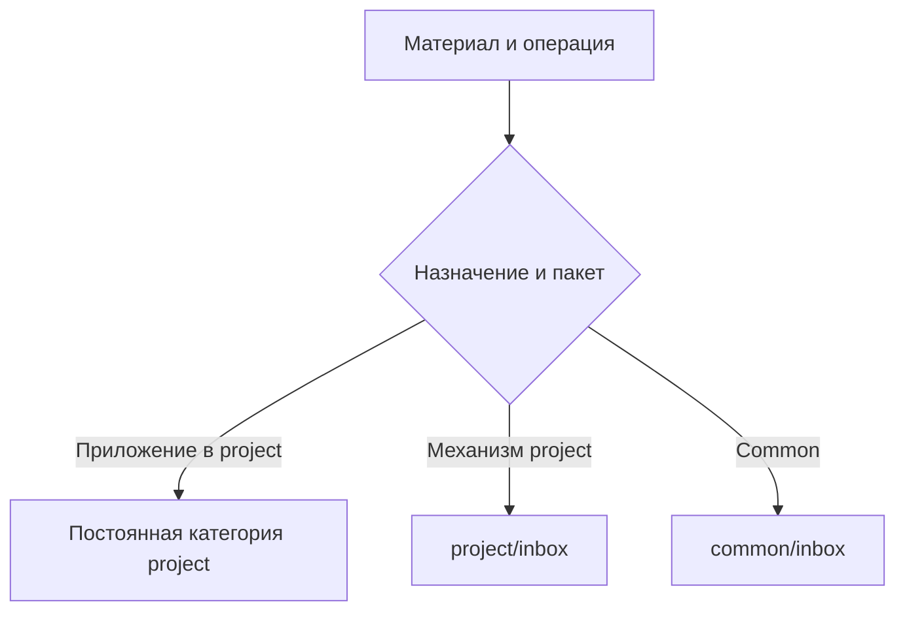
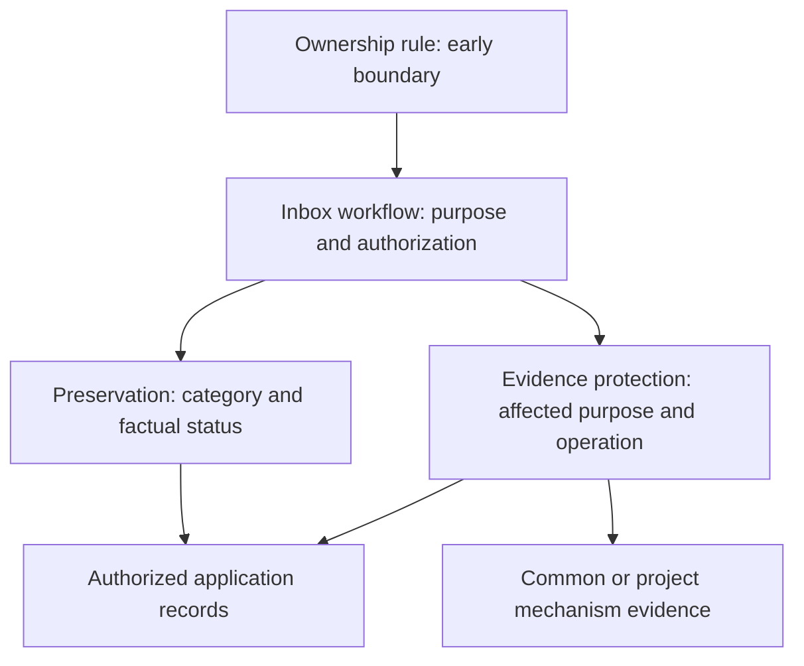

# Project Harness Inbox Boundaries - Plan

## Goal Capsule

- **Objective:** Агент сохраняет результаты обычной работы над приложением без отдельной inbox-заявки при каждом сохранении.
- **Means:** Разделить механизм harness и рабочие материалы приложения по назначению.
- **Product authority:** `harness/common/inbox/2026-10-09-project-harness-inbox-boundaries/request.md` и подтверждённое пользователем разделение в текущем чате.
- **Open blockers:** Решений о требуемом поведении не осталось; публикация итоговых инструкций требует отдельного разрешения.

---

## Product Contract

### Summary

Обычные материалы приложения сохраняются напрямую в постоянные категории project.
Изменения механизма project и любые изменения common сохраняют согласованный inbox-маршрут.

### Problem Frame

Текущий контракт требует заявку для любого сохранения внутри harness, включая идеи, планы и handoff приложения.
Повседневная работа поэтому добавляет согласование заявки даже там, где сама задача уже разрешена.

### Key Decisions

- **Маршрут определяется назначением.** Governs R1–R4. (session-settled: user-approved — chosen over blanket inbox for every project write: устранить лишние заявки при сохранении рабочих результатов и сохранить защиту механизма.)
- **Common остаётся защищённым.** Governs R3, R6. Разрешение проектной задачи не распространяется на общий механизм.

### Requirements

**Routing**

- R1. Разрешённая обычная работа над приложением сохраняет и обновляет идеи, исследования, решения, спецификации, планы, handoff и результаты проверок напрямую в соответствующих постоянных категориях project.
- R2. Изменения структуры, правил, процедур, проверок механизма и управляющих настроек project harness проходят через project/inbox.
- R3. Изменения common harness продолжают проходить через common/inbox, включая его инструкции, код, результаты и память.
- R4. Назначение материала и смысл операции определяют маршрут независимо от категории, имени файла или слова «проверка».

**Preserved contracts**

- R5. Прямое сохранение сохраняет фактические статусы идей, решений, реализации и проверок.
- R6. Новая маршрутизация сохраняет применимые разрешения стадий, защиту статичных входов и условия проверки и публикации инструкций.
- R7. Эта работа не переносит и не очищает существующие заявки, документы и свидетельства.
- R8. Доказательства механизма harness сохраняют действующую защиту при операциях над файлами и родительскими каталогами, включая смешанные операции.

### Actors

- A1. Пользователь поручает проектную задачу или изменение механизма и разрешает необходимые стадии.
- A2. Агент определяет назначение материала, выбирает маршрут и сохраняет достоверный результат.

### Key Flows

- F1. Сохранение материала приложения. **Trigger:** разрешённая работа приложения создаёт результат. Агент по R4 выбирает соответствующую категорию project, сохраняет результат по R1 и его фактический статус по R5.
- F2. Изменение механизма. **Trigger:** операция меняет управление harness. Агент определяет пакет по R2–R4 и обрабатывает соответствующий inbox с сохранением R6 и R8.



### Acceptance Examples

| ID | Input | Expected result | Covers |
|---|---|---|---|
| AE1 | Сохранить идею приложения в project/docs | Прямая запись без отдельной заявки; идея остаётся кандидатом | R1, R4, R5 |
| AE2 | Записать принятое архитектурное решение приложения | Прямая запись в project/decisions | R1, R4 |
| AE3 | Сохранить план и контекст продолжения приложения | Прямая запись в project/docs/plans и project/handoffs | R1, R4 |
| AE4 | Сохранить результат тестирования приложения | Прямая запись в project/testing/evidence с реальным результатом проверки | R1, R4, R5 |
| AE5 | Изменить проектное правило или проверку механизма | project/inbox; размещение в docs не меняет маршрут | R2, R4, R6 |
| AE6 | Изменить общее правило или сохранить общую harness-память | common/inbox; поручение приложения не разрешает common | R3, R6 |
| AE7 | Очистить каталог со свидетельствами приложения и механизма | Сохраняется защита свидетельств механизма; общего автоматического разрешения нет | R4, R7, R8 |

### Scope Boundaries

Миграция существующего содержимого исключена по R7.
Дополнительные агенты маршрутизации, новые обязательные скиллы и изменения общего каркаса не нужны.
Реализация приложения RAG не входит в эту заявку.

### Sources

- Общий владелец маршрута: `harness/common/skills/comm-process-harness-inbox/references/workflow.md`.
- Сохранение знаний: `harness/common/skills/comm-preserve-harness-knowledge/SKILL.md` и собственные ресурсы.
- Защита свидетельств: `harness/common/skills/comm-protect-harness-evidence/SKILL.md`.
- Ограничения до выбора процедуры: `harness/common/rules/comm-skill-rule-ownership.md`.

---

## Planning Contract

### Key Technical Decisions

- KTD1. **Extend existing owners.** Implement R1–R6 in the ownership rule, inbox workflow, preservation resources and evidence skill; retain a single procedure owner for each responsibility.
- KTD2. **Classify before skills-first.** Application records use factual project categories; agent-governing material uses the existing mechanism procedure even in docs (R1–R5).
- KTD3. **Protect inseparable mixed operations.** Inspect affected files and descendants; mixed mechanism evidence retains its protected route, and unresolved purpose pauses dependent mutation (R4, R8).
- KTD4. **Stage full candidates before publication.** Keep current source/native instructions untouched until publication authority; static integrity and actual native behavior have separate evidence (R6, R7).

### High-Level Technical Design

The sketch identifies the existing instruction owners, not a new executable router.



### System-Wide Impact

Common rules reach Codex through the AGENTS rule-reading instruction and Claude through native .claude/rules.
Full changed skill folders must reach both .agents/skills and .claude/skills on publication.
Common-only creates a neutral project; combined installation must preserve existing project bytes.
Neither structural equality nor prior unavailable native runs establish current behavioral compliance.

---

## Implementation Units

### U1. Coherent purpose-based candidate

- **Goal:** implement R1–R8 without creating a new routing owner.
- **Files:** full candidates under harness/common/inbox/2026-10-09-project-harness-inbox-boundaries/candidate/: harness/common/rules/comm-skill-rule-ownership.md; harness/common/skills/comm-process-harness-inbox/ and workflow resource; harness/common/skills/comm-preserve-harness-knowledge/ and its resources; harness/common/skills/comm-protect-harness-evidence/; harness/common/INDEX.md; harness/project/INDEX.md; harness/common/decisions/2026-10-05-inbox-execution-status.md.
- **Approach:** KTD1–KTD3; add a dated scope clarification to the existing accepted decision while retaining its history. Preserve dates, protected inputs and template. This request authorizes candidate preparation, not publication.
- **Test Scenarios:** AE1–AE7; include explicit preservation/evidence invocation, candidate/planned/failed/unrun status, a mechanism procedure disguised in docs, a mixed-purpose file and an unclassified parent operation.
- **Verification:** review every active blanket caller against the candidate; validate machine links and unchanged protected inputs. No migration or actual cleanup of existing evidence.

### U2. Structural and native validation

- **Dependencies:** U1.
- **Goal:** establish what the final candidate actually proves (R6–R8).
- **Files:** current-request validation report and behavioral scenario inputs; permanent execution evidence under harness/common/testing/evidence/2026-10-09-project-harness-inbox-boundaries/.
- **Approach:** KTD4; reuse existing pytest and native fixture/probe mechanisms rather than a new semantic router.
- **Test Scenarios:** both installation modes, repeated startup, project-only refusal, retained project bytes, equal full source/native sets, human-guide exclusion; fresh Codex and Claude runs exercise U1 scenarios.
- **Verification:** existing test_rule_copies.py, test_skills_first_knowledge.py, test_ensure_entrypoint_links.py, test_entrypoint_portability.py, test_human_guide_reader.py and test_plugin_eval_without_human.py run against an isolated candidate installation. Native discovery, explicit invocation, implicit selection and unrelated non-loading are recorded separately per agent/mode. Native failure/unavailability stays unverified.

### U3. Report and publication gate

- **Dependencies:** U2.
- **Goal:** preserve a reviewable result and truthful remaining work (R5–R8).
- **Files:** current request.md, validation.md, candidate manifest and permanent validation evidence.
- **Approach:** preserve candidate identity and verification receipts. Request publication only after the final candidate and checks exist; unavailable native results require confirmation of this exact unverified version.
- **Test Scenarios:** a prepared candidate never becomes completed merely by copying or by receiving permission; publication retains separate native statuses.
- **Verification:** source/native changed sets agree after any authorized publication, request accounting cites permanent evidence, and existing app/inbox/evidence content remains unmodified by this candidate.

---

## Verification Contract

Run tests from an isolated candidate checkout using the existing environment, with these repository-specific commands:

```sh
python3 -B harness/common/checks/ensure_entrypoint_links.py
.venv/bin/python -m pytest -q harness/common/testing/tests/test_rule_copies.py harness/common/testing/tests/test_skills_first_knowledge.py harness/common/testing/tests/test_ensure_entrypoint_links.py harness/common/testing/tests/test_entrypoint_portability.py harness/common/testing/tests/test_human_guide_reader.py harness/common/testing/tests/test_plugin_eval_without_human.py
```

Reuse harness/common/inbox/2026-10-07-lazy-context-routing/native_probe.py for isolated native execution after adapting its fixed candidate/request paths to this request.
Apply comm-validate-harness-instructions including current instruction analysis and per-agent/mode native checks.
A structural pass does not prove semantic routing; only actual native behavior can do that.
Current availability must be checked rather than inherited from earlier failures.

---

## Definition of Done

U1 is done when the full candidate coherently covers R1–R8 and no live candidate owner restores blanket app inbox routing.
U2 is done when required checks have actual outcomes and all limitations are recorded; unavailable native behavior remains unverified and keeps the publication gate.
The request is completed only after its required publication is authorized and performed, or the user explicitly decides closure.
Preserve original source resources, existing project data and evidence; remove abandoned experimental candidate logic rather than leaving it as production code.
No application implementation, evidence migration, template change or unrelated inbox processing is part of this first request.
