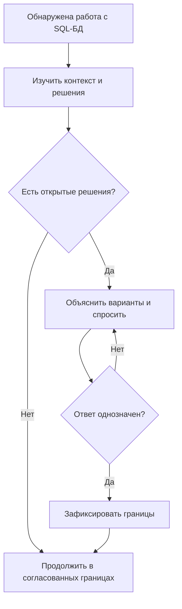
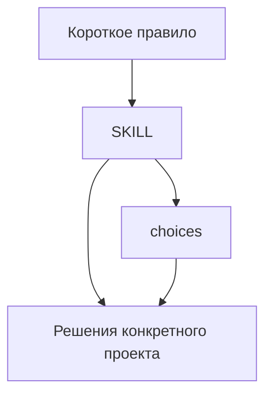

# Согласование архитектуры SQL-БД до планирования - Plan

## Goal Capsule

Пользователь определяет архитектурные решения SQL-БД до их закрепления агентом в плане, спецификации или коде.
Основание: `harness/common/inbox/2026-10-16-confirm-database-design/request.md` и подтверждённый в чате 2026-10-16 объём.
Открытых вопросов требований нет; публикация требует отдельного разрешения после подготовки проверенного результата.

---

## Product Contract

### Summary

Переносимый common-скилл организует согласование SQL-БД в Codex и Claude.
Короткое правило обращает к нему до зависимого планирования, а ресурс содержит варианты и вопросы.

### Problem Frame

Самостоятельный выбор ORM, миграций или владельца сессий может попасть в план до обсуждения с пользователем.
Наличие готовой реализации не доказывает, что пользователь одобрил её архитектуру.

### Requirements

**Early agreement**

- R1. До создания или изменения плана, спецификации либо кода согласовать открытые решения о SQL-БД, схемах, таблицах, моделях, инициализации, миграциях, запросах, транзакциях и lifecycle engine/connection/session; при обнаружении зависимости внутри другой задачи остановить зависимую часть.
- R2. Предварительно изучить стек, доступ к данным, модели, миграции, запуск, существующие данные, sync/async, процессы, фоновые задачи и утверждённые решения; read-only источники не изменять.
- R3. Независимо согласовать создание схемы/инициализацию, метод запросов и владение ресурсами, объяснив различия всех требуемых вариантов и рекомендацию с учётом проекта.
- R4. По каждому существенному применимому вопросу получить явное решение или делегирование деталей, не исключая вопросы молча.
- R5. До однозначного ответа не выполнять зависимую работу: молчание, время, предвыбор, рекомендация и существующий код не являются согласием; неизменные согласования не запрашивать повторно, новые существенные решения согласовывать.

**Portability and evidence**

- R6. Фиксировать решения, причины, область, ограничения, исключения, делегированные детали и открытые вопросы в проектном harness по действующим разрешениям; согласие в текущем диалоге сохраняет силу до разрешённой записи.
- R7. Проверить необходимость короткого раннего правила и lazy-подключение в обоих агентах без изменения защищённых входов; процедура имеет одного владельца и не задаёт конкретный стек всем проектам.
- R8. Проверить текущую компактную версию отдельно для Codex/Claude и common-only/common+project: структуру, бюджет, listing, explicit/implicit вызов, ресурсы, отсутствие загрузки в посторонней задаче и поведение.
- R9. Сохранить постоянные результаты вне inbox с реальными статусами и неизменными исходными логами; неуспешные и непроведённые проверки не считать успешными.
- R10. Публиковать канонические инструкции и установочные копии только после отдельного разрешения; непроверенная версия требует явного подтверждения именно этой версии.

**Required decision content**

- R11. Для схемы предложить параметризованный SQL через `.execute()` с явной эволюцией схемы, SQLAlchemy с Alembic и другой обоснованный подход; различать создание БД и схемы/таблиц, безопасную обработку значений и DDL-идентификаторов.
- R12. Для запросов предложить прямой параметризованный SQL, SQLAlchemy Core и/или ORM с уточнением API и другой обоснованный подход; `.execute()` само по себе не отличает SQL от SQLAlchemy-выражений.
- R13. Для ресурсов предложить функции/контекстные менеджеры, класс-владелец engine и фабрики сессий и другой обоснованный подход; неприменимую ORM session не вводить в стек ради терминологии.
- R14. Согласовать владельца и момент инициализации, пустую/существующую БД, первый/повторный/одновременный запуск и миграции при запуске либо развёртывании.
- R15. Согласовать структуру моделей, metadata, связи, ограничения, индексы, инструмент миграций, старую историю, сохранность данных, ошибки и восстановление на нужном задаче уровне.
- R16. Отдельно согласовать допустимость `create_all()` и автоматической генерации миграций при запуске, не выводя их из выбора ORM/Alembic.
- R17. Согласовать жизненный цикл и закрытие ресурсов, владение на процесс, области и передачу connection/session, независимость параллельных операций, sync/async, фоновые задачи, применимые пулы и таймауты.
- R18. Согласовать транзакции, commit/rollback, блокировки, retries и отмену, организацию слоя запросов, составные/частичные выражения и допустимость смешанного подхода.
- R19. Согласовать исключения для SQL сторонних библиотек и владение их таблицами/миграциями; узкое исключение не расширять на запросы приложения.
- R20. Согласовать проверки пустой/существующей БД, обновления, сохранности, повторного/конкурентного запуска и восстановления с учётом доступа к реальной БД.
- R21. Допускать групповое согласование при однозначном ответе по каждому открытому пункту и не требовать отдельного одобрения каждого запроса внутри согласованной архитектуры.

### Key Decisions

Один основной владелец процедуры и условный ресурс сохраняют цельный результат согласования; раннее правило предотвращает выбор архитектуры до загрузки процедуры. Governs R3, R7.
Три блока согласования дают один результат: границы разрешённой работы с SQL-БД. Governs R3, R11–R21.

### Key Flows

F1. Агент обнаруживает SQL-работу, читает контекст и действующие решения, показывает применимые варианты, ожидает явного ответа и выполняет только согласованную часть. Covers R1–R6.

### Acceptance Examples

- AE1. Запрос нового плана с таблицами без согласований приводит к чтению контекста и вопросам, а не к записи плана. Covers R1–R3.
- AE2. Согласование SQLAlchemy/Alembic для схемы не разрешает самостоятельно выбрать запросы и lifecycle. Covers R3, R5.
- AE3. Молчание, предвыбор и неоднозначный ответ сохраняют остановку; явное согласие разрешает только названный объём. Covers R5.
- AE4. Сохранённые решения не запрашиваются заново; новый существенный выбор согласуется отдельно. Covers R5–R6.
- AE5. Узкое исключение сторонней библиотеки не разрешает общий raw SQL, а неприменимые ORM session не добавляются в другой стек. Covers R4, R6.
- AE6. Недоступный агент или неуспешный прогон остаётся непроверенным; копирование не повышает статус. Covers R8–R10.

### Scope Boundaries

Изменение приложения, реальной БД, общего каркаса, чужих заявок и защищённых AGENTS.md/CLAUDE.md исключено.
Публикация входит в конечный результат заявки, но её разрешение ещё не получено.

### Sources

- Полный scope и критерии: `harness/common/inbox/2026-10-16-confirm-database-design/request.md`.
- Владельцы процедур: `harness/common/skills/comm-create-lazy-claude-codex-skills/SKILL.md`, `harness/common/skills/comm-validate-harness-instructions/SKILL.md`, `harness/common/skills/comm-process-harness-inbox/SKILL.md`.

---

## Planning Contract

Product Contract unchanged.
Технический подход подтверждён пользователем 2026-10-16 после исследования: весь согласованный scope, существующие средства harness, уточнение отложенной записи и явные проверки partial approval.
Исполнитель — основной агент текущего чата; native проверки выполняются отдельными Codex/Claude процессами в одноразовых копиях.
Публикация по R10 остаётся последующим действием пользователя и исполнителя.

### Key Technical Decisions

- KTD1. Использовать приложенный комплект скилл → choices и раннее правило, сохранив R1–R7 и R11–R21; не вводить новый router или настройки БД приложения.
- KTD2. Уточнить шаг записи: отсутствие разрешения на сохранение решения задерживает запись, но не отменяет согласие в текущем чате и не блокирует независимую разрешённую работу. Implements R5–R6; это устраняет противоречивое чтение «Record ... Then proceed».
- KTD3. Адаптировать существующие native runners в новый файл доказательств, оставляя исходные отчёты и программы неизменными. Implements R8–R9; копии установки содержат обычные файлы и не меняют рабочие native каталоги.
- KTD4. Сначала проверить исходное поведение без новых инструкций, затем ту же задачу с кандидатом; безопасный baseline не выдавать за причинный RED. Implements R8–R9.
- KTD5. Применять проверки профиля, plugin-eval через human-filter и native поведение независимо: generic оценка не заменяет native доказательство. Implements R8; любое изменение кандидата требует повторения обязательных проверок текущей версии.

### High-Level Technical Design

Комплект имеет одну цепочку загрузки; исходники в inbox остаются кандидатами до R10.

Матрица из четырёх независимых сочетаний: Codex/common-only, Codex/common+project, Claude/common-only, Claude/common+project.
В каждом сочетании отдельно учитываются доступность, listing, чтение правил, explicit/implicit вызов, загрузка resources, unrelated non-loading и поведение.

### Risks and Dependencies

Исторический отчёт `harness/common/testing/evidence/2026-10-13-ban-harness-symlinks/2026-10-13-candidate-report.md` содержит OAuth-сбой Claude; текущий статус устанавливается новым прогоном.
Недоступность native среды оставляет соответствующие проверки непроведёнными и не разрешает публикацию по умолчанию.
Проверки сохраняют обычные пути конфигурации/auth, не подменяют HOME/CODEX_HOME и не обходят отклонённое разрешение.
Установочные копии для проверки временные; подготовка новых зависимостей подчиняется действующим правилам uv.

### Sources and Patterns

- `harness/common/testing/evidence/2026-10-13-ban-harness-symlinks/native_validation.py`: изолированные установки, snapshots, JSON events и отдельные результаты режимов.
- `harness/common/testing/evidence/2026-10-13-numbered-workflow-options/native-runner-v2.py`: положительные/неоднозначные/конфликтные ответы; старые prompts и номера меню не переносить.
- `harness/common/skills/comm-validate-harness-instructions/references/evaluation.md`: доверенный обычный plugin-eval entry и запрет обхода через shell shim.
- `harness/common/scripts/plugin_eval_without_human.mjs`: действующий фильтр human-файлов.

---

## Implementation Units

### U1. Подготовить воспроизводимые сценарии и baseline

**Goal:** Отделить текущее поведение от эффекта кандидата.
**Requirements:** R1–R9, AE1–AE6, F1.
**Dependencies:** Подтверждённые требования и технический подход.
**Files:** новый `harness/common/testing/evidence/2026-10-16-confirm-database-design/native_validation.py`, `scenarios.json`, `report.md`; human guides новых каталогов.
**Approach:** KTD3–KTD4; адаптировать fixture без намеренных симлинков, с нейтральным common-only и неизменным содержимым project в combined.
**Test scenarios:**
1. Новый план с SQL-БД без решений: наблюдать чтение/вопросы/изменённые файлы. Covers AE1.
2. Новые таблицы, изменение запросов, session/connection и SQL внутри общей задачи: наблюдать раннюю остановку каждой зависимости.
3. Посторонняя задача не загружает choices/skill; human-файл не попадает в загрузчики.
**Verification:** Сохранены команды, версии, stdout/stderr/exit, prompts, snapshots; отсутствие доступа или ошибка имеют фактический статус.

### U2. Уточнить компактный кандидат

**Goal:** Исправить KTD2 без изменения согласованной процедуры.
**Requirements:** R1–R7, R11–R21, AE2–AE5.
**Dependencies:** U1 baseline либо документированная недоступность baseline.
**Files:** `harness/common/inbox/2026-10-16-confirm-database-design/comm-confirm-database-design/SKILL.md`, `comm-confirm-database-design/references/choices.md`, `comm-confirm-database-design.md`; `scenarios.json` в evidence U1.
**Approach:** KTD1–KTD2; сохранять единый алгоритм и условное чтение ресурса, объяснение раннего правила хранить в результате.
**Test scenarios:**
1. Одобрена только схема: запросы/lifecycle не считать одобренными. Covers AE2.
2. Неоднозначный ответ и молчание не разрешают изменения. Covers AE3.
3. Ранее одобренное решение и явно делегированная деталь не вызывают повторного опроса. Covers AE4.
4. Разрешения на запись нет: согласие остаётся в чате, защищённая запись не выполняется, независимая согласованная работа возможна.
5. Non-Python stack и неприменимая ORM session; узкое стороннее SQL исключение. Covers AE5.
6. Legacy migrations, create_all и startup autogenerate получают самостоятельное рассмотрение.
**Verification:** Карта scope → кандидат → сценарии полна; проверка профиля и анализ содержимого не находят потери обязательств.

### U3. Проверить конечную версию и подготовить результат

**Goal:** Получить воспроизводимый отчёт о текущем кандидате для решения о публикации.
**Requirements:** R7–R10, AE1–AE6.
**Dependencies:** U2.
**Files:** новый evidence каталог U1, текущая заявка; новые результаты прогонов создаются отдельно, исходные логи не перезаписываются.
**Approach:** KTD3–KTD5; measured baseline/current startup+metadata, полное available resources и сопоставимые actual reads учитываются раздельно.
**Test scenarios:**
1. Каждый agent/mode: native listing, explicit own-resource, implicit selection и unrelated non-loading.
2. Все сценарии U1/U2 на окончательной версии; доступность агента не считать доказательством сценариев.
3. Повторный startup и сохранность project combined; проверка project-only refusal существующим механизмом.
4. При отказе доступа/авторизации сохранить точную ошибку и непроведённые проверки. Covers AE6.
**Verification:** Нет смешения generic/profile/native статусов; неизменённые исходники и installed copies рабочего дерева сохранены; отчёт указывает остаток и SHA-256 кандидата.

---

## Verification Contract

| Check | Method | Expected result |
|---|---|---|
| Profile | установленный `skill-creator/scripts/quick_validate.py` на каталоге кандидата | валидный skill profile; правило N/A |
| Generic | `node harness/common/scripts/plugin_eval_without_human.mjs <ordinary-entry> start <candidate-dir> --format json`, затем analyze | реальные findings и бюджет; grade A/no errors как требование content-contract, без подгонки порогов |
| Improvement | JSON improvementBrief и сравнение после исправлений по применимому plugin-eval skill | required/recommended findings рассмотрены, версия идентифицирована |
| Native | новый `native_validation.py` из U1 | матрица agent × mode × scenario с наблюдаемыми действиями и ресурсами |
| Installation | текущая common startup check в отдельных fixture roots | повторный вход, отсутствие симлинков, сохранность project, корректный refusal project-only |
| Human exclusion | действующие human-filter проверки и отдельное наблюдение чтений | README.human.md не загружается в контекст |
| Integrity | hashes кандидатов, снимки до/после и сравнение затронутых файлов | нет незаявленных правок или подмены исходных свидетельств |

Конкретные версии инструментов, доступность и команды каждого прогона записываются в новом evidence, не предполагаются по историческим отчётам.
Статические оценки токенов не выдаются за фактический usage/cost; пороги берутся из действующего владельца, без увеличения ради успеха.

---

## Definition of Done

U1 завершён при наличии сценариев, fixture и честного baseline либо точной причины его недоступности.
U2 завершён при компактном полном кандидате без противоречия KTD2.
U3 завершён при полном отчёте текущей версии; непроведённые проверки остаются открытым ограничением, а не успешным результатом.
Подготовка к публикации завершена только когда пользователь может проверить состав, diff, hashes и результаты.
Вся заявка завершена после разрешённой публикации или отдельного явного решения пользователя о другом закрытии; готовый кандидат не является закрытием.
Экспериментальный код не остаётся в действующих инструкциях, сторонние файлы не коммитятся; raw evidence сохраняется по R9.

## Результат исполнения, 2026-10-16

U1 завершён: baseline, сценарии, изолированные fixtures и неизменяемые raw-логи
сохранены. Pressure baseline имеет прямое делегирование; обычный baseline
не выбирал архитектуру и не выдаётся за опасный causal RED.
U2 завершён: кандидат v4 устраняет зависимость согласия от разрешения записи
и различает подварианты SQLAlchemy от отдельной третьей альтернативы запросов.
U3 завершён как подготовка полного отчёта: профиль и generic A/95, 168 тестов,
source review без замечаний, 26 запусков Codex с 24 пройденными rubric и двумя
pressure-несоответствиями. Claude v4 не проверен; все итоговые статусы непроверенные.

[Отчёт, hashes и scope публикации](../../testing/evidence/2026-10-16-confirm-database-design/report.md).
Заявка остаётся открытой до разрешённой публикации либо отдельного решения
о закрытии; завершение U1–U3 не является разрешением публикации.

## Завершение v6, 2026-10-16

После уточнения формулировки задачи в SKILL.md явно разделены рекомендация
архитектуры и разрешение зависимой записи. Повторы сокращены, профиль пройден,
оценка A/95 без ошибок. Основной сценарий изменён на рекомендацию и явное
согласование; история prompts/raw-результатов сохранена. Все 13 случаев × 2
режима Codex пройдены. 168 общих автотестов и review v4→v6 без замечаний.

V6 опубликована в canonical common и обычные равные native-копии; startup
и полный набор installed rules приняты, 4 теста rule copies пройдены после установки.
Codex проверенный в указанной матрице, Claude непроверенный, общий статус непроверенный.
Заявка закрыта как выполненная. [Окончательный отчёт](../../testing/evidence/2026-10-16-confirm-database-design/report-v6.md).
