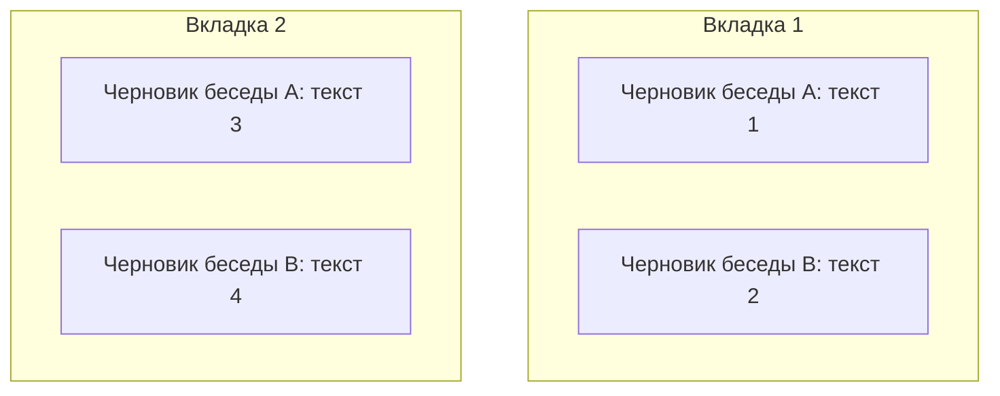
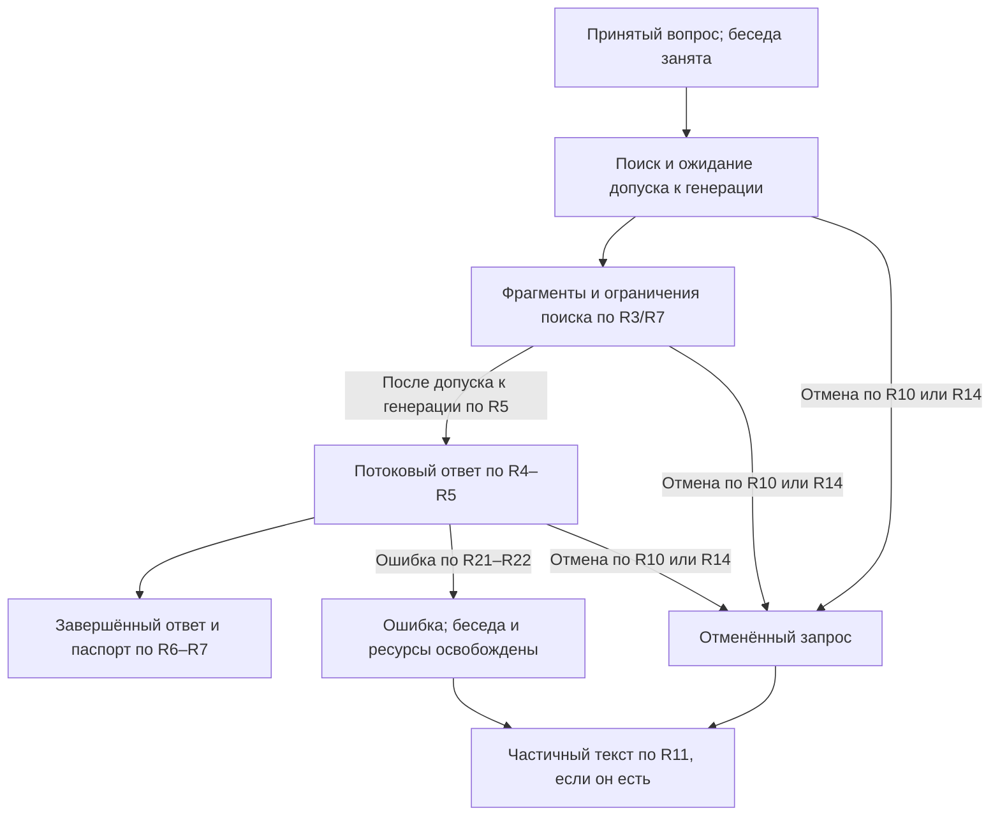
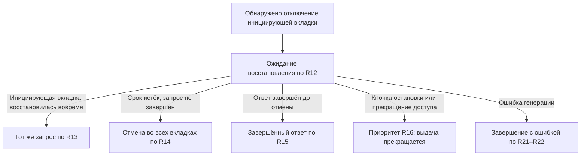

# RAG Answer Lifecycle - Plan

## Goal Capsule

- **Objective:** Владелец личной библиотеки получает полезные фрагменты до готовности ответа, видит его основания и сохраняет понятную историю при отмене или обрыве соединения.
- **Product authority:** Подтверждённое пользователем 2026-10-13 сводное описание текущего пути и действующий реестр `harness/project/decisions/2026-10-08-rag-architecture-decisions.md`, включая последнюю редакцию RAG-43 и последующие уточнения RAG-44–RAG-50.
- **Scope:** Путь одного вопроса от неотправленного черновика и приёма до ответа, ошибки или отмены, включая ранние фрагменты, ожидание, источники и навигацию между беседами и вкладками.
- **Open blockers:** Полная ревизия требований MVP от 2026-10-13 выявила незакрытые продуктовые политики; согласование продолжается по `harness/project/docs/ideation/2026-10-13-rag-brainstorm-question-audit.md`. Готовность к планированию не подтверждена.

---

## Product Contract

### Summary

Один серверный жизненный цикл связывает вопрос, ранние фрагменты, очередь, потоковый ответ, его источники и обработку ошибки генерации.
Все вкладки беседы отображают общее состояние запроса, а его отмена и восстановление подчиняются R10–R16 и R20.

### Key Decisions

- **Серверная беседа — общая точка состояния вкладок.** Governs R2, R8, R9, R19; основание — RAG-25/RAG-42.
- **Сохранение прерванного текста.** Governs R11. (session-settled: user-directed — chosen over deleting partial output: сохранение видимого результата без его использования как основания следующего ответа.)
- **Отмена по инициирующей вкладке с ожиданием восстановления.** Governs R12–R16, R20; действует последняя редакция RAG-43 вместо прежней отмены по последней вкладке.
- **Ошибка завершается без автоматического повтора.** Governs R11, R20–R22. (session-settled: user-directed — chosen over one automatic retry: сохранение частичного результата и явная отправка нового вопроса пользователем.)
- **Переключение беседы сохраняет выполняющийся запрос.** Governs R23, R24. (session-settled: user-directed — chosen over immediate cancellation on navigation: сохранение результата в исходной беседе при переключении.)
- **Переключение сохраняет черновик исходной беседы.** Governs R25. (session-settled: user-directed — chosen over clearing the draft on navigation: восстановление набранного текста при возвращении в беседу.)
- **Обновление страницы сохраняет черновики этой вкладки.** Governs R26. (session-settled: user-directed — chosen over clearing drafts on refresh: восстановление отдельных текстов бесед без отправки вопроса.)
- **Закрытие вкладки удаляет её черновики.** Governs R27. (session-settled: user-directed — chosen over restoring drafts on the next app opening: хранение неотправленного текста ограничено сроком открытой вкладки.)
- **Уменьшение лимита сохраняет уже активные запросы.** Governs R5, R28. (session-settled: user-directed — chosen over pausing or cancelling excess active requests: новое ограничение действует на дальнейший допуск.)
- **Сохранённые настройки переживают перезапуск.** Governs R29. (session-settled: user-directed — chosen over resetting admin changes to file defaults on restart: сохранённые переопределения имеют приоритет.)
- **Текущий план охватывает один путь пользователя.** Governs R1–R29; другие принятые идеи MVP остаются отдельными областями работы.

<!-- ce-section: work-relationships -->
### How This Work Fits Together

Этот документ охватывает жизненный цикл вопроса и соединяет идеи раннего результата и паспорта ответа.
Связи с остальным MVP отражают текущее понимание, а не фиксированный порядок реализации.

- **Depends on:** аккаунты, серверная история, личные готовые документы, поиск и управление генерацией по уже согласованным решениям RAG.
- **Shares:** правила доступа, удаления и сохранения контекста с обработкой документов и историей бесед.
- **Depends on:** фактическая поддержка выбранным runtime требований RAG-11; историческая проба одного слота её не доказывает.
- **Can proceed independently of:** проектирование сверки OCR, предпросмотра настроек и подбора допустимой пачки файлов, если соблюдаются их общие права доступа.
- **Still to decide:** технические интерфейсы этих областей; они не становятся дополнительными требованиями этого документа.

### Actors

- A1. Владелец аккаунта и личной беседы, допущенный к защищённым операциям.
- A2. Вкладки браузера A1: инициирующая вкладка отправила текущий вопрос, остальные наблюдают ту же беседу.
- A3. Сервис: хранит историю, проверяет доступ, принимает запрос и управляет его обработкой и выдачей.

### Requirements

**Search and answer**

- R1. Поиск использует выбранную личную область готовых доступных документов и не расширяет её автоматически при исключении или удалении источников.
- R2. История беседы хранится на сервере независимо от открытой вкладки по RAG-25.
- R3. Найденные доступные фрагменты показываются до первого токена ответа, включая ожидание в очереди, отдельно от текста модели по RAG-33.
- R4. Генерация после поиска продолжается автоматически до завершения, ошибки либо отмены запроса.
- R5. Генерация соблюдает действующий контракт RAG-11 с уточнением изменения лимита по R28: по умолчанию до 12 активных запросов с отдельными контекстами, до 3 продвигаемых запросов за шаг, справедливая выдача и общие для сервиса лимиты.
- R6. Ответ имеет компактный раскрываемый паспорт фактической области поиска, использованных источников и фрагментов с различением цитат и выводов по RAG-34.
- R7. Паспорт сообщает о неготовых или исключённых выбранных документах и недостатке найденных оснований, не выдавая отсутствие находки за отсутствие факта во всей библиотеке.

**Conversation and tabs**

- R8. С приёма вопроса до завершения, ошибки или отмены в беседе выполняется один запрос, включая ожидание в очереди; сервер атомарно отклоняет конкурирующий другой вопрос по RAG-42/RAG-44.
- R9. Все вкладки отображают общую беседу с состоянием отправки по RAG-42, сохраняя независимые черновики.

**Cancellation and reconnection**

- R10. Серверная остановка по кнопке проверяет владельца и отменяет запрос с освобождением места в очереди либо слота генерации.
- R11. Частичный текст ответа после отмены или ошибки сохраняется с отметкой «Прервано» и исключается из контекста последующих ответов, включая checkpoints и резюме, по RAG-41/RAG-44.
- R12. После обнаружения отключения инициирующей вкладки начинается ожидание восстановления 10 секунд независимо от других вкладок, при этом очередь и генерация продолжаются по последней редакции RAG-43.
- R13. Восстановление соединения инициирующей вкладки до истечения срока R12 сохраняет тот же незавершённый запрос и доставляет накопленный текст без повторного вопроса.
- R14. Без восстановления по R13 незавершённый запрос отменяется во всех вкладках по истечении срока R12, освобождая ресурсы и разблокируя отправку с сохранением черновиков открытых вкладок; для закрытых действует R27.
- R15. Ответ, завершившийся во время ожидания по R12, сохраняется обычным завершённым ответом.
- R16. Остановка кнопкой и прекращение доступа не откладываются на срок R12.

**Access and consistency**

- R17. Защищённые операции соблюдают аутентификацию, подтверждение email, роль и владение ресурсом, а прекращение доступа прекращает дальнейшую выдачу по RAG-21/RAG-23/RAG-29.
- R18. Удалённые сведения исключаются из последующих поиска и контекста, включая checkpoints и резюме, при сохранении видимой старой истории с отметкой удалённого источника по RAG-16.
- R19. Повтор одной операции не дублирует пользовательский вопрос и запуск, как установлено в уточнениях выбранной архитектуры реестра RAG.
- R20. Отменённый или завершившийся ошибкой запрос не возобновляется при возвращении пользователя; повторный вопрос отправляется как новая операция.

**Generation failure**

- R21. Ошибка локальной генерации показывается пользователю без автоматической повторной попытки по RAG-44.
- R22. Ошибка завершает запрос, освобождая его ресурсы и разблокируя отправку во всех вкладках с сохранением черновиков открытых вкладок по R27; срок R12 не откладывает обработку ошибки.

**Conversation navigation**

- R23. Переключение из беседы A в B в той же открытой подключённой вкладке не отменяет запрос A и не запускает срок R12; ожидание или генерация A продолжается в фоне по RAG-45.
- R24. Результат фонового запроса сохраняется в исходной беседе A и отображается с её текущим состоянием при возвращении, не смешиваясь с ответом беседы B.
- R25. Каждая беседа в одной вкладке сохраняет отдельный неотправленный черновик при переключении и восстанавливает его в поле ввода при возвращении по RAG-46; восстановление не отправляет вопрос.
- R26. Обновление страницы в той же вкладке сохраняет её отдельные черновики бесед по RAG-47 и восстанавливает текст соответствующей беседы без отправки вопроса; независимость других вкладок по R9 сохраняется, а реальное отключение выполняющегося запроса обрабатывается по R12–R16.
- R27. Закрытие вкладки удаляет её неотправленные черновики всех бесед по RAG-48; при следующем открытии приложения эти тексты не восстанавливаются. Черновики остальных открытых вкладок и серверная история сохраняются; выполняющийся запрос следует R12–R16.

**Generation limit changes**

- R28. Уменьшение лимита активных запросов по RAG-49 не отменяет и не приостанавливает уже активные запросы; число ранее активных запросов может временно превышать новый лимит. Новые запросы ждут допуска, пока число активных не станет строго меньше нового лимита; завершение, ошибка и отмена продолжают действовать по R10–R22.
- R29. Изменения глобальных динамических настроек через админку сохраняются после перезапуска по RAG-50; сохранённые переопределения имеют приоритет, а файл задаёт дефолты для непереопределённых настроек. Права RAG-14 и ограничения изменения параметров RAG-30 сохраняются.

### Key Flows

- F1. **Question to answer. Covers R1–R8, R17–R19, R28, R29.** Владелец отправляет вопрос; сервис проверяет доступ и принимает запрос в свободную беседу, выполняет поиск и показывает ранние фрагменты, затем выдаёт потоковый ответ с паспортом по R3–R7. Уменьшение лимита активных запросов меняет дальнейший допуск, сохраняя уже активные запросы по R28. После перезапуска настройки допуска определяются по R29.
- F2. **Shared conversation. Covers R8, R9, R19, R22.** Вторая вкладка показывает текущую серверную беседу; конфликтующий вопрос остаётся её черновиком, а после завершения, ошибки или отмены отправка снова доступна по R9/R14/R22.
- F3. **Connection recovery. Covers R11–R16, R20.** При отключении инициирующей вкладки действует R12; восстановление обслуживается по R13, отсутствие восстановления — по R14, завершение ответа в этот период — по R15.
- F4. **Stop or access loss. Covers R10, R11, R16–R18.** Остановка отменяет текущий запрос; прекращение доступа прекращает защищённые операции и дальнейшую выдачу без ожидания R12, сохраняя ограничения доступа к истории.
- F5. **Generation failure. Covers R8, R9, R11, R20–R22.** Сбой локальной генерации завершает запрос по R21/R22; имеющийся частичный текст обрабатывается по R11, новый вопрос — по R20.
- F6. **Navigate to another conversation. Covers R2, R5, R12–R16, R23, R24.** Владелец переключается из A в B; запрос A продолжает свой путь по R23, а при возвращении его результат доступен по R24; последующее отключение соединения обрабатывается по R12–R16.
- F7. **Restore an unsent draft. Covers R9, R25–R27.** Владелец набирает вопрос в A, переходит в B и возвращается; поле ввода A восстанавливается по R25, сохраняя отдельный черновик B и независимость других вкладок по R9. После обновления страницы в той же вкладке отдельные черновики также восстанавливаются по R26, без отправки вопроса. Закрытие вкладки удаляет её черновики по R27.

Схема показывает границу независимости черновиков по R9/R25.

Ниже схема F1; поиск и показ фрагментов могут выполняться во время ожидания генерации по R3.

Ожидание восстановления в F3 относится к соединению, а не заменяет состояние запроса: обработка по R12 продолжается.
Схема ниже показывает правила R12–R16, а не способ обнаружения отключения.

### Acceptance Examples

| Example | Covers | Scenario and expected result |
| --- | --- | --- |
| AE1. Early result | R1, R3–R5 | Генерация ожидает допуска; найденные разрешённые фрагменты уже доступны владельцу, и запрос продолжает путь F1 без дополнительного подтверждения. |
| AE2. Two different questions | R8, R9 | Две вкладки одновременно отправляют разные вопросы; сервер принимает один, второй не добавляется в историю или очередь и остаётся черновиком с отказом «В беседе уже выполняется запрос». |
| AE3. Waiting request stopped | R8–R10 | Владелец отменяет ожидающий запрос; он покидает очередь, не начинает генерацию, беседа освобождается и вкладки могут отправить следующий вопрос. |
| AE4. Partial output stopped | R9–R11, R16 | Владелец останавливает начатый ответ; выданный текст сохраняется как прерванный и не попадает в контекст следующего ответа. |
| AE5. Initiating tab recovers | R12, R13, R19 | Соединение инициирующей вкладки восстановлено через 5 секунд после обнаружения обрыва; она получает накопленный текст того же запроса, без второго вопроса или запуска. |
| AE6. Another tab stays connected | R9, R11, R12, R14 | Инициирующая вкладка не вернулась за 10 секунд, но другая вкладка подключена; незавершённый запрос отменяется для всех вкладок, черновики сохраняются и отправка разблокируется. |
| AE7. Answer completes during recovery wait | R12, R15 | Ответ завершился через 6 секунд ожидания восстановления; он остаётся завершённым и не меняется на «Прервано» по истечении таймера. |
| AE8. Stop during recovery wait | R10–R12, R16 | При действующем ожидании восстановления поступает допустимая остановка; отмена не ждёт остаток таймера. |
| AE9. Access revoked | R16, R17 | Во время ожидания или выдачи аккаунт административно блокируется; новые защищённые операции и дальнейшая выдача прекращаются без ожидания таймера R12. |
| AE10. Isolation and service limits | R1, R5, R17 | При дефолтах R5 тринадцатый запрос ждёт допуска, активные контексты разных пользователей не смешиваются, а за шаг продвигается не более трёх запросов справедливым образом. |
| AE11. Incomplete selected library | R1, R6, R7 | Часть выбранных документов не готова; паспорт сообщает ограничение фактического поиска, а поиск не расширяется на остальные документы пользователя. |
| AE12. Removed source and next question | R11, R18 | Источник старого ответа удалён и ранее отменённый ответ сохранён; следующий вопрос не получает удалённые сведения или прерванный текст через историю контекста, checkpoints или резюме. |
| AE13. Repeated operation | R8, R19 | Повтор отправки той же операции не создаёт второе сообщение или второй запуск; намеренно новый вопрос после завершения или отмены является новой операцией. |
| AE14. Return after cancellation | R11, R14, R20 | Владелец возвращается после отмены; история сохраняет прерванный текст, но генерация не возобновляется до явной отправки нового вопроса. |
| AE15. Foreign conversation | R1, R10, R17 | Другой обычный пользователь обращается напрямую к чужой беседе или её остановке; сервер отказывает, не раскрывая вопрос, фрагменты или ответ владельца. |
| AE16. Failure after partial output | R8, R9, R11, R20–R22 | Модель выдала часть текста и завершилась с ошибкой; ошибка видна, ресурсы освобождены, вкладки могут отправить новый вопрос, частичный текст исключён из последующего контекста, повторного запуска нет. |
| AE17. Failure before first token | R8, R9, R21, R22 | Локальная генерация завершается ошибкой до первого токена; частичный ответ не создаётся, ошибка видна и беседа освобождается без повторной попытки. |
| AE18. Failure during recovery wait | R11, R12, R20–R22 | Во время ожидания восстановления инициирующей вкладки генерация завершается ошибкой; завершение не ждёт таймера, а восстановление вкладки не запускает запрос заново. |
| AE19. Navigate while answer runs | R2, R5, R23, R24 | Запрос A ожидает или генерируется, владелец смотрит B в той же подключённой вкладке; запрос A продолжает работу без таймера отмены, его текст не появляется как ответ B, при возвращении виден текущий результат A. |
| AE20. Disconnect after navigation | R12–R14, R23, R24 | После перехода из A в B соединение инициирующей вкладки реально прерывается; для незавершённого запроса A действует ожидание восстановления по R12 и последующая отмена по R14. |
| AE21. Separate conversation drafts | R25 | В A набран один неотправленный вопрос, затем в B другой; переключение между A и B восстанавливает соответствующий текст, без его подмены или автоматической отправки. |
| AE22. Independent tab drafts | R9, R25 | Две вкладки имеют разные черновики одной беседы; переключение бесед в первой восстанавливает её собственный текст и не меняет черновик второй вкладки. |
| AE23. Refresh restores drafts | R25, R26 | В A и B набраны разные неотправленные вопросы; после обновления страницы в той же вкладке открытие каждой беседы восстанавливает её текст, без добавления вопроса в историю или очередь. |
| AE24. Refresh preserves tab independence | R9, R26 | Две вкладки имеют разные черновики одной беседы; обновление первой восстанавливает её собственный текст и не меняет текст второй. |
| AE25. Closing removes drafts | R25–R27 | В A и B набраны разные неотправленные вопросы; после закрытия вкладки и следующего открытия приложения оба черновика не восстанавливаются. |
| AE26. Closing preserves other tab and history | R2, R9, R12–R16, R27 | Две вкладки имеют разные черновики одной беседы; закрытие первой удаляет только её черновики, сохраняя текст второй и серверную историю. Незавершённый запрос закрытой инициирующей вкладки обрабатывается по R12–R16. |
| AE27. Lower limit preserves active requests | R5, R28 | При 10 активных запросах супер-администратор уменьшает лимит до 6; все 10 продолжают свой жизненный цикл, без отмены или приостановки из-за изменения лимита, а новые ждут допуска. |
| AE28. Admission at the new limit | R5, R28 | После уменьшения лимита до 6 при 6 активных ожидающий запрос ещё не допускается; когда остаётся 5 активных, допускается один, соблюдая новый предел 6. |
| AE29. Saved override after restart | R5, R29 | В файле лимит активных запросов 12, super_admin сохраняет 6; после перезапуска действует 6, без сброса к файловому значению. |
| AE30. File default without override | R29 | Для настройки нет сохранённого переопределения; при запуске применяется её значение из конфигурационного файла. |

### Scope Boundaries

- Активная область — Requirements и Key Flows этого документа; проектирование аккаунтов, загрузки документов и общей админки относится к зависимостям, а не к дополнительным возможностям этого пути.
- Сверка и исправление OCR, предпросмотр настроек, помощь с пачкой файлов и поиск опровержений остаются принятыми частями MVP, но не проектируются здесь.
- Условный внешний fallback не включается этим документом; RAG-31/RAG-39 сохраняют отдельные условия его разрешения.
- Восстановление черновиков закрытой вкладки не входит в MVP по R27. Подробная компоновка интерфейса и ограничения очереди сверх уже согласованного RAG-11 этим документом не утверждаются.
- Биллинг, общие библиотеки, автономные действия и автоматическая перепроверка старых ответов не добавляются.

### Dependencies / Assumptions

- Действующая архитектура и границы MVP остаются в реестре RAG; этот документ уточняет один пользовательский путь.
- Общие критерии приёмки MVP задаёт RAG-27; текущие Acceptance Examples проверяют только этот путь.
- Фактическая поддержка R5 выбранным runtime и работа при совместной нагрузке с OCR/API/worker/PostgreSQL ещё не проверены; исторические результаты одного слота не подтверждают эти требования.
- Готовность документов, статус аккаунта, владение беседой и удаление источников должны быть доступны текущему пути как серверные факты.
- Таймер R12 отсчитывается после обнаружения отключения; мгновенное обнаружение физического обрыва не обещается.

### Outstanding Questions

**Resolve Before Planning:**

- По новому поручению пользователя сначала согласовать список Q01–Q13 в
  `harness/project/docs/ideation/2026-10-13-rag-brainstorm-question-audit.md`.
  Этот документ остаётся контрактом одного пути, а аудит охватывает весь принятый MVP.
- Q01 закрыт в RAG-50/R29; остаются открыты Q02–Q13. Для текущего пути
  непосредственно важны Q07 (нет готовых доступных источников), Q08 (удаление
  используемого источника во время ответа) и Q13 (перезапуск/авария сервиса).
  Поведение этих веток ещё не выбрано.
- Политика старых OCR-цитат и контекста Q11 — зависимость от принятых RAG-12/RAG-35;
  её согласование не вводит автоматическую перепроверку старых ответов.

**Deferred to Planning:**

- Способ обнаружения отключения и безопасного подтверждения, что вернулась именно инициирующая вкладка, для R12/R13.
- Доставка и восстановление пропущенных фрагментов, текста и состояния без повторной операции по R3/R9/R13/R19.
- Атомарный порядок приёма, завершения, отмены и истечения таймера для R8/R10/R14/R15.
- Доставка состояния ошибки и безопасное освобождение ресурсов при сбое генерации для R21/R22.
- Сохранение связи инициирующей вкладки с фоновым запросом и доставка его состояния при переключении бесед для R23/R24.
- Способ хранения независимых черновиков бесед и вкладок для R9/R25–R27: сохранение при навигации и обновлении страницы, удаление при закрытии вкладки и различение этих событий.
- Представление паспорта и связывание утверждений с доступными источниками по R6/R7.
- Исключение прерванного и удалённого материала из контекста по R11/R18 при сохранении видимой истории.
- Атомарное применение нового лимита при допуске по R28 и техническая граница применения отдельного лимита продвижения за шаг по R5/RAG-11.
- Место и механизм хранения глобальных динамических переопределений, проверка значений и восстановление настроек по R29.
- Фактическая поддержка планирования генерации по R5/R28, совместная нагрузка и условия технической приёмки интеграции.

### Sources / Research

- `harness/project/docs/ideation/2026-10-13-rag-brainstorm-question-audit.md`: полный список вопросов Q01–Q13, условных пунктов и технических допущений; запрет преждевременного перехода к планированию.

- `harness/project/decisions/2026-10-08-rag-architecture-decisions.md`: RAG-11/RAG-15/RAG-16/RAG-21/RAG-23/RAG-25/RAG-26/RAG-27/RAG-29/RAG-33/RAG-34/RAG-40–RAG-50 и уточнения выбранной архитектуры.
- `harness/project/handoffs/2026-10-08-rag-project-continuation.md`: текущая редакция правил отмены, контекст продолжения и границы непроверенных возможностей.
- `harness/project/docs/ideation/2026-10-09-personal-rag-ideation.html`: происхождение идей раннего результата и паспорта ответа; последующие согласования определяются реестром RAG.
- `harness/project/testing/evidence/2026-10-08-rag-decision-import/_docs/idea-review.md`: исторический источник уточнений; прежнее поведение при обрыве не является текущим правилом отмены.
