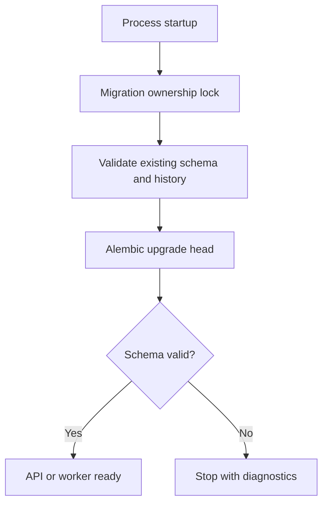
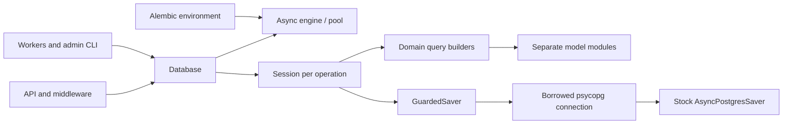
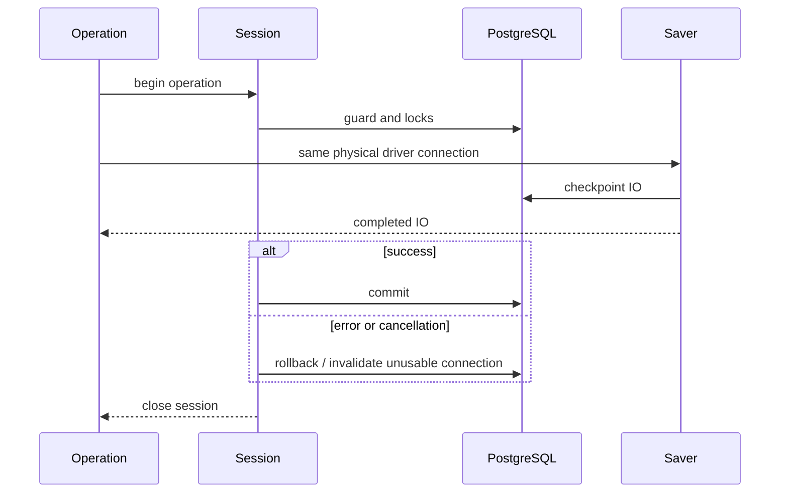

# SQLAlchemy and Alembic Database Layer - Plan

## Goal Capsule

- **Objective:** Разработчик может сопровождать модели и запросы единообразно, а оператор запускать новую или обновлять существующую БД без потери данных и нарушения доступа пользователей.
- **Means:** SQLAlchemy для моделей и запросов приложения, Alembic для управления схемой.
- **Product authority:** Требования и последовательные решения пользователя от 2026-10-15, зафиксированные в `harness/project/docs/2026-10-15-sqlalchemy-reference-analysis.md`.
- **Stop conditions:** Не менять согласованные решения без пользователя; при несовместимости общей транзакции SQLAlchemy/AsyncPostgresSaver остановить перенос зависимых операций и представить доказательства.
- **Execution:** Исполнитель выполняет техническую проверку общей транзакции первой, затем завершает перенос, техническую регрессию и документацию. Публикация и развёртывание вне локальной среды не входят в задачу.

---

## Product Contract

### Summary

Слой БД использует отдельные SQLAlchemy-модели и класс Database для engine, соединений и сессий. Запросы приложения строятся SQLAlchemy expressions; штатный PostgreSQL checkpointer LangGraph сохраняется. Готовые миграции Alembic подготавливают схему перед запуском.

### Problem Frame

Сейчас схема хранится в SQL-файлах с собственным журналом, а запросы и управление psycopg-соединениями распределены по сервисам. Перенос должен сохранить накопленные данные, права доступа и существующие границы commit, включая операции, которые фиксируют результат до последующей ошибки доставки.

### Requirements

**Models and database access**

- R1. Каждая модель SQLAlchemy располагается в отдельном Python-модуле; названия и группировку модулей определяет исполнитель по структуре проекта.
- R2. Явно создаваемый Database без Singleton владеет engine и фабрикой сессий, предоставляет контексты connection/session и освобождает ресурсы при завершении.
- R3. Независимые операции используют отдельные сессии; вложенные функции запросов принимают текущую сессию для сохранения общей транзакции.
- R4. Запросы приложения к БД строятся SQLAlchemy expressions с возможностью композиции частичных запросов; передача прежних SQL-строк в text() не считается переходом.
- R5. Сохраняется штатный AsyncPostgresSaver; его внутренние SQL-запросы являются согласованным исключением из R4.
- R6. Проверки владельца, originating session, epochs и доступности источников остаются атомарными с соответствующими операциями checkpoint.

**Schema and startup**

- R7. Все изменения схемы приложения и checkpointer выполняются только ревизиями Alembic; create_all и отдельный runtime setup checkpointer не используются.
- R8. Перед готовностью приложения и использующих БД воркеров выполняется alembic upgrade head: пустая БД получает схему, существующая — недостающие миграции.
- R9. Новые изменения моделей сопровождаются новыми подготовленными и проверенными ревизиями; генерация миграций при запуске запрещена.
- R10. При повреждении схемы, уже отмеченной актуальной, запуск останавливается с диагностикой; автоматическое создание пустых замен удалённых таблиц не выполняется.
- R11. Переход со старых журналов миграций сохраняет данные и эффекты применённых миграций, отказываясь принимать неизвестную/несовместимую схему как head.
- R12. Повторный и конкурентный запуск подготовки схемы не повторяет изменения данных и не создаёт гонки миграций.

**Compatibility and verification**

- R13. Сохраняются существующие API-контракты, ограничения схемы, pgvector, блокировки, состояния запросов и неизменяемость опубликованных источников.
- R14. Ошибки и отмена операций не оставляют незавершённых транзакций или занятых соединений; успешный ответ о записи выдаётся после commit.
- R15. Технические проверки охватывают модели, миграции, запросы, общую транзакцию saver, изоляцию пользователей, recovery и упаковку ресурсов.
- R16. Проверки качества 30/30 ответов и цитат выполняются только после всех этапов реализации и заключительных коммитов; их ошибки отражаются в отчёте и сами по себе не запускают исправления или рефакторинг. Технические проверки доступа и ссылочной целостности выполняются во время реализации.
- R17. TLT_TG_AggregatorManager используется только как read-only образец; изменения выполняются в текущем проекте.

### Key Decisions

- **Database class.** Governs R2, R3. (session-settled: user-directed — chosen over separate resource factory functions: пользователь выбрал единый класс после сравнения вариантов.)
- **Stock LangGraph saver.** Governs R5, R6. (session-settled: user-directed — chosen over a custom SQLAlchemy saver: сохранить библиотечную реализацию с явным исключением для внутреннего SQL.)
- **Alembic-only startup.** Governs R7, R8, R9. (session-settled: user-directed — chosen over create_all bootstrap: пользователь явно закрепил применение готовых миграций без генерации при запуске.)
- **Fail on damaged current schema.** Governs R10. (session-settled: user-directed — chosen over recreating missing tables automatically: не скрывать утрату данных пустой таблицей.)
- **Delegated model layout.** Governs R1. Пользователь поручил исполнителю самостоятельно выбрать расположение модулей.

### Key Flows

- F1. **Startup:** открыть ресурсы → сериализовать подготовку схемы → проверить/принять известную прежнюю историю → применить готовые ревизии → проверить конечную схему → начать работу. Covers R7–R12.
- F2. **Business operation:** создать сессию → открыть транзакцию → проверить права и захватить требуемые блокировки → выполнить составные запросы → commit либо rollback → освободить сессию. Covers R2–R4, R6, R13, R14.
- F3. **Checkpoint:** внутри защищённой операции передать штатному saver то же физическое соединение, не создавая независимой транзакции/пула. Covers R5, R6.



### Acceptance Examples

- AE1. **Covers R7–R9, R12.** На пустой БД запуск создаёт все объекты и начальные записи; повторный запуск не меняет историю или данные; ревизии при этом не генерируются.
- AE2. **Covers R11, R13.** На известной старой схеме переход сохраняет данные; эффекты миграции 005 выполняются ровно один раз, если она ещё не была применена.
- AE3. **Covers R10.** После удаления таблицы при текущем head следующий запуск сообщает повреждение и не восстанавливает её автоматически.
- AE4. **Covers R6, R13, R14.** Отозванная сессия, чужой владелец или устаревший epoch запрещает checkpoint; ошибка после его записи откатывает транзакцию вместе с изменениями приложения.
- AE5. **Covers R2, R3, R12, R14.** Параллельные операции не используют один AsyncSession; конкурентные старты не применяют ревизию дважды; после ошибки соединение освобождается.
- AE6. **Covers R15, R16.** Проверки миграций и технических контрактов проходят до заключительных коммитов; после них запускается набор качества 30/30 и выдаётся отчёт без исправлений только по его результатам.

### Scope Boundaries

Смена RAG-моделей, OCR, промптов, UI и бизнес-политик не входит в работу. Штатный saver не переписывается согласно R5. Runtime DDL ограничено R7; PostgreSQL-specific DDL внутри Alembic-ревизий допустимо. Служебные запросы тестовых фикстур и диагностические проверки должны быть адаптированы к новой архитектуре; исключение R5 не распространяется на новый собственный SQL приложения.

### Sources and Research

- `harness/project/docs/2026-10-15-sqlalchemy-reference-analysis.md`: анализ образца и решения пользователя.
- `backend/app/db.py`, `backend/migrations/001_answer_lifecycle.sql`–`006_documents.sql`: прежний runner и схема.
- `backend/app/rag.py`: GuardedSaver и атомарность проверок доступа с checkpoint.
- `backend/app/generation.py`, `backend/app/document_worker.py`: владение advisory locks и фоновые процессы.
- `backend/tests/conftest.py`, `backend/tests/test_resources.py`, `backend/pyproject.toml`: фикстуры, ресурсы и зависимости.
- [SQLAlchemy async sessions](https://docs.sqlalchemy.org/en/20/orm/extensions/asyncio.html): жизненный цикл и ограничения конкурентного использования.
- [Alembic cookbook](https://alembic.sqlalchemy.org/en/latest/cookbook.html): программный запуск миграций и работа с общей connection.

---

## Planning Contract

Product Contract unchanged: R1–R17, F1–F3 и AE1–AE6 сохранены по смыслу.

### Key Technical Decisions

- KTD1. Модели находятся в плоском пакете `backend/app/models/`: общий DeclarativeBase и явный реестр импортов, отдельный файл для каждой из 24 прикладных таблиц. Строковые внешние ключи и составные ограничения сохраняют цикл documents/source_revisions без импортов сервисов или ненужных ORM relationships. Governs R1, R13.
- KTD2. Database остаётся в `backend/app/db.py`; async engine использует psycopg и один пул, фабрика создаёт независимые AsyncSession. Контекст сессии отвечает за закрытие, а сервисная операция явно определяет commit/rollback. Вложенные запросы принимают активную сессию. Это сохраняет отдельные предварительные чтения, commit перед SMTP и компенсацию upload перед повторным выбросом ошибки. Governs R2, R3, R14. (session-settled: user-directed — chosen over separate resource factory functions: единый владелец engine и фабрики без Singleton.)
- KTD3. Запросы остаются в существующих доменных модулях, используют mapped columns и SQLAlchemy expressions; повторяющиеся выборки источников, документов и событий выделяются в небольшие функции построения Select. Результаты на существующих границах сервиса преобразуются в обычные словари, чтобы сохранить изменяемые поля и JSON-контракт. Отдельный универсальный repository/DAO не нужен. Governs R4, R13.
- KTD4. GuardedSaver получает psycopg driver_connection из SQLAlchemy-соединения текущей сессии после выполнения guard-запросов. SQLAlchemy владеет внешней транзакцией; saver полностью завершается до её выхода. Отдельные операции не делят checkout, неисправное соединение инвалидируется перед повторным использованием. Governs R5, R6, R14. (session-settled: user-directed — chosen over custom saver: сохранить штатный AsyncPostgresSaver с проверенным соединением.)
- KTD5. Начальная ревизия Alembic принимает только известный непрерывный журнал lifecycle_migrations с совпадающими SHA256 и ожидаемой схемой, затем выполняет недостающий суффикс неизменённых миграций 001–006 в своей транзакции. Пустая БД проходит тот же путь. Никакого stamp head по наличию таблиц. Governs R7, R11; это сохраняет преобразования данных 003 и 005.
- KTD6. Отдельная ревизия фиксирует схему stock saver 3.1.3 и смысл checkpoint_migrations 0–9. Она проверяет известную историю и существующие объекты, применяет недостающие шаги и сохраняет данные. Для первоначального перехода при остановленных сервисах используются обычные транзакционные индексы: конкурентное создание индексов и его частичные commit здесь не нужны. Новая версия saver требует новой проверенной ревизии. Governs R5, R7, R11.
- KTD7. Alembic environment удерживает выделенное физическое соединение и прежний session advisory lock `rag:migrations` на всём пути проверки/upgrade/проверки. Известные начальные состояния обоих журналов проверяются до изменений. После ожидания lock состояние читается заново; SQLAlchemy autobegin проверки завершается до передачи управления Alembic. Блокировка снимается до закрытия connection. Governs R8, R12.
- KTD8. Проверка схемы ограничена объектами проекта: таблицами, колонками, типами, ограничениями, индексами, view, функцией/триггерами неизменяемости и обязательными singleton-строками. Для старых префиксов используются проверенные неизменяемые ожидания ревизий, для head — соответствующий контракт. Проверка не создаёт временную БД при запуске и не ремонтирует расхождения. Governs R10, R11, R13.
- KTD9. Alembic env, revisions, frozen baseline SQL и схема проверки включаются в wheel через существующий механизм ресурсов. Команда rag-migrate и запуск API/воркеров/CLI используют один путь upgrade head. Autogenerate получает прикладную metadata и исключает служебные таблицы Alembic, legacy и stock saver. Governs R7–R9, R15.
- KTD10. Supervisor и document worker удерживают session advisory locks на выделенных SQLAlchemy AsyncConnection до завершения процесса, фиксируя каждое обновление lease отдельно. Дочерний процесс создаёт собственный Database в своём event loop. Governs R2, R12–R14.

### High-Level Technical Design

Компоненты и владение ресурсами:



Жизненный цикл защищённой записи:



Состояния подготовки схемы определены F1 и KTD5–KTD8: пустая → готовая; известный старый префикс → актуальная; повреждённая или неизвестная → остановка с диагностикой. Переход между версиями выполняется при остановленных старых API и воркерах: migration lock не блокирует обычные бизнес-запросы.

### Output Structure

```text
backend/
  app/
    db.py
    models/
      base.py
      __init__.py
      account.py, session.py, conversation.py, document.py, tab.py
      service_state.py, setting.py, settings_audit.py
      request.py, message.py, event.py
      source_revision.py, source_page.py, source_chunk.py
      request_source.py, graph_binding.py, coordinator_lease.py
      email_verification.py, account_invitation.py, accounts_audit.py
      document_policy.py, document_file.py, document_page_text.py, document_policy_audit.py
  alembic.ini
  migrations/
    env.py
    script.py.mako
    versions/
      0001_application.py
      0002_checkpoints.py
    schema_contract.py
    contracts/
    001_answer_lifecycle.sql … 006_documents.sql
```

Файлы старых SQL остаются неизменяемым baseline под управлением KTD5; новые изменения оформляются Python-ревизиями Alembic. View источников описывается SQLAlchemy selectable, без фиктивной ORM primary key.

### System-Wide Impact

Меняются все владельцы ресурсов: lifespan, пять API-модулей, handoff middleware, SSE polling/disconnect, coordinator/supervisor/child, document worker и account CLI. Перенос затрагивает auth/accounts/answers/events/documents/sources/settings/rag и тестовые фикстуры. UI и HTTP-поля сохраняются. Handoff продолжает дожидаться drainage до guard и проверять доступ перед выдачей приватного ответа; успешные записи уже зафиксированы к этому моменту.

### Risks and Deferred Implementation Details

- Совместимость raw bridge подтверждена API и исходниками, но требует PostgreSQL-проверки U1 до массового переноса. Проверяются pipeline и fallback savepoint.
- Autobegin может незаметно удерживать блокировки во время SMTP, KDF, OCR, токенизации и сетевых ожиданий. U4–U6 сохраняют существующие границы и проверяют видимость независимым соединением.
- При повреждении известного head оператор восстанавливает данные/схему из проверенного источника; автоматический repair и destructive downgrade baseline не реализуются согласно R10/R11.
- Точные версии SQLAlchemy/Alembic/pgvector закрепляются через uv после проверки разрешения зависимостей. Исследование подтверждает SQLAlchemy 2.1.4 и Alembic 1.20.0 для Python 3.12; установленный saver остаётся 3.1.3.
- Точная нормализация PostgreSQL catalog и имена вспомогательных функций определяются при реализации, без расширения поддерживаемых неизвестных схем. Runtime автоисправление, собственный saver, общий query DSL и дополнительные режимы конфигурации рассмотрены и не строятся: они не нужны согласованному переходу.

### Research Basis

- `backend/app/accounts.py` register/login, `backend/app/documents.py` upload/delete и `backend/app/handoff.py` view: намеренные границы транзакций.
- `backend/app/generation.py` Supervisor/worker и `backend/app/document_worker.py`: выделенные advisory-lock соединения.
- [SQLAlchemy driver connection access](https://docs.sqlalchemy.org/en/21/faq/connections.html#accessing-the-underlying-connection-for-an-asyncio-driver), [async sessions](https://docs.sqlalchemy.org/en/21/orm/extensions/asyncio.html).
- [Alembic async integration](https://alembic.sqlalchemy.org/en/latest/cookbook.html#using-asyncio-with-alembic), [autogenerate limitations](https://alembic.sqlalchemy.org/en/latest/autogenerate.html).
- Установленные `langgraph/checkpoint/postgres/aio.py`, `base.py`, `_ainternal.py` версии 3.1.3 и `psycopg/transaction.py` версии 3.3.6: saver не коммитит активную внешнюю транзакцию при соблюдении KTD4.

---

## Implementation Units

### U1. Database lifecycle and saver transaction proof

**Goal:** Подтвердить общую транзакцию до переноса доменных запросов.
**Requirements:** R2, R3, R5, R6, R14; F2, F3; KTD2, KTD4.
**Dependencies:** Нет.
**Files:** `backend/app/db.py`, `backend/pyproject.toml`, `backend/uv.lock`, `backend/tests/test_database.py`, `backend/tests/test_saver_transaction.py`.
**Approach:** Добавить зависимости, engine/factory и контексты ресурсов; обработать существующий URI и libpq conninfo без ручной интерполяции credentials. Проверить borrowed driver через отдельную техническую интеграцию. Сначала использовать прежнюю подготовку disposable test DB; runtime setup удаляется U3/U7.
**Test scenarios:**

- Covers AE4. Запись приложения и checkpoint на одном backend PID откатываются после ошибки перед commit; независимое соединение не видит промежуточного результата.
- Pipeline и принудительный fallback saver сохраняют внешнюю транзакцию и dict/blob roundtrip.
- Covers AE5. Параллельные операции имеют разные сессии; отмена ожидающего запроса освобождает lock и checkout, следующий запрос работает.
- DSN с unix socket и специальными символами credentials подключается без потери параметров.

**Verification:** Реальный PostgreSQL подтверждает атомарность и отсутствие утечки ресурсов; при провале зависимый перенос не начинается.

### U2. Separate models and metadata registry

**Goal:** Описать существующую прикладную схему без изменения данных или API.
**Requirements:** R1, R4, R13; KTD1, KTD3.
**Dependencies:** U1.
**Files:** `backend/app/models/*.py`, `backend/tests/test_models.py`, `backend/pyproject.toml`, `backend/uv.lock`.
**Approach:** Описать 24 таблицы, PostgreSQL-типы, vector(384), server defaults, составные FK/unique/check и частичные индексы. Добавить явный реестр и общий Base. Не переносить роли служебных checkpoint-таблиц в прикладной ORM.
**Test scenarios:**

- Реестр содержит все прикладные таблицы; импорт отдельного модуля не создаёт engine и не подключается к БД.
- Metadata соответствует схеме существующих миграций, включая UUID array, vector, циклический composite FK и unfinished-request partial unique index.

**Verification:** Проверка metadata и Alembic comparison не предлагает непреднамеренных schema changes; DDL не запускается при импорте моделей.

### U3. Alembic adoption, startup integrity and packaging

**Goal:** Подготовка схемы проходит одним проверяемым путём с сохранением прежних данных.
**Requirements:** R7–R12, R15; F1; KTD5–KTD9.
**Dependencies:** U1, U2.
**Files:** `backend/alembic.ini`, `backend/migrations/env.py`, `backend/migrations/script.py.mako`, `backend/migrations/versions/*.py`, `backend/migrations/schema_contract.py`, `backend/migrations/contracts/*`, `backend/app/db.py`, `backend/app/resources.py`, `backend/pyproject.toml`, `backend/tests/test_migrations.py`, `backend/tests/test_resources.py`.
**Approach:** Реализовать две начальные ревизии, валидацию конечного состояния и сериализацию KTD5–KTD9. Сохранить baseline SQL байт-в-байт. Проверенные ожидания поддерживаемых старых схем получить только в disposable БД и сохранить как ресурсы. Онлайн upgrade обязателен; неподдерживаемый offline adoption/downgrade завершается явной ошибкой.
**Test scenarios:**

- Covers AE1/AE2. Пустая БД, каждый префикс 001–006 и полная прежняя БД достигают одной схемы; повторный upgrade не меняет данные.
- До 003 сохраняются lease/epoch; до 005 незавершённый запрос получает один terminal event и исключённое assistant message; повторный запуск не дублирует эффекты.
- Covers AE3. Удалённая таблица, изменённый FK/trigger, отсутствующий singleton, неверный checksum или неизвестная версия отвергаются без автоматического ремонта.
- Checkpoint без истории, с известным префиксом и полным журналом сохраняет payload; подтверждённый старый crash после DDL до marker принимается только при точном соответствии известному шагу.
- Covers AE5. Два конкурентных upgrade сериализуются; ошибка ревизии оставляет корректный rollback и освобождает migration lock.
- Установленный wheel вне checkout содержит env/revisions/baseline/контракты и выполняет upgrade.

**Verification:** Технические миграционные тесты проходят; head не запускает DDL повторно и диагностирует повреждение.

### U4. Identity, settings and protected HTTP reads

**Goal:** Перевести аккаунты, авторизацию и настройки без изменения права доступа и commit semantics.
**Requirements:** R3, R4, R13–R15; F2; KTD2, KTD3.
**Dependencies:** U1, U2, U3.
**Files:** `backend/app/{auth,accounts,settings,handoff}.py`, `backend/app/api/{accounts,settings}.py`, `backend/tests/{conftest,test_accounts,test_settings,test_http,test_invalidation}.py`.
**Approach:** Перевести запросы и адаптировать fixtures/callers. Выделить session-taking чтения для handoff, чтобы вложенный вызов не начинал вторую внешнюю транзакцию. Завершать preflight SELECT до KDF; сохранять commit регистрации перед SMTP. Ошибки SQLAlchemy проверять через original SQLSTATE там, где это требуется контрактом.
**Test scenarios:**

- Ошибка SMTP оставляет unverified account и позволяет повторную отправку с тем же паролем.
- Отзыв сессии/отключение аккаунта блокирует последующую выдачу приватного HTTP-ответа.
- Вложенные чтения handoff используют текущую сессию; сохранение настроек видно после успешного ответа.

**Verification:** Существующие account/settings/HTTP/isolation тесты проходят с новой архитектурой.

### U5. Sources, documents and ingestion worker

**Goal:** Перевести составные запросы источников и обработку документов с сохранением публикации и компенсаций.
**Requirements:** R3, R4, R13–R15; F2; KTD2, KTD3, KTD10.
**Dependencies:** U4.
**Files:** `backend/app/{sources,documents,document_worker}.py`, `backend/app/api/documents.py`, `backend/tests/{test_documents,test_source_contract,test_document_ocr}.py`, связанные browser/integration fixtures.
**Approach:** Переиспользовать selectable доступных ревизий, публичных колонок документов и scoped document union. Сохранить vector ordering, timestamps и lock ordering. Отдельные транзакции сопровождают upload chunks, fail_upload, staging и публикацию; OCR/embedding работают вне открытых DB-транзакций.
**Test scenarios:**

- Запрещённый/удалённый источник не попадает в retrieval/history; опубликованные revisions/pages/chunks/page_texts неизменяемы.
- Ошибка/cancel upload фиксирует компенсацию; uncertain commit не удаляет потенциально сохранённый original.
- Сбой staging сохраняет диагностируемое состояние и корректное восстановление worker.

**Verification:** Document/source технические тесты подтверждают прежние ограничения и видимость записей между транзакциями.

### U6. Answer lifecycle, checkpoints and generation ownership

**Goal:** Перевести оставшиеся запросы жизненного цикла и включить проверенный stock-saver bridge.
**Requirements:** R3–R6, R12–R15; F2, F3; KTD2–KTD4, KTD10.
**Dependencies:** U5.
**Files:** `backend/app/{answers,events,rag,generation,handoff}.py`, `backend/app/api/{answers,tabs}.py`, `backend/tests/{test_admission,test_rag_context,test_scheduler,test_service_recovery,test_service_ownership_lease,test_stream_recovery,test_invalidation}.py`.
**Approach:** Сохранить отдельные admission-транзакции вокруг токенизации, порядок guard locks, per-tab deadline commits, lease commits и short SSE polls. Перевести supervisor/child на собственные Database и keeper connections. GuardedSaver применяет KTD4 без runtime setup.
**Test scenarios:**

- Covers AE4. Чужой owner, revoked originating session и stale epochs запрещают checkpoint; ошибка после saver откатывает всю запись.
- Параллельные admission/stop/finalizing сохраняют единственный unfinished request и terminal event.
- Потеря generation ownership и рестарт процесса не позволяют старому epoch публиковать ответ.
- SSE drainage не удерживает транзакцию; отключение таба и delayed alist повторно проверяют доступ.

**Verification:** Lifecycle/recovery/scheduler/transport технические тесты проходят с реальными независимыми соединениями.

### U7. All startup paths and complete technical regression

**Goal:** Завершить перенос всех потребителей и проверить поставляемое приложение.
**Requirements:** R8, R13–R17; F1; KTD9, KTD10.
**Dependencies:** U6.
**Files:** `backend/app/{main,db,accounts,generation,document_worker,resources}.py`, `backend/tests/conftest.py`, `backend/tests/browser/*.py`, `backend/tests/integration/*.py`, документация запуска в `harness/project/docs/`.
**Approach:** Подключить подготовку схемы до ready API, worker и CLI, teardown после фоновых задач. Адаптировать диагностические/fixture запросы и упаковку. Удалить устаревшие runtime pool/raw SQL пути; сохранить исключительно согласованный сторонний SQL и versioned migration DDL. Зафиксировать инструкцию создания следующей ревизии и обновления существующей установки.
**Test scenarios:**

- Covers AE1/AE3. Каждый entrypoint работает с пустой БД и отказывает до ready на повреждённой схеме.
- Covers AE6. Unit/integration/browser технические сценарии запускаются с точечным исключением frozen thirty-question quality case.
- Wheel выполняет миграции и запуск вне checkout; model change обнаруживается проверкой metadata без генерации при старте.

**Verification:** Поиск оставшегося app-owned SQL не выявляет обходов R4; итоговая проверка подтверждает все применимые AE и отсутствие изменений read-only образца.

---

## Verification Contract

Все команды запускаются через uv, с реальным disposable PostgreSQL для транзакций и миграций. Во время планирования тесты не выполнялись.

- Основной технический набор: `uv run --project backend --frozen pytest -c backend/pyproject.toml backend/tests --ignore=backend/tests/runtime --ignore=backend/tests/browser --ignore=backend/tests/integration -q`.
- Integration: `uv run --project backend --frozen pytest -c backend/pyproject.toml backend/tests/integration --deselect=backend/tests/integration/test_answer_lifecycle.py::test_frozen_thirty_questions_use_real_multilingual_documents -q`.
- Browser: `xvfb-run -a uv run --project backend --frozen pytest -c backend/pyproject.toml backend/tests/browser -q` при доступных браузерных prerequisites.
- Упаковка: `uv build --project backend --wheel`; smoke установки и миграции из disposable uv environment вне checkout.
- Новые тесты Database, bridge, metadata и миграций входят в основной набор. Истинно конкурентные проверки используют разные соединения/процессы.
- Runtime native/model tests выполняются, если затронутый контракт требует их и доступны прежние ресурсы; отсутствие prerequisite явно фиксируется, не считается успешной проверкой.
- Отложенный запуск R16 точечный: технические тесты нескольких пользователей и прав доступа к цитируемым источникам не откладываются по словам thirty/citation. После всех этапов и заключительных коммитов отдельно запускается `backend/tests/integration/test_answer_lifecycle.py::test_frozen_thirty_questions_use_real_multilingual_documents` и предусмотренные этим набором проверки цитат; результат становится отчётом, а не новым циклом исправлений.

## Definition of Done

Все U1–U7 реализованы; R1–R17 соблюдены; новые и существующие применимые технические проверки пройдены либо назван конкретный внешний blocker. Ни один blocker безопасности транзакций, миграций или сохранности данных не объявляется выполненной работой.

В diff нет create_all, runtime autogenerate, saver.setup или собственного SQL приложения, скрытого в text(). Нет заброшенного экспериментального кода, альтернативного runner и неиспользуемых обёрток. Документация описывает применённый механизм и честно перечисляет выполненные/пропущенные проверки. После заключительных коммитов выполнен финальный набор качества согласно R16 либо названа фактическая недоступная предпосылка; обнаруженные ошибки качества перечислены без автоматических исправлений.
