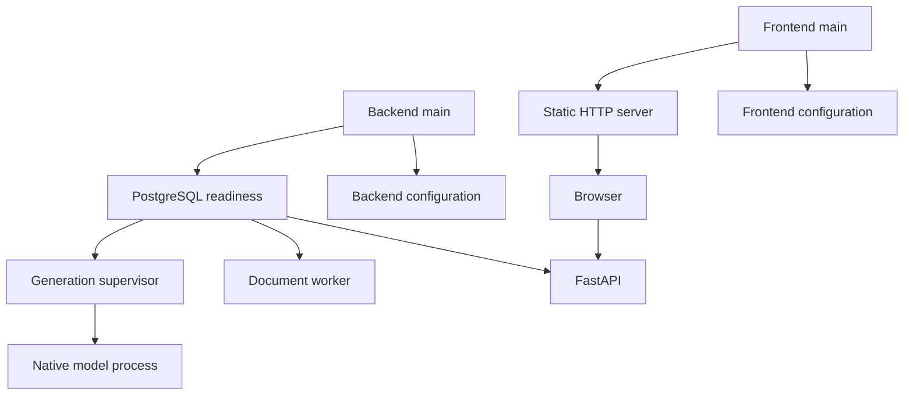

# Backend and Frontend Entrypoints - Plan

## Goal Capsule

- **Objective:** Оператор запускает серверную часть и веб-интерфейс двумя командами, без ручного запуска каждого обработчика и редактирования адресов в коде.
- **Means:** `python3 backend/main.py` и `python3 frontend/main.py`, раздельная конфигурация разделов.
- **Product authority:** Запрос пользователя и подтверждение границ задачи от 2026-10-16; действующие требования harness к конфигурации.
- **Open blockers:** Нет нерешённых вопросов о требованиях.

---

## Product Contract

### Summary

Серверная точка входа управляет API, генерацией и обработкой документов. Фронтендовая точка входа раздаёт веб-интерфейс с публичными настройками подключения. Изменяемые параметры установки задаются конфигами соответствующего раздела.

### Requirements

**Startup and shutdown**

- R1. Команды `python3 backend/main.py` и `python3 frontend/main.py` запускают соответствующие разделы после однократной подготовки окружения и локальных настроек.
- R2. Бэк загружает и проверяет настройки до запуска дочерних процессов и дожидается доступности настроенного PostgreSQL в пределах заданного времени.
- R3. Бэк запускает существующие API, обработчик документов и сервис генерации отдельными процессами и отслеживает их завершение.
- R4. Неожиданное завершение любого управляемого процесса вызывает диагностируемое завершение бэка с ошибкой и остановку остальных процессов.
- R5. `Ctrl+C` и штатный сигнал остановки завершают управляемые процессы, включая дочерний процесс модели; ожидание остановки ограничено конфигурацией.
- R6. Фронт раздаёт HTML/CSS/JavaScript по настроенному адресу и передаёт браузеру адрес API из своего конфига.

**Configuration**

- R7. Адреса, порты, БД, SMTP, пути моделей и хранилища, параметры запуска и интервалы управления процессами задаются конфигурацией разделов, без значений установки в исполняемом коде.
- R8. Общие настройки без секретов и шаблоны с заглушками остаются видимыми Git, а рабочие локальные параметры установки и секреты исключаются точными правилами `.gitignore` согласно `harness/common/skills/comm-separate-application-config/SKILL.md`.
- R9. Браузеру доступны только явно выбранные публичные параметры; конфиги и секреты бэка не доступны через HTTP-раздачу фронта.
- R10. Источники конфигурации, приоритеты переопределения, относительные пути и ошибки отсутствующих обязательных параметров документированы.
- R11. Относительные пути запуска и конфигов не зависят от текущего рабочего каталога оператора.

**Compatibility and verification**

- R12. Сохраняются действующие SQLAlchemy expressions, класс Database на процесс и применение готовых миграций Alembic без runtime autogenerate или create_all.
- R13. Сохраняются существующие настройки моделей, HTTP-контракты и отдельные точки запуска компонентов для технических проверок.
- R14. Проверки охватывают изменение конфигов, запуск из другого каталога, недоступность БД, занятый порт, завершение дочернего процесса и остановку дерева процессов.

### Key Decisions

- **Two Python entrypoints.** Governs R1, R3, R6. (session-settled: user-directed — chosen over separate manual commands and systemd-only launch: пользователь хочет запускать каждый раздел одним файлом.)
- **External PostgreSQL lifecycle.** Governs R2, R12. (session-settled: user-approved — chosen over managing PostgreSQL from the launcher: подтверждено подключение к уже работающей БД.)
- **Fail together.** Governs R4, R5. (session-settled: user-approved — chosen over leaving surviving components running: подтверждена остановка остальных процессов при сбое.)
- **Existing database architecture.** Governs R12. Основание: согласованные решения в `harness/project/docs/plans/2026-10-15-1316-refactor-sqlalchemy-alembic-plan.md`.

### Key Flows

- F1. **Backend start:** загрузка и проверка конфигов → ожидание PostgreSQL → запуск обработчиков и API → контроль завершения. Covers R1–R4, R7, R11, R12.
- F2. **Backend stop:** сигнал оператора или сбой компонента → остановка дерева запущенных процессов → ожидание → принудительное завершение оставшихся процессов в пределах конфигурации. Covers R4, R5.
- F3. **Frontend start:** загрузка публичного конфига → запуск HTTP → выдача интерфейса и публичных параметров → обращения браузера к настроенному API. Covers R6, R8–R11.

### Acceptance Examples

- AE1. **Covers R1–R3, R11.** При доступных зависимостях запуск из корня или другого каталога создаёт API и оба обработчика без дополнительных команд.
- AE2. **Covers R2, R4, R5.** Недоступная БД, занятый порт или сбой одного компонента завершают запуск с ошибкой без оставленного работающего дерева процессов.
- AE3. **Covers R5.** После `Ctrl+C` завершаются API, обработчик документов, generation supervisor и его native worker.
- AE4. **Covers R6–R10.** Изменение адреса API в локальном конфиге фронта меняет адрес запросов браузера без правки HTML/JS; попытки получить локальные конфиги по HTTP не раскрывают их содержимое.
- AE5. **Covers R8.** Git отслеживает шаблоны и общие конфиги, но не рабочие локальные конфиги; проверены ignore и фактический индекс отдельно.

### Scope Boundaries

- Установка, запуск и остановка PostgreSQL, скачивание моделей и настройка внешнего SMTP выполняются вне этих точек входа.
- Контейнеризация, systemd deployment и изменение модели данных не входят в задачу.
- Протокольные константы и неизменяемые правила предметной области не превращаются в настройки установки.

### Dependencies

Для полного запуска нужны подготовленное Python-окружение бэка, PostgreSQL с pgvector, существующие файлы моделей и заполненная локальная конфигурация.

---

## Planning Contract

Product Contract unchanged.

### Problem Frame

Оператор сейчас запускает компоненты отдельными командами и связывает адреса через HTML и переменные окружения. Добавление локальных конфигов под корень HTTP-раздачи без ограничения публичных путей раскрыло бы параметры установки.

### Key Technical Decisions

- KTD1. Использовать TOML: отслеживаемый `config/service.toml` с общими defaults и `config/service.local.example.toml` с заглушками, опциональный игнорируемый `config/service.local.toml` с переопределениями. Локальный конфиг перекрывает общий; значения запуска имеют приоритет над унаследованными RAG-переменными. Относительные пути отсчитываются от корня раздела. Governs R7–R11.
- KTD2. `backend/main.py` выбирает настроенный Python из окружения бэка и передаёт управление launcher без импорта inference-модулей. Существующие переменные RAG остаются внутренним интерфейсом компонентов; прямые component CLI сохраняют совместимость. Governs R1, R3, R13.
- KTD3. Проверку PostgreSQL выполнять через существующий Database и SQLAlchemy expression с общим deadline, закрывая engine до запуска дочерних процессов. Подготовка схемы остаётся за существующими entrypoints. Governs R2, R12.
- KTD4. Запускать компоненты отдельными process groups; остановка охватывает группы и после завершения их лидеров. Дочерний native worker остаётся под существующим generation supervisor. Supervisor не объявляется готовым только на основании существования PID. Governs R3–R5.
- KTD5. HTTP-раздача фронта разрешает только index и файлы `src/`; адрес API и клиентские интервалы подставляются в публичные метаданные HTML из allowlist. GET и HEAD имеют одинаковые границы доступа. Governs R6, R9.
- KTD6. Сетевые defaults API/SMTP и интервалы управления новыми процессами берутся из service config; неизменяемые протокольные значения и существующие модели/лимиты остаются в своих владельцах. Governs R7, R13.

### Risks and Verification Boundaries

Полный model startup требует существующих артефактов Qwen, E5 и OCR. Технические проверки управления процессами используют настоящие дочерние процессы и изолированную БД; их результат не подменяет проверку качества ответов модели. Generation остаётся Linux-specific по существующему контракту host fence.

---

## Implementation Units

### U1. Configuration boundaries

**Goal:** Загружать конфиги разделов с проверкой обязательных значений и без раскрытия секретов.
**Requirements:** R7–R13; KTD1, KTD2, KTD6.
**Dependencies:** Нет.
**Files:** `backend/app/configuration.py`, `backend/config/service.toml`, `backend/config/service.local.example.toml`, `frontend/config/service.toml`, `frontend/config/service.local.example.toml`, `.gitignore`, `backend/app/main.py`, `backend/app/accounts.py`, `backend/tests/test_launch_configuration.py`.
**Approach:** Ввести компактный загрузчик и нормализацию путей; существующим компонентам передавать их env-контракт. Сохранить прямые CLI и тестовое переопределение окружения.
**Test scenarios:**

- Локальный конфиг изменяет значения общего, незаданные обязательные параметры дают ошибку с именем ключа без его содержимого.
- Относительные пути разрешаются одинаково из разных cwd; неправильный порт или origin отвергается до запуска.
- Covers AE5. Общие конфиги/шаблоны видны Git, локальные исключены и не отслеживаются.

**Verification:** Тесты загрузчика и существующие account/API тесты проходят.

### U2. Backend process lifecycle

**Goal:** Управлять всем бэком через один main.
**Requirements:** R1–R5, R11–R14; F1, F2; KTD2–KTD4.
**Dependencies:** U1.
**Files:** `backend/main.py`, `backend/app/launcher.py`, `backend/app/main.py`, `backend/tests/test_backend_launcher.py`.
**Approach:** Сначала проверить конфиг/файлы и готовность БД, затем запустить существующие module entrypoints с отдельными группами; обрабатывать сигналы и любое неожиданное завершение как событие всего запуска.
**Test scenarios:**

- Covers AE1. Подготовленная БД допускает старт; проверка не импортирует inference-модули.
- Covers AE2. Недоступная БД и молчащий TCP peer ограничены deadline; до готовности дети не запускаются.
- Covers AE2. Сбой первого/последующего компонента, включая неожиданный exit 0, останавливает остальных и возвращает ошибку.
- Covers AE3. SIGINT/SIGTERM и принудительная остановка завершают настоящее дерево процессов, включая оставшегося потомка уже завершившегося лидера.

**Verification:** Тесты используют настоящие subprocesses и disposable PostgreSQL; существующие supervisor/recovery тесты сохраняются.

### U3. Frontend entrypoint and public settings

**Goal:** Раздавать интерфейс одной командой с настройками подключения из конфига.
**Requirements:** R1, R6–R11, R13, R14; F3; KTD1, KTD5.
**Dependencies:** U1.
**Files:** `frontend/main.py`, `frontend/index.html`, `frontend/src/api.js`, `frontend/src/conversations.js`, `backend/tests/test_frontend_launcher.py`, `backend/tests/browser/test_accounts.py`, `backend/tests/test_frontend_reducer.py`.
**Approach:** Использовать стандартную библиотеку Python для HTTP с публичным allowlist и подстановкой только публичных метаданных. Browser fixture перевести на тот же handler.
**Test scenarios:**

- Covers AE4. Изменённые адрес/порт/API origin работают из чужого cwd без правок JS/HTML.
- Covers AE4. GET/HEAD для конфига, Python-файла, обхода пути и внешнего symlink не раскрывают содержимого.
- Занятый порт даёт понятный ненулевой exit; CSS/JS имеют подходящий MIME.
- Существующая регистрация/вход/SSE в браузере работают с разными адресами frontend/backend.

**Verification:** HTTP smoke и reducer/account browser tests проходят.

### U4. Startup documentation and integrated verification

**Goal:** Описать однократную подготовку и подтвердить запуск/остановку поставляемых точек входа.
**Requirements:** R1, R7–R14; AE1–AE5.
**Dependencies:** U2, U3.
**Files:** `harness/project/docs/2026-10-16-service-entrypoints.md`, тесты U1–U3.
**Approach:** Документировать приоритеты конфигов, пути, обязательные ресурсы, внешнюю БД/SMTP и команды запуска. Проверить фактический индекс и игнорирование.
**Test scenarios:** Проверки U1–U3 совместно с технической account/API/config/resource/supervisor регрессией.
**Verification:** Инструкция соответствует фактическим ключам и поведению; недоступные зависимости названы явно.

---

## Verification Contract

- Новые проверки: `uv run --project backend --frozen pytest -c backend/pyproject.toml backend/tests/test_launch_configuration.py backend/tests/test_backend_launcher.py backend/tests/test_frontend_launcher.py -q`.
- Регрессия: `uv run --project backend --frozen pytest -c backend/pyproject.toml backend/tests --ignore=backend/tests/runtime --ignore=backend/tests/browser --ignore=backend/tests/integration -q`.
- Browser: `uv run --project backend --frozen pytest -c backend/pyproject.toml backend/tests/browser/test_accounts.py -q` при доступных prerequisites браузера.
- CLI smoke запускает обе точки входа из корня и другого cwd; проверяет ошибки настройки и занятого порта.
- Git visibility проверяется отдельно через `git check-ignore -v --no-index` и `git ls-files`.

## Definition of Done

U1–U4 реализованы, AE1–AE5 проверены в применимых технических сценариях. Общие конфиги и шаблоны отслеживаются, локальные параметры не раскрываются браузеру и не добавлены в Git. Изменённые entrypoints сохраняют существующие контракты компонентов; документация перечисляет реальные ограничения проверки. Экспериментальный и неиспользуемый код отсутствует.
