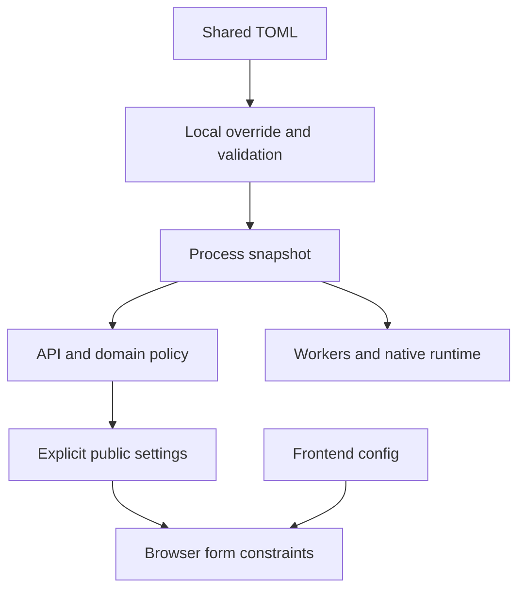

# Application Settings Extraction - Plan

## Goal Capsule

- **Objective:** Оператор меняет параметры приложения в файлах настроек, без редактирования Python, JavaScript и HTML.
- **Means:** Расширение TOML-профилей бэка и публичной конфигурации фронта.
- **Product authority:** Поручение пользователя об аудите всего проекта и подтверждение объёма второго этапа от 2026-10-16.
- **Open blockers:** Нет.

## Product Contract

### Summary

Оставшиеся изменяемые параметры безопасности, сроков действия, обработки запросов, RAG, native inference, документов и OCR получают TOML-владельцев. Фронт получает публичные ограничения из того же backend policy, что API и доменные проверки.

### Requirements

**Configuration ownership**

- R1. Вынести кандидаты из `harness/project/docs/2026-10-16-configuration-audit.md` в настройки соответствующей подсистемы.
- R2. Сохранить текущие значения по умолчанию, строки модельных промптов и исходное поведение при штатной конфигурации.
- R3. Общие настройки и шаблоны отслеживаются Git, а локальные overrides исключены точными правилами согласно `harness/common/skills/comm-separate-application-config/SKILL.md`.
- R4. Некорректные значения и несовместимые комбинации отвергаются с именем параметра без раскрытия секретов.
- R5. Все процессы одного запуска используют одинаковую выбранную конфигурацию независимо от cwd.

**Compatibility and public settings**

- R6. Изменение профиля создания паролей не лишает существующие аккаунты возможности входа.
- R7. API, доменные проверки и формы фронта используют согласованные публичные ограничения, публикуя только явный allowlist.
- R8. Сохранить утверждённые SQLAlchemy/Alembic, persisted formats, права доступа, transport/fencing и исторические ревизии.
- R9. Не превращать модельные, математические и протокольные инварианты из аудита в свободные настройки установки.
- R10. Сохранить административные overrides в БД и независимость inference-light generation supervisor.

**Verification**

- R11. Проверки меняют настройки и подтверждают наблюдаемое изменение TTL, ограничений, context/retrieval/chunk/OCR и supervision.
- R12. Выполнить применимую техническую и браузерную регрессию и отдельный локальный коммит результата.

### Key Decisions

- **Extraction without changed defaults.** Governs R1, R2. (session-settled: user-approved — chosen over changing policy during extraction: подтверждён перенос с сохранением текущих значений.)
- **Keep storage and protocol invariants.** Governs R8, R9. (session-settled: user-approved — chosen over parameterizing every literal: подтверждено сохранение миграций и протокольных инвариантов.)

### Key Flows

- F1. Конфиги defaults → локальные overrides → проверка типов/связей → process-local snapshot → существующие обработчики. Covers R1–R5, R10.
- F2. Backend policy → публичный allowlist endpoint → атрибуты форм фронта → серверная проверка того же policy. Covers R7.
- F3. Новый пароль → текущий scrypt profile; вход → профиль сохранённого хеша из разрешённых совместимых профилей → сравнение digest. Covers R6.

### Scope Boundaries

Исторические migrations/schema contracts, тестовые fixtures, HTTP/ASGI/model token protocols, CSS и локализация не переписываются. Настройка GPU/sampling, смена embedding dimension и новая модель хранения не входят в задачу; профили отражают действующие CPU-модели.

## Planning Contract

Product Contract unchanged.

### Key Technical Decisions

- KTD1. Переиспользовать strict recursive merge в `app.configuration`; `load_settings(name)` читает packaged/shared `<name>.toml` и `<name>.local.toml` из каталога выбранного `RAG_SERVICE_CONFIG` либо стандартного backend/config. Кэшировать по источнику в пределах процесса; изменения применяются перезапуском. Governs R3–R5.
- KTD2. `policy.toml` владеет account/security, mail content, tab/SSE/generation supervision и ingestion policy; `runtime.toml` расширяется RAG/embedding/native параметрами, `ocr.toml` — execution/geometry/fragment tuning, `prompts.toml` — исходными модельными строками. Governs R1, R2, R10.
- KTD3. Для persisted scrypt сохраняются существующие параметры кодирования; verifier использует конфигурационно разрешённые старые и текущий профили, ограничивая затраты памяти. Governs R6, R8.
- KTD4. Новый публичный `/api/public-settings` возвращает только input limits; frontend запрашивает его до готовности форм. UI-only значения принадлежат frontend service config. Governs R7.
- KTD5. Native prefill batch и slice используют одно значение; context admission/packing/runtime — общий n_ctx; foreground threshold согласован между OCR стадиями. Governs R2, R4, R11.

## Implementation Units

### U1. Settings loading and owned defaults

**Requirements:** R1–R5, R9; KTD1, KTD2.
**Dependencies:** Нет.
**Files:** `backend/app/configuration.py`, `backend/config/{policy,runtime,ocr,prompts}.toml`, локальные templates, `.gitignore`, `backend/tests/test_application_settings.py`.
**Approach:** Ввести общий loader/validation без inference imports; перенести исходные строки в TOML без преобразования байтов.
**Test scenarios:** Local overrides из другого cwd; неизвестный ключ, неправильный тип, несовместимые пары параметров; отсутствие секретов в ошибках; независимые baseline prompt hashes.
**Verification:** Loader tests проходят, shared/templates видимы Git, local files игнорируются и не отслеживаются.

### U2. Backend policy and process timing

**Requirements:** R1, R2, R4–R6, R8–R11; KTD2, KTD3.
**Dependencies:** U1.
**Files:** `backend/app/{accounts,events,generation,documents,document_worker}.py`, `backend/app/api/{accounts,documents,tabs}.py`, `backend/tests/test_configured_policy.py`.
**Approach:** Заменить tuning literals на выбранные settings, сохраняя SQL expressions и per-process ownership; verifier поддерживает исходный и текущий profile.
**Test scenarios:** Сменить n при создании новых паролей и проверить старый хеш; изменённые session/verification TTL видны в disposable БД; input limits соблюдаются API/domain; существующие lease/recovery сценарии проходят.
**Verification:** Configured-policy, accounts/events/supervisor технические проверки проходят.

### U3. RAG native and OCR tuning

**Requirements:** R1, R2, R4, R8–R11; KTD2, KTD5.
**Dependencies:** U1.
**Files:** `backend/app/{rag,sources,llama_runtime,answers,ocr,ocr_fragments,settings}.py`, связанные tests.
**Approach:** Переиспользовать профиль, связывая дублирующиеся batch/context/threshold значения; протоколы и размерность не менять.
**Test scenarios:** Изменённые response reserve/retrieval/chunk/fragment параметры наблюдаемы; baseline prompt идентичен; defaults сохраняют native/OCR geometry и fragment publication.
**Verification:** RAG context/source, OCR fragment, settings и inference import boundary checks проходят; реальные модели используются для затронутых native boundary сценариев.

### U4. Public policy frontend and completion

**Requirements:** R2–R5, R7–R12; KTD4.
**Dependencies:** U2, U3.
**Files:** `backend/app/main.py`, `frontend/{main.py,index.html,src/api.js,src/app.js,src/conversations.js,config/service.toml}`, backend frontend/browser/reducer tests, `harness/project/docs/2026-10-16-application-settings.md`.
**Approach:** Выдать публичный policy через allowlist и применить его к формам; UI-only настройки публиковать отдельно через frontend allowlist. Документировать restart semantics, совместимость и владельцев каждого профиля.
**Test scenarios:** Изменённый policy согласован в API/HTML form; public ответ и статическая раздача не содержат секретов; registration/login/SSE и обе main-точки работают.
**Verification:** Применимая техническая регрессия и браузерные аккаунты проходят; оставшиеся literals повторно классифицированы.

## Verification Contract

Новые тесты используют самостоятельные expected/baseline и изменённые локальные конфиги, а не копируют вычисленный результат из реализации. Технический набор запускается через `uv run --project backend --frozen --no-sync pytest -c backend/pyproject.toml backend/tests --ignore=backend/tests/runtime --ignore=backend/tests/browser --ignore=backend/tests/integration -q` с прежними локальными моделями. Отдельно выполняются затронутые browser/native проверки. Git visibility и независимый Codex review подтверждают итоговый diff; история и чужие файлы сохраняются.

## Definition of Done

Все согласованные кандидаты получили config-владельца или доказанную классификацию инварианта; текущие defaults и persisted passwords совместимы. Новые настройки проверены на наблюдаемое поведение, секреты не опубликованы, результат документирован и закоммичен отдельным локальным коммитом.
