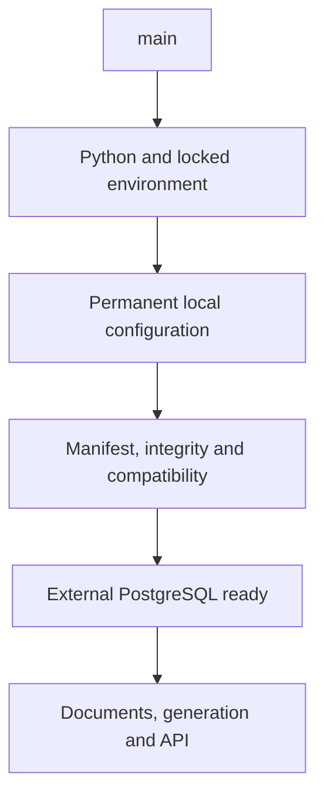
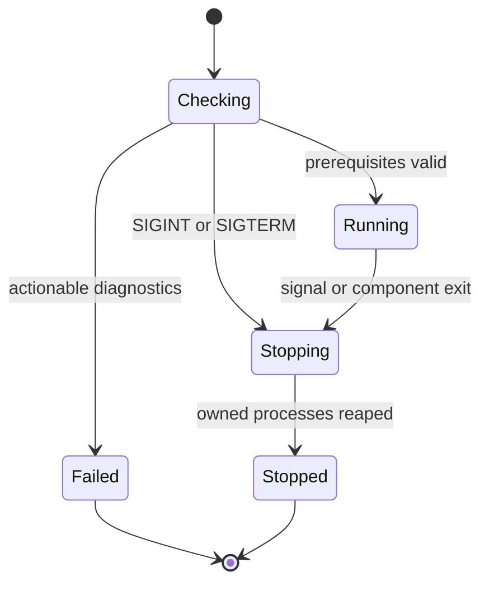

# Ordinary local startup in WSL - Plan

## Goal Capsule

- **Objective:** После подготовки установки разработчик запускает приложение двумя main-командами без ручного экспорта тестового окружения и полностью останавливает каждый раздел через Ctrl+C.
- **Means:** Локальный PostgreSQL с pgvector, постоянная конфигурация, модели вне virtualenv и предварительные проверки запуска.
- **Product authority:** Подтверждённый пользователем объём 2026-10-16; дополнения: пользователь БД rag_assist_user и остановка всего дерева бэкенда.
- **Open blockers:** Нет открытых продуктовых решений; доступность системных пакетов и происхождение файлов моделей проверяются до соответствующих изменений.

---

## Product Contract

### Summary

Настроить обычный запуск бэкенда и фронтенда в локальной WSL. Main проверяет окружение до основного кода, использует постоянные настройки и сообщает о недостающих моделях без их автоматического скачивания.

### Problem Frame

Обычный запуск не использовал существующие модельные ресурсы и постоянное подключение к БД; успешные тесты с временными настройками этого не подтверждали.

### Requirements

**Local database and configuration**

- R1. Установить PostgreSQL с pgvector локально в WSL через apt и обеспечить доступ приложения на 127.0.0.1:5432.
- R2. Создать отдельного пользователя rag_assist_user и базу приложения, сохраняя существующие базы и данные.
- R3. Записать фактический DSN и пути моделей в исключённый из Git локальный конфиг без раскрытия паролей.
- R4. Сохранить согласованную архитектуру SQLAlchemy expressions, Alembic migrations и Database как владельца engine/session factory.

**Models and dependencies**

- R5. Перенести существующий набор моделей в rag/local_models/ внутри проекта независимо от Python-окружения.
- R6. Подготовка моделей является отдельной явной командой с закреплёнными источниками, ревизиями, SHA-256 и совместимыми профилями для полного набора файлов.
- R7. До запуска компонентов main проверяет наличие, целостность и совместимость требуемых моделей и останавливается с конкретной диагностикой при ошибке.
- R8. Main проверяет версию Python и зависимости до импортов приложения, устанавливает недостающие Python-зависимости через uv по существующему lock-файлу и повторяет проверку.
- R9. Обычный main не скачивает модели и не устанавливает системный PostgreSQL; при нехватке ресурсов сообщает явные действия подготовки.

**Lifecycle and verification**

- R10. Ctrl+C и SIGTERM завершают соответствующий main и все принадлежащие ему процессы без затрагивания независимых сервисов.
- R11. Проверить обычные python3 backend/main.py и python3 frontend/main.py без временного TOML, тестовых DSN и переменных путей моделей.
- R12. Проверка подтверждает готовность API, загрузку моделей, затронутые функции и повторный запуск после остановки.

### Key Decisions

- **Постоянная установка вместо тестовой среды.** Governs R1–R3, R11; временные тестовые базы и значения не переносятся в рабочую конфигурацию.
- **Модели сохраняют прежнюю идентичность.** Governs R5–R7; перенос не меняет embedding space, OCR и модель генерации.
- **Подготовка отделена от запуска.** Governs R6, R8, R9; автоматическая подготовка Python разрешена пользователем, модельные ресурсы готовятся явно.

### Key Flows

- F1. **Covers R6–R9.** Main проверяет Python, окружение и конфигурацию; отсутствие модели завершает запуск до компонентов и указывает подготовку.
- F2. **Covers R1–R4, R11, R12.** Подготовленная локальная БД принимает подключение, приложение применяет готовые миграции и становится доступным.
- F3. **Covers R10–R12.** Оператор останавливает main, проверяется отсутствие принадлежащих процессов и доступность повторного запуска на тех же портах.

### Acceptance Examples

- AE1. **Covers R5–R7, R9.** Удалённый, повреждённый или несовместимый обязательный модельный файл блокирует запуск компонентов с указанием проблемы.
- AE2. **Covers R8.** Недостающее окружение восстанавливается uv по lock-файлу; ошибка установки завершает запуск до импортов приложения.
- AE3. **Covers R3, R11, R12.** Обычные main-команды читают постоянную конфигурацию и обслуживают запросы без тестовых переопределений.
- AE4. **Covers R10–R12.** SIGINT/SIGTERM останавливают весь принадлежащий процессный набор, после чего повторный запуск не конфликтует с остатками предыдущего.

### Scope Boundaries

- Модели, промпты, формат данных и бизнес-поведение не заменяются.
- Новый SQL-слой, генерация миграций при старте, переиндексация документов и изменение существующих данных не требуются.
- SMTP не входит в подготовку локального PostgreSQL и моделей; ненастроенная отправка подтверждений должна оставаться явно обозначенной.

### Sources and Research

- harness/common/skills/comm-manage-local-models/references/lifecycle.md
- harness/common/skills/comm-verify-application-startup/SKILL.md
- harness/project/docs/2026-10-16-service-entrypoints.md
- harness/project/docs/plans/2026-10-15-1316-refactor-sqlalchemy-alembic-plan.md
- backend/main.py, backend/app/launcher.py, frontend/main.py, backend/config/service.toml

---

## Planning Contract

Product Contract unchanged: R1–R12, F1–F3, AE1–AE4 сохранены.

### Key Technical Decisions

- KTD1. Установка использует доступные пакеты Ubuntu postgresql-16, postgresql-client-16 и postgresql-16-pgvector. Администратор создаёт vector в rag_assist до миграций; rag_assist_user владеет только БД приложения и не получает SUPERUSER/CREATEDB/CREATEROLE. Governs R1–R4. Основания: проверенные apt candidates и существующая ревизия 0002_sources_and_context.
- KTD2. Точный инвентарь девяти файлов и источники закрепляются в backend/config/models.toml; rag/local_models/.gitignore сохраняет scaffold и исключает содержимое. Пути backend-relative используют ../rag/local_models. Governs R3, R5–R7. Источники: прежний runtime-assets-recovered-v1.json и перепроверенные metadata immutable revisions Hugging Face.
- KTD3. Отдельная stdlib-подготовка принимает существующий каталог или явно запрошенное скачивание закреплённого набора, проверяет staging до выбора и сохраняет возможность восстановления прежнего набора. Удаление исходников переноса допускается только после проверки полного назначения. Governs R5–R7, R9.
- KTD4. Stdlib-bootstrap проверяет backend Python 3.12 и установленные locked версии до импортов приложения, выполняет не более одной uv sync/повторной проверки. Известную рабочую native-сборку сохраняет; изменение её fingerprint при восстановлении зависимостей выявляется, а совместимость проверяется до запуска компонентов. Фронт требует только stdlib Python 3.11+. Governs R7–R9. Точное совпадение версии llama-cpp-python не является доказательством совместимости native-библиотек.
- KTD5. Существующий backend supervisor сохраняет группы процессов, subreaper и bounded TERM/KILL; ранние subprocess-проверки и uv входят в ту же область владения сигналами. У фронта дочерние процессы не вводятся; HTTP-потоки закрываются и проверяются активным соединением. Внешний PostgreSQL никогда не считается дочерним сервисом приложения. Governs R10–R12.
- KTD6. Проверка установки использует реальные локальные main-команды с очищенными тестовыми RAG-переопределениями. Готовность API, generation и OCR проверяется отдельно от факта создания процесса; тяжёлые native-проверки идут последовательно. Governs R11, R12.

### High-Level Technical Design

### Risks and Execution-Time Checks

- Подтверждённый прежний набор native .so имеет отдельные SHA-256; историческая запись не содержит полного воспроизводимого compiler/CMake recipe. Восстановление Python-окружения не должно объявлять произвольную rebuilt-библиотеку совместимой только по версии; сохранить рабочий baseline и проверить фактические способности/загрузку.
- Порт 5432 и существующие базы проверяются перед provisioning; занятый независимым сервисом порт требует решения, а не остановки чужого процесса.
- Данные лицензий закреплённых наборов сохраняются с источниками; перевод E5 не имеет отдельного license-поля, его исходная multilingual-e5-small опубликована под MIT.

---

## Implementation Units

### U1. Trusted model inventory and preparation

**Goal:** Сохранить модели независимо от virtualenv с проверяемой идентичностью.
**Requirements:** R5–R7, R9; F1; AE1.
**Dependencies:** None.
**Files:** backend/config/models.toml, backend/app/model_artifacts.py, backend/prepare_models.py, rag/local_models/.gitignore, backend/tests/test_model_artifacts.py.
**Approach:** Реализовать KTD2/KTD3; переиспользовать существующие pinned bytes и профили без замены моделей.
**Test scenarios:**

- Covers AE1. Missing, truncated, wrong-hash and outside-storage files reject before selection/startup.
- Explicit preparation verifies all staged companions; failure preserves existing set and source; a validated set can be reused.
- Pinned download URLs never use mutable main/latest; ordinary verification makes no network calls.

**Verification:** Все девять destination hashes совпадают с доверенным manifest; модельные JSON/ONNX/GGUF не отслеживаются Git, manifest и scaffold видимы.

### U2. Early bootstrap and entrypoint checks

**Goal:** Выдавать управляемую диагностику до запуска основного кода и готовить Python-зависимости.
**Requirements:** R7–R9; F1; AE1, AE2.
**Dependencies:** U1 integration contract.
**Files:** backend/main.py, backend/bootstrap.py, backend/app/launcher.py, frontend/main.py, backend/tests/test_startup_bootstrap.py, backend/tests/test_backend_launcher.py, backend/tests/test_frontend_launcher.py.
**Approach:** Применить KTD4/KTD5, сохранить --config и backend-relative paths; не импортировать inference в supervisor.
**Test scenarios:**

- Covers AE2. Missing/mismatched dependency, unavailable uv and failed sync stop before app imports; successful sync rechecks once.
- Unsupported Python emits concrete remediation instead of tomllib traceback.
- Covers AE1. Missing/corrupt model or profile mismatch prevents every component from starting and prints explicit preparation guidance.

**Verification:** Focused bootstrap/config/launcher regressions pass and current compatible native installation remains intact.

### U3. Local PostgreSQL and persistent installation config

**Goal:** Подключать обычный backend к постоянной локальной БД.
**Requirements:** R1–R4, R11; F2; AE3.
**Dependencies:** U1, U2 for integrated startup.
**Files:** backend/config/service.local.toml, backend/config/service.local.example.toml, backend/config/service.toml, harness/project/docs/2026-10-16-service-entrypoints.md.
**Approach:** Provision KTD1 on verified project cluster; generate a private DB password; fill ignored installation config with actual paths and DSN; use existing migration chain.
**Test expectation:** No new unit tests for apt/config-only changes; actual PostgreSQL login, vector query, migration and ordinary startup provide the proof.
**Verification:** TCP login identifies rag_assist_user and rag_assist, vector exists, migration reaches current head, local secret config ignored/untracked.

### U4. Full lifecycle and ordinary-startup proof

**Goal:** Подтвердить работу и полную остановку пользовательских команд.
**Requirements:** R10–R12; F3; AE3, AE4.
**Dependencies:** U1, U2, U3.
**Files:** backend/tests/test_backend_launcher.py, backend/tests/test_frontend_launcher.py, harness/project/docs/2026-10-16-service-entrypoints.md, new application verification evidence under harness/project/testing/evidence/work/.
**Approach:** KTD5/KTD6; использовать реальные процессы и сокеты, тестировать принадлежность через PID/process groups, не process-name killing.
**Test scenarios:**

- Covers AE4. SIGINT and SIGTERM during normal running and early owned subprocess work terminate all owned children/grandchildren; unrelated process and PostgreSQL survive.
- Frontend with active connection terminates promptly and releases its port; frontend launches no dependent OS processes.
- Covers AE3. Ordinary backend main reaches API plus healthy generation; moved E5 and OCR load and perform a representative affected operation.
- Covers AE4. Repeated start/stop releases both ordinary ports and leaves no owned process.

**Verification:** New tests, relevant existing tests and separate actual local startup checks have factual results; unavailable heavy checks remain explicitly unverified.

---

## Verification Contract

- Focused tests: uv run --project backend --frozen pytest -c backend/pyproject.toml backend/tests/test_model_artifacts.py backend/tests/test_startup_bootstrap.py backend/tests/test_backend_launcher.py backend/tests/test_frontend_launcher.py backend/tests/test_launch_configuration.py backend/tests/test_resources.py backend/tests/test_supervisor_imports.py -q.
- Model integrity/profile checks use manifest and actual moved files; native/model loading occurs sequentially.
- Ordinary commands: python3 backend/main.py and python3 frontend/main.py from project root, with permanent installation config and without test RAG overrides.
- Verify API HTTP, healthy native generation, representative embedding/OCR function, SIGINT/SIGTERM process cleanup, released ports and repeat startup.
- PostgreSQL service remains running after application shutdown. Fresh WSL boot persistence is unverified unless actually exercised; do not shut down unrelated sessions for this test.
- A fresh-machine native rebuild is not proven by existing package metadata and must not be presented as verified.

---

## Definition of Done

U1–U4 satisfy their cited requirements and acceptance examples. Ordinary local startup and stop are verified separately from fixture-based tests. Model files are outside virtualenv, unchanged in identity and untracked; persistent config is private and untracked. No abandoned code, temporary credentials or unrelated user files enter the commit. Any unavailable installation/function check is reported with its concrete gap, never counted as passing.
