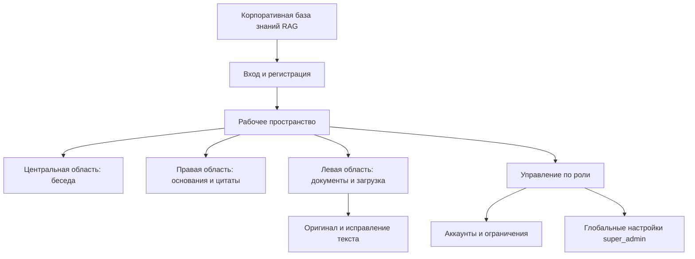
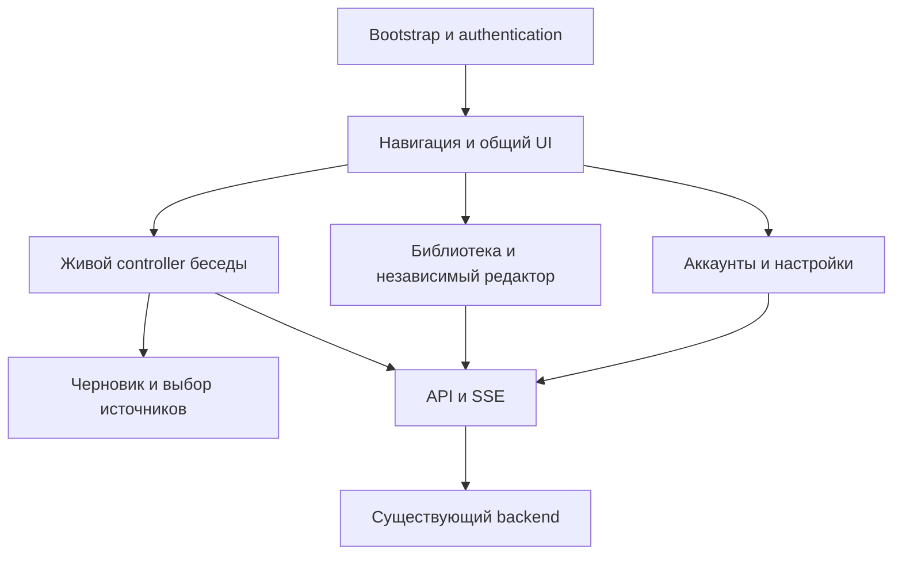
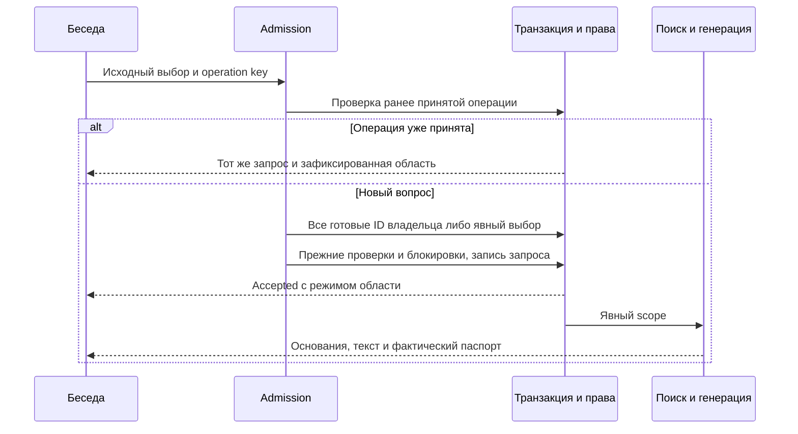
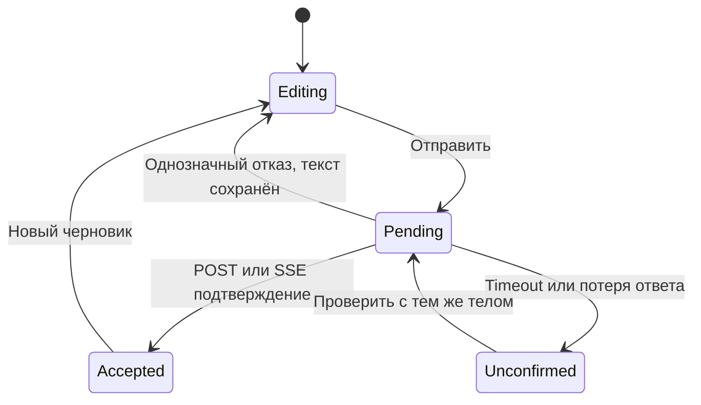
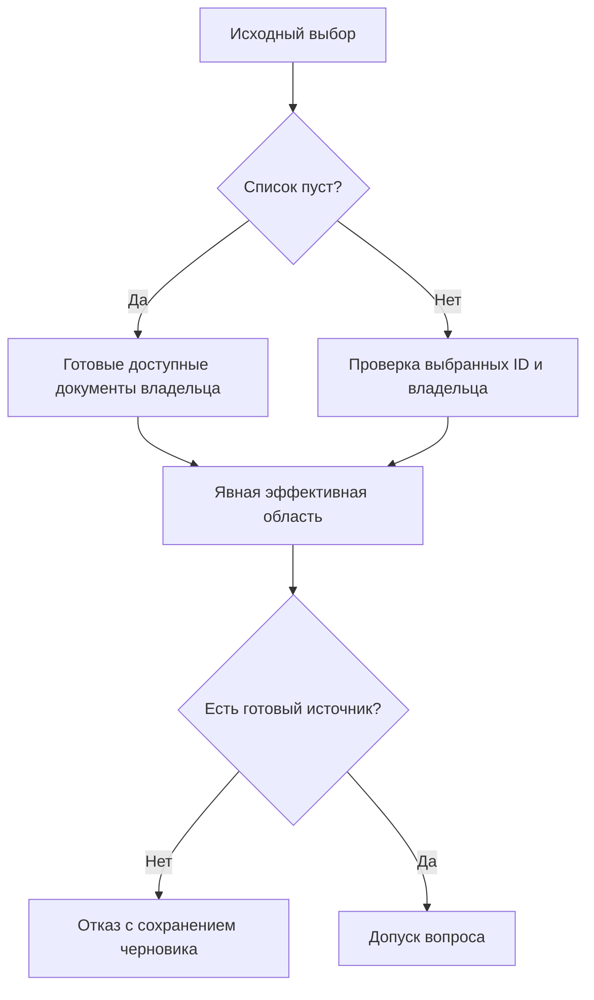

# Frontend Usability Refactor - Plan

## Goal Capsule

- **Objective:** Пользователь корпоративной базы знаний может пройти существующие сценарии работы с документами и ответами через понятный интерфейс, в котором действия дают ожидаемый результат и объясняют ошибки.
- **Means:** Полный рефакторинг фронта по варианту C: три рабочие области — документы, беседа и основания.
- **Product authority:** Поручение пользователя от 2026-10-18; последующее прямое изменение выбора с A на C — «Три рабочие области» после визуального сравнения A/B/C; подтверждение полного охвата ответом «да»; последующие прямые указания переименовать продукт в «Корпоративная база знаний RAG» и искать по всем доступным источникам при пустом выборе, по выбранным — при непустом.
- **Open blockers:** Нерешённых продуктовых вопросов перед техническим планированием нет.

---

## Product Contract

### Summary

Полностью переработать интерфейс существующей корпоративной базы знаний: документы, беседа и основания одновременно доступны в трёх рабочих областях на широком экране; управление открывается отдельным разделом. На узком экране области переключаются с сохранением контекста.
Все существующие действия получают законченные формы, состояния и обратную связь; экраны работают на широком и узком экране и с клавиатурой.

### Problem Frame

Пользователь сообщает, что кнопки не выполняют ожидаемые действия, а компоновка мешает работе.
В исходной версии история, форма вопроса, документы и административные формы находятся в одной длинной колонке; результаты операций выводятся далеко от многих действий.
Исходная проверка отдельно воспроизвела невозможность повторной остановки ответа после временной ошибки, а часть обычных сценариев прошла.
Поэтому визуальная переработка и исправление поведения составляют одну задачу.

### Key Decisions

- **Вариант C — три рабочие области.** Governs R1, R2, R7. (session-settled: user-directed — chosen over chat-first A and library-first B: пользователь последующим прямым указанием заменил прежний выбор A на C. Документы, беседа и основания видны одновременно на широком экране.)
- **Законченный интерфейс всех существующих разделов.** Governs R3, R4, R14, R18. Пользователь отдельно уточнил, что грубые схемы предназначены только для выбора предварительной структуры.
- **Сохранность работы и явные последствия действий.** Governs R8, R16, R17. (session-settled: user-approved — chosen over silent loss of edits and immediate deletion: пользователь подтвердил предложенный охват с защитой правок и подтверждением удаления.)
- **Новое название продукта.** Governs R5. Название задано прямым последующим указанием пользователя; оно не задаёт новую модель доступа к данным.
- **Выбор источников необязателен.** Governs R28–R30. Последующее прямое указание пользователя меняет трактовку пустого выбора; действующие границы владельца и готовности остаются обязательными.

### Actors

- A1. Пользователь работает со своими документами, беседами и ответами.
- A2. Администратор управляет разрешёнными аккаунтами и ограничениями документов в пределах текущих прав.
- A3. Суперадминистратор дополнительно управляет ролями и глобальными настройками и просматривает разрешённую чужую библиотеку.

### Requirements

**Structure and presentation**

- R1. Основной экран следует схеме C: три рабочие области документов, беседы и оснований видны одновременно на широком экране. Список бесед доступен в области беседы; управление открывается отдельным разделом.
- R2. Основания и паспорт занимают третью рабочую область рядом с документами и беседой на широком экране. При выборе ответа там появляются его основания; пустое состояние объясняет назначение области. На узком экране области переключаются с возвратом к тому же месту беседы.
- R3. Все существующие экраны получают согласованную визуальную иерархию заголовков, форм, основных и вторичных действий, отступов и статусов.
- R4. Каждый экран имеет завершённые состояния загрузки, пустого содержимого, результата и ошибки с понятным следующим действием.
- R5. Продукт называется «Корпоративная база знаний RAG» в названии страницы и видимом обозначении приложения.

**Authentication and conversations**

- R6. Вход, регистрация, приглашение, подтверждение email и выход сохраняют существующие правила и дают понятный результат на соответствующем экране.
- R7. Создание и выбор бесед доступны из основной навигации; беседы различимы по содержанию или понятной подписи новой беседы.
- R8. Переходы между беседами и разделами сохраняют неотправленный текст и выбранную пользователем область источников в соответствующем контексте.
- R9. Действующие гарантии черновиков, подтверждения отправки, независимости вкладок и очистки при смене владельца сохраняются по принятому контракту жизненного цикла ответа.
- R10. Пользователь видит причину недоступности отправки и способ продолжить работу без потери введённого вопроса.
- R11. Поиск, очередь, генерация и конечное состояние ответа различимы; временная ошибка остановки позволяет повторить действие, пока запрос остаётся активным.
- R12. Найденные основания доступны до ответа модели, а цитаты открывают исходные фрагменты и сохраняют отметки изменений источника.
- R13. Восстановление соединения и проверка неподтверждённой отправки сохраняют текущую операцию без автоматической повторной генерации.

**Documents and editing**

- R14. Библиотека предоставляет полный текущий цикл загрузки, обработки, выбора режима OCR, просмотра отчёта, открытия документа, скачивания оригинала, исправления и удаления.
- R15. Готовность, неготовность, ошибка обработки и необходимость выбора режима документа показаны различимо с доступными в этом состоянии действиями.
- R16. Обновление статусов или уход из редактора не уничтожает несохранённые исправления без предупреждения и выбора пользователя.
- R17. Удаление документа требует подтверждения с названием документа и объяснением последствий для его дальнейшего использования.

**Administration and context**

- R18. Аккаунты, персональные ограничения документов и глобальные настройки получают отдельный от беседы интерфейс в пределах существующих ролей.
- R19. Просмотр чужой библиотеки явно показывает владельца и режим чтения и имеет понятный возврат к своей библиотеке.
- R20. Глобальные настройки сохраняют просмотр последствий изменения, неизменяемые параметры и различие сохранённой и применённой ревизий.

**Interaction reliability and access**

- R21. Результаты, ошибки и выполняемые действия показываются рядом с соответствующей операцией, а не только в общем сообщении наверху страницы.
- R22. Зависший или отклонённый запрос не оставляет управляющие элементы в необъяснимом постоянном ожидании; повтор учитывает возможность уже выполненной операции.
- R23. Поздний результат запроса не подменяет выбранный раздел, документ, владельца или текущую редакцию данных.
- R24. Навигация, формы, раскрываемые области и диалоги доступны с клавиатуры с видимым фокусом и его понятным восстановлением.
- R25. На узком экране содержимое и основные действия остаются читаемыми и доступными без горизонтальной прокрутки или перекрытия полем вопроса.
- R26. Пользовательский и модельный текст отображается безопасно; действующие проверки прав и границы данных между владельцами сохраняются.
- R27. Действующий способ запуска приложения и локальная конфигурация сохраняют работоспособность после рефакторинга.

**Search scope**

- R28. Если источники не выбраны, вопрос использует для RAG все готовые доступные документы текущего пользователя.
- R29. Если источники выбраны, RAG ограничен выбранными доступными документами и не расширяет область при исключении неготовых или недоступных источников.
- R30. Интерфейс различает поиск по всей доступной библиотеке и по выбранным документам; паспорт сохраняет фактически доступные и использованные источники ответа.

### Key Flows

- F1. **Вход в рабочее пространство.** A1–A3 открывают сервис, проходят соответствующий путь R6 и получают свой разрешённый интерфейс по R1, R4, R18.
- F2. **Вопрос и проверка ответа.** A1 выбирает беседу и документы, отправляет вопрос, наблюдает состояния, при необходимости останавливает ответ и раскрывает основания по R7–R13.
- F3. **Подготовка документа.** A1 загружает файл, при необходимости выбирает режим обработки, проверяет статус и открывает результат по R14, R15.
- F4. **Исправление и удаление.** A1 работает с оригиналом и текстом, сохраняет исправления или подтверждает отказ от них, затем при необходимости подтверждает удаление по R14, R16, R17.
- F5. **Управление.** A2/A3 работают с аккаунтами и лимитами, A3 дополнительно проверяет чужую библиотеку и применённые настройки по R18–R20.

### Acceptance Examples

| Example | Coverage | Trigger and expected result |
| --- | --- | --- |
| AE1. | R4, R6, R22 | Публичные настройки временно недоступны: экран объясняет причину и предлагает повтор; после восстановления вход доступен. |
| AE2. | R8–R10, R28–R30 | Пользователь пишет вопрос и меняет беседу или раздел: при возврате его черновик и область источников сохранены; пустой выбор означает все доступные источники, а недоступность отправки объясняется реальной причиной. |
| AE3. | R11, R21, R22 | Остановка активного ответа получает временный отказ: видна ошибка рядом с действием и доступна безопасная повторная попытка. |
| AE4. | R9, R13, R23 | Подтверждение предыдущей отправки приходит после ввода нового текста или смены беседы: новый текст и текущий экран не потеряны, повторный ответ не запущен. |
| AE5. | R12, R26 | Ответ содержит цитату или загруженный текст с HTML: цитата раскрывает сохранённый фрагмент, а HTML остаётся текстом. |
| AE6. | R14–R17 | Пользователь редактирует текст и обновляет статусы либо уходит со страницы: правки сохраняются или запрашивается явное решение; удаление можно отменить. |
| AE7. | R18–R20, R26 | Пользователь входит с разными ролями: видит только доступные действия; чужая библиотека подписана, редактирование и собственная библиотека не смешиваются. |
| AE8. | R2, R24, R25 | На узком экране пользователь открывает основания и возвращается: вопрос и место беседы сохранены, управление доступно с клавиатуры. |
| AE9. | R26, R28, R30 | В личной библиотеке есть несколько готовых документов и источник другого владельца: вопрос без выбора ищет по всем своим готовым документам, а чужой и неготовый материалы не входят в поиск. |
| AE10. | R29, R30 | Выбран один документ, а нужный фрагмент есть только в другом: невыбранный документ не попадает в поиск, историю контекста или паспорт как использованный источник. |
| AE11. | R10, R28, R29 | В эффективной области нет готовых доступных документов: вопрос остаётся черновиком с объяснением, без новой истории или автоматической отправки при последующей готовности. |

### Success Criteria

Приёмка подтверждает существующие сценарии каждого раздела и AE1–AE11 в реальном браузере, включая ошибки взаимодействий.
Компоновка проверяется минимум на ширинах 375, 768 и 1440 CSS px и с клавиатурой.
Временные и подменённые сетевые ответы используются для проверок отказов, но не заменяют реальные сценарии аккаунтов, документов и ответа модели.
Грубые схемы и одни успешные модульные тесты не являются приёмкой окончательного интерфейса.

### Scope Boundaries

Работа охватывает существующий фронт, серверную трактовку области поиска по R28–R30 и необходимую проверку интеграции с текущим приложением.
Смена моделей, новая организация SQL-хранилища и добавление отсутствующих возможностей всего MVP не входят в эту задачу.
Новое название по R5 сохраняет действующие границы доступа по R26.

### Dependencies and Assumptions

Доступность API, регистрации, обработки документов и генерации проверяется в воспроизводимом окружении с существующими локальными ресурсами.
Исходные браузерные тесты отдельных worker требуют передачи путей моделей из действующих настроек; их отсутствие уже дало ошибки окружения и не должно приниматься за отказ кнопок.
Наблюдавшаяся недоступность исходного frontend-порта требует отдельной проверки обычного запуска по R27.

### Sources and Research

- `harness/project/docs/2026-10-18-frontend-refactor-audit.md` — карта экранов, дефекты и проверенное исходное состояние.
- `harness/project/testing/evidence/work/2026-10-18-frontend-refactor-baseline-v1.md` — пять успешных исходных сценариев после подготовки окружения и воспроизведение отказа остановки.
- `harness/project/testing/evidence/work/2026-10-18-frontend-drafts-reducer-baseline-v1.log` — две успешные проверки состояния и отказ браузерного теста без пути модели: вместо ожидаемого no_ready_sources получен tokenizer_unavailable.
- `harness/project/docs/plans/2026-10-13-0244-feat-rag-answer-lifecycle-plan.md` — принятый контракт черновиков, передачи ответа, источников и разграничения данных; применяется в R9, R12, R13, R26.
- `harness/project/docs/2026-10-16-service-entrypoints.md` и `harness/project/docs/2026-10-16-application-settings.md` — текущий запуск, публичные ограничения и конфигурация.
- `frontend/index.html`, `frontend/src/app.js`, `frontend/src/conversations.js`, `frontend/src/drafts.js`, `frontend/src/api.js` — текущие состояния, действия и подтверждённые места дефектов.

---

## Planning Contract

Product Contract updated by user direction: R1–R2 следуют варианту C вместо A; остальные R3–R30, A1–A3, F1–F5 и AE1–AE11 сохраняются. Пользователь подтвердил plan-time охват и фиксацию состава готовых документов при приёме вопроса.

### Key Technical Decisions

- KTD1. Сохранить native JavaScript ESM и существующий Python HTTP launcher; выделить навигацию/общие UI-операции, документы и управление в отдельные модули. Это позволяет менять представления без пересоздания controller беседы. Governs R1–R4, R18, R27.
- KTD2. При пустом исходном выборе разрешать явный owner-ready набор ID внутри текущей транзакции admission и сохранять его в Request.scope. Fingerprint вычислять по первоначальному телу запроса. Первый replay-check остаётся до tokenization; для новой операции candidate scope разрешается до упорядоченных document locks. Второй replay-check остаётся после document/tab/conversation locks, перед проверкой готовности и INSERT, и возвращает сохранённый запрос с прежним scope независимо от нового candidate набора. Режим и исходный выбор хранить в существующем passport JSON, передавать в accepted SSE и сохранять при prepare. Governs R9, R13, R26, R28–R30. (session-settled: user-approved — chosen over adding later documents to an already accepted question: пользователь подтвердил фиксацию состава источников при приёме вопроса.)
- KTD3. Сохранить SQLAlchemy expressions, готовые Alembic-ревизии и существующий Database/session lifecycle по согласованиям `harness/project/docs/2026-10-15-sqlalchemy-reference-analysis.md`. Новые режимы не требуют новой схемы; явный scope сохраняет текущие history/guard/document-lock проверки. Governs R26–R30.
- KTD4. Хранить выбор источников вместе с owner/conversation/tab-черновиком, независимо от текущего DOM списка. Отсутствующий выбранный ID остаётся явно недоступным до ручного снятия выбора; pending body не изменяется новыми правками. Governs R8–R10, R13, R23, R28–R30.
- KTD5. Общий слой операций связывает busy/feedback с конкретным действием, а async-результаты проверяют идентичность сессии и поколения чтения. Публичный request timeout задаётся в текущем frontend TOML и передаётся разрешённым meta-полем; timeout записи означает неизвестный результат, а не разрешение повторить мутацию. Governs R4, R6, R11, R21–R23, R27.
- KTD6. Редактор документа имеет независимое состояние владельца, ID, базовой ревизии, исходного и рабочего текста и принятых исправлений. Обновление списка не пересоздаёт редактор; принятые исправления показываются как ожидающие публикации и не отправляются повторно до разрешения состояния. Object URL освобождаются только при замене/закрытии соответствующего просмотра. Governs R14–R17, R23.
- KTD7. Общие семантические области и native dialog обслуживают подтверждение удаления/потери правок и восстановление фокуса. Документы, беседа и основания образуют три одновременно видимые области на широком экране. Один DOM каждой области сохраняет редактор, composer и поток; узкий экран переключает области, не создавая второй экземпляр состояния. Governs R1–R4, R8, R16, R17, R24, R25.
- KTD8. Единая система CSS-токенов задаёт типографику, интервалы, поверхности, акцент и состояния; интерфейс использует локальные системные шрифты и статические inline SVG. Полностью проработать все формы и состояния по R3, без декоративных экранов-заглушек. Governs R3–R5, R24, R25.

### High-Level Technical Design

Снимок фиксирует членство документов; ревизия каждого документа определяется существующим prepare и фактическими зависимостями. Динамический wildcard отклонён: он требует новых согласованных правил истории и блокировок и даёт лишние точки расхождения; исследование достаточно для выбора KTD2 без отдельного экспериментального bake-off.

### System-Wide Impact

Пустой document_ids получает новую семантику только для новых операций. Непустые запросы сохраняют строгую область; старые паспорта без метаданных режима читаются как прежний явный выбор. Исключение неготовых источников не переключает явный выбор на всю библиотеку. Существующие данные, SQL-схема, модели, способы запуска и проверки доступа остаются соответствующими R26, R27, KTD3.

### Risks and Dependencies

- Потерянное подтверждение записи: применять KTD5, не повторять автоматически upload admission, correction или settings; ответ модели проверять по прежнему operation key.
- Поздние результаты списков/редактора/чужой библиотеки: применять KTD5, KTD6; чужая библиотека никогда не становится inventory выбора вопроса.
- Регрессии потока и черновиков: сохранить reducer/version merge и existing SSE heartbeat; проверить ранние фрагменты, delayed ACK и stale snapshots.
- Принятая correction ещё не опубликована: сохранить рабочий текст по KTD6 и различать очередь и новую опубликованную ревизию.
- Браузерные fixtures требуют установленного Chromium, PostgreSQL/pgvector и путей существующих моделей; передать их через текущий loader в окружение изолированных тестов без вывода секретов. Headed restore/duplicate проверки требуют действующего дисплея или имеющегося Xvfb.

---

## Implementation Units

### U1. Optional source selection through admission and passport

**Goal:** Реализовать R28–R30 с сохранением серверных гарантий R9, R13, R26.

**Requirements:** R9, R12, R13, R26, R28–R30; F2; AE9–AE11.

**Dependencies:** Нет.

**Files:** `backend/app/answers.py`, `backend/app/sources.py`, `backend/app/rag.py`, `backend/tests/test_admission.py`, `backend/tests/test_source_contract.py`, `backend/tests/test_rag_context.py`, `backend/tests/test_frontend_reducer.py`.

**Approach:** Применить KTD2, KTD3. Добавить узкое чтение всех готовых собственных ID, сохранить исходное тело отдельно от эффективного scope и протянуть метаданные accepted/prepare. Исправить тестовый helper с `scope or default`, чтобы [] действительно проверял пустой выбор.

**Patterns to follow:** Два replay-check в answers.admit, available_source_revisions, RequestSource, существующие ordered document locks и passport serialization.

**Execution note:** Сначала воспроизвести новую семантику отдельными интеграционными проверками на изолированной БД.

**Test scenarios:**

- Covers AE9. Пустой выбор включает несколько готовых собственных документов и исключает чужие/нецелостные ревизии.
- Covers AE10. Непустой выбор исключает невыбранный документ из retrieval и history dependencies.
- Covers AE11. Пустая эффективная библиотека оставляет вопрос без истории/очереди; поздняя готовность сама не запускает его.
- Повтор той же операции после добавления документа возвращает прежний scope; изменение исходного тела с тем же ключом по-прежнему конфликтует.
- Accepted SSE и snapshot сохраняют режим до появления fragments; prepare сохраняет его после заполнения паспорта.
- Correction/deletion не обходят текущие guard и owner проверки нового all-mode запроса.

**Verification:** Серверные регрессии подтверждают KTD2 без изменения схемы и без wildcard в сохранённом scope.

### U2. Application shell, authentication and shared operations

**Goal:** Дать пользователю рабочие вход, навигацию и понятную обратную связь в новой компоновке.

**Requirements:** R1, R3–R7, R18, R21–R27; F1; AE1, AE7, AE8.

**Dependencies:** Нет; конечная интеграция использует U1.

**Files:** `frontend/index.html`, `frontend/src/styles.css`, `frontend/src/app.js`, новые `frontend/src/ui.js` и `frontend/src/navigation.js`, `frontend/src/api.js`, `frontend/main.py`, `frontend/config/service.toml`, `frontend/config/service.local.example.toml`, `backend/tests/test_frontend_launcher.py`, `backend/tests/browser/test_accounts.py`, новый `backend/tests/browser/test_frontend_workspace.py`.

**Approach:** Применить KTD1, KTD5, KTD7, KTD8. Сохранить идентификаторы бизнес-областей, разделить вход/регистрацию и рабочие разделы, поддержать понятный возврат и допустимые по роли переходы. Начальные verification/invite данные держать в приватном bootstrap-состоянии до завершения соответствующей операции. Общие настройки и placeholder template остаются Git-visible, рабочие local overrides не изменяются.

**Patterns to follow:** Текущий public-settings allowlist, frontend TOML loader, session_changed check, semantic labels/dialog/details, безопасный textContent.

**Test scenarios:**

- Covers AE1. Сбой первой публичной политики и успешный повтор включают формы с правильными ограничениями.
- Реальные регистрация/verification/login/logout и приглашение работают через новый переключатель форм; URL-токен не теряется при повторе политики.
- Covers AE7. Навигация пользователя/admin/super_admin показывает разрешённые разделы и корректно обрабатывает недоступный прямой переход.
- Covers AE8. Клавиатура и узкий экран дают доступ к навигации и возврату; timeout/ошибка не оставляют кнопку постоянно busy.
- Новый публичный timeout проходит в HTML, не раскрывая backend config; GET/HEAD allowlist и обычное завершение launcher сохраняются.

**Verification:** Реальный account browser suite и frontend launcher/public-settings проверки проходят с новой оболочкой; независимые рабочие разделы не уничтожают сессию.

### U3. Conversation workspace and per-conversation scope

**Goal:** Завершить область беседы, выбор источников, потоковые ответы и постоянную соседнюю область оснований по варианту C.

**Requirements:** R1, R2, R7–R13, R21–R26, R28–R30; F2; AE2–AE5, AE8–AE11.

**Dependencies:** U1, U2.

**Files:** `frontend/src/conversations.js`, `frontend/src/drafts.js`, `frontend/src/styles.css`, `frontend/index.html`, `backend/tests/test_frontend_reducer.py`, `backend/tests/browser/test_answer_lifecycle.py`, `backend/tests/browser/test_frontend_workspace.py`.

**Approach:** Применить KTD4, KTD7. Различать беседы по первой известной реплике/подписи новой беседы, оставить DOM composer/cards стабильным и добавить локальное управление stop. Непустые недоступные ID отобразить удаляемыми выбранными элементами, не фильтровать их из тела молча. Паспорта старого и нового формата читать совместимо. В каждой беседе хранить выбранный ответ, по умолчанию последний запрос; доступное с клавиатуры действие «Показать основания» на карточке выбирает его для третьей области. На узком экране переключатель оснований отмечает появление новых фрагментов без переноса фокуса; открытие области снимает отметку.

**Test scenarios:**

- Covers AE2. Черновик и область каждой беседы независимы, переживают переходы/reload и очищаются согласно прежнему owner/tab контракту.
- Covers AE3. 503 остановки разрешает повтор; terminal SSE до позднего POST не возвращает активную кнопку.
- Covers AE4. Потерянный POST и accepted SSE согласуют один запрос; новый текст/выбор не стираются ACK и старым snapshot.
- Covers AE5. Основания видны до текста модели, цитата открывает исходный фрагмент, HTML остаётся текстом. Выбор старого ответа и смена беседы показывают основания выбранного ответа; на 375 px появление фрагментов отмечается в переключателе без потери фокуса.
- Covers AE8. Переключение рабочих областей и переход к цитате сохраняют фокус, прокрутку и вопрос на узком и широком экране.
- Covers AE9–AE11. UI ясно показывает all/selected; исчезновение последнего выбранного ID не расширяет область, ручное снятие последнего выбора включает all.

**Verification:** Реальная интеграция беседы и управляемые отказы подтверждают R9–R13 без замены доказательств seeded или mocked-only сценарием.

### U4. Document library and durable editor state

**Goal:** Полностью проработать библиотеку, обработку и редактирование документов.

**Requirements:** R3, R4, R8, R14–R17, R19, R21–R26; F3, F4; AE5–AE8.

**Dependencies:** U2, U3.

**Files:** новый `frontend/src/documents.js`, `frontend/src/app.js`, `frontend/index.html`, `frontend/src/styles.css`, `backend/tests/browser/test_documents.py`, `backend/tests/browser/test_frontend_workspace.py`.

**Approach:** Вынести библиотеку и независимый editor controller по KTD6; хранить owner/read-only контекст отдельно от собственного inventory вопроса. Добавить guards ухода/удаления и локальную обратную связь; реальное завершение доступа немедленно очищает приватное содержимое. Список обновляет статусы без потери editor DOM.

**Test scenarios:**

- Реальные TXT/PDF upload, OCR choice/cancel, отчёт, оригинал, страницы и correction доступны через новую навигацию.
- Covers AE6. Refresh не уничтожает правки; отмена ухода/удаления сохраняет ввод; подтверждение удаления называет документ и корректно возвращает фокус.
- Неуспешный или конфликтующий save сохраняет рабочий текст; принятый queued save не отправляется второй раз по старой base_revision.
- Частичный upload/неизвестный результат не вызывает автоматический повтор admission и показывает актуальный список принятых файлов.
- Covers AE7. Чужая библиотека подписана, readonly, refresh сохраняет владельца; возврат не меняет область вопроса.
- Два обратных порядка ответов list/editor не открывают старый документ или чужую библиотеку в новом контексте.

**Verification:** Пройдены настоящие сценарии документов и контролируемые editor/library race проверки; object URL не освобождаются у активного просмотра.

### U5. Accounts, document policies and generation settings

**Goal:** Завершить отдельный рабочий раздел управления по ролям.

**Requirements:** R3, R4, R18–R26; F5; AE7.

**Dependencies:** U2, U4.

**Files:** новый `frontend/src/administration.js`, `frontend/src/app.js`, `frontend/index.html`, `frontend/src/styles.css`, `backend/tests/browser/test_accounts.py`, `backend/tests/browser/test_frontend_workspace.py`.

**Approach:** Перенести текущие account/policy/settings операции в предметный controller, сохранить permission checks и KTD5. Действия на карточках имеют локальные статусы; у полей ясные подписи и ограничения. Изменения глобальных параметров проходят прежний preview/save/apply путь R20.

**Test scenarios:**

- Covers AE7. Реальный operator/admin/user путь изменения роли, блокировки, деактивации и выхода соблюдает доступ и видимость действий.
- Разрешения форматов/рукописей и положительные лимиты сохраняются с понятной ошибкой при отказе.
- Settings preview показывает изменения и область действия; read-only параметры не редактируются; сохранённая/применённая ревизии различимы.
- Ошибка/timeout сохранения не уничтожает форму и не вызывает автоматический повтор записи; старое чтение не подменяет новое.
- Переход к чужой библиотеке и возврат соблюдают R19 без доступа admin к её содержимому.

**Verification:** Реальные role/settings/policy сценарии и новые controlled failures проходят через конечный интерфейс управления.

### U6. Whole-application acceptance and ordinary startup

**Goal:** Подтвердить готовность полного переработанного фронта по всем требованиям и убрать заменённый код.

**Requirements:** R1–R30, F1–F5, AE1–AE11 и Success Criteria.

**Dependencies:** U1–U5.

**Files:** `backend/tests/browser/test_accounts.py`, `backend/tests/browser/test_documents.py`, `backend/tests/browser/test_answer_lifecycle.py`, `backend/tests/browser/test_invalidation.py`, `backend/tests/browser/test_frontend_workspace.py`, `harness/project/docs/2026-10-16-application-settings.md`, новые датированные результаты в `harness/project/testing/evidence/work/` и прикладное описание интерфейса в `harness/project/docs/`.

**Approach:** Проверить Verification Contract, пройти пользовательские действия на готовых экранах, визуально осмотреть снимки и выполнить обычный frontend запуск. Обновить старые locators под осмысленные названия/разделы/подтверждения, сохранив смысл сценариев. Удалить заменённые обработчики/стили; временные пробы не включать в production.

**Test scenarios:**

- Реальные signup→upload→all/selected question→fragments/answer/citation→stop/retry→edit/delete и административные сценарии на конечном UI.
- Повтор при недоступном API, задержанные ответы, утрата сессии, разные роли и независимые вкладки.
- Все основные разделы на ширинах Success Criteria без overflow/перекрытий; keyboard и диалоги с возвратом фокуса.
- Обычный launcher отдаёт конечный HTML/модули, применяет public config и корректно завершает свой процесс; готовность модели не подменяется одной созданной сессией процесса.

**Verification:** Каждое требование имеет текущее доказательство либо явный незакрытый дефект; задача не объявляется готовой при незавершённом пункте.

---

## Verification Contract

Команды выполняются из корня проекта в существующем окружении. Путь запуска pytest — `backend/.venv/bin/pytest`; рабочие и тестовые Python-зависимости подготавливаются только существующим uv workflow при необходимости. Перед native/browser tests окружение получает существующие пути моделей из service loader; DSN и SMTP задаются изолированными fixtures, не рабочими значениями установки.

| Check | Command or method | Coverage |
| --- | --- | --- |
| Source scope | `backend/.venv/bin/pytest backend/tests/test_admission.py backend/tests/test_source_contract.py backend/tests/test_rag_context.py -q` | U1; оба режима, isolation, replay, history, passport |
| State and public serving | `backend/.venv/bin/pytest backend/tests/test_frontend_reducer.py backend/tests/test_frontend_launcher.py backend/tests/test_public_settings.py -q` | U2, U3; scope/drafts, launcher/config allowlist |
| Real frontend flows | `backend/.venv/bin/pytest backend/tests/browser/test_accounts.py backend/tests/browser/test_documents.py backend/tests/browser/test_answer_lifecycle.py backend/tests/browser/test_invalidation.py -q` | U2–U6; настоящие API/SMTP/документы/модель/инвалидация |
| Controlled UI failures | `backend/.venv/bin/pytest backend/tests/browser/test_frontend_workspace.py -q` | U2–U5; сбои/гонки/dirty guards/focus/navigation |
| Relevant backend regression | `backend/.venv/bin/pytest backend/tests/test_stream_recovery.py backend/tests/test_invalidation.py backend/tests/test_documents.py backend/tests/test_settings.py backend/tests/test_accounts.py -q` | Изменённые интеграционные границы U1–U5 |
| Visual and keyboard | Реальный Chromium, снимки и действия всех конечных разделов по Success Criteria | U6; полная проработка, не только DOM assertions |
| Ordinary startup | `python3 frontend/main.py` с существующими настройками и фактическая HTTP/модульная проверка, затем остановка только принадлежащего задаче процесса | R27; если пользовательский порт занят, его процесс не останавливать |
| Diff and ownership | `git diff --check`; осмотр явного списка изменённых файлов | Сохранность пользовательских файлов и отсутствие экспериментального кода |

Новые application evidence сохраняются отдельными файлами; предыдущие сырые логи/снимки не перезаписываются. Headed restore-проверки сохраняют прежний профиль/extension контракт. Невыполненный или упавший запуск не считается успешным; технические ошибки prerequisite исправляются в существующей разрешённой установке.

---

## Definition of Done

- U1 завершён, когда AE9–AE11 доказаны через admission/retrieval/history/passport и старые guard/replay контракты сохранены.
- U2 завершён, когда все пути входа и разрешённая навигация работают с локальной обратной связью и проверенным публичным config.
- U3 завершён, когда реальные ответы, источники, stop/retry, pending ACK и независимые черновики работают в выбранной схеме C с тремя рабочими областями.
- U4 завершён, когда все существующие операции документов доступны, правки защищены и контекст владельца не смешивается.
- U5 завершён, когда роли, policies и глобальные настройки проходят конечные формы и ошибки не оставляют их неработоспособными.
- U6 завершён, когда требования и Success Criteria подтверждены текущим браузером/проверками, обычный запуск проверен и существенные дефекты закрыты.
- Финальный diff содержит только относящиеся к задаче изменения; заменённые обработчики, мёртвые стили и код неудавшихся проб удалены.
- Источники пользователя и прежние evidence сохранены; полный рефакторинг не подменяется готовностью схем, переименованием или одним успешным тестом.
