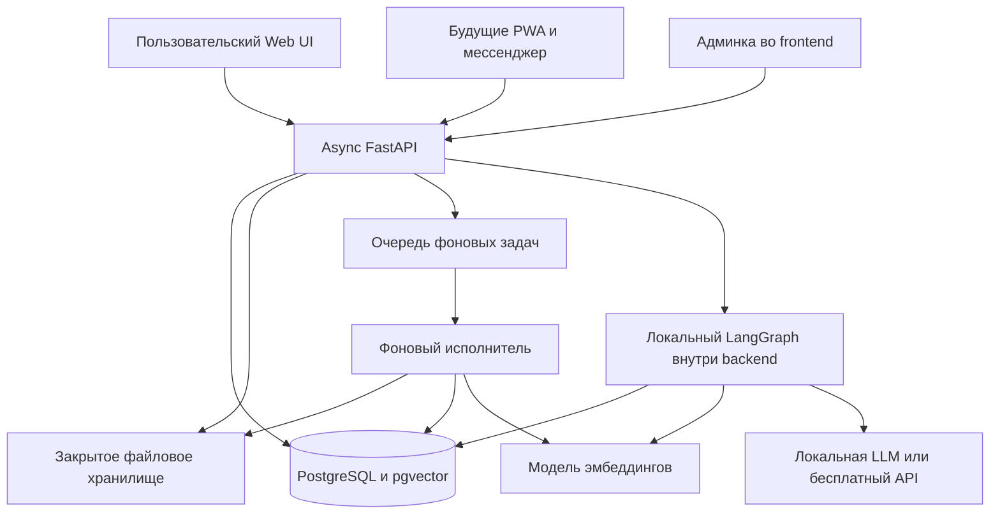

# Предварительная архитектура многопользовательского RAG-портала

Дата обновления: 2026-10-03.

Документ фиксирует выбранную пользователем основу. Рекомендации и решения на согласование отделены от подтверждённых требований. Уточнения архитектуры вносятся в этот файл.

Итог повторной проверки идеи: [idea-review.md](idea-review.md). Согласование продукта не означает завершения технического проектирования, запуска реализации или возобновления отложенных API-проб.

## 1. Зафиксированные решения

| Решение | Основание и последствия |
| --- | --- |
| Один прикладной backend | Общие операции для пользовательского веб-интерфейса, будущих клиентов и административных действий. |
| Гибридный монолит | Один проект с папками `backend/` и `frontend/`. У частей независимые зависимости, конфигурация, запуск и развёртывание; каждая может размещаться на отдельной машине. |
| API на async FastAPI | Выбор пользователя. Асинхронный ввод-вывод для запросов к БД и AI-провайдерам; тяжёлая обработка файлов вынесена из процесса API. |
| Фоновая обработка документов | Парсинг, нарезка, создание эмбеддингов и индексация выполняются отдельно от HTTP-запроса загрузки. |
| Файловое хранилище | Оригиналы документов сохраняются отдельно от поискового индекса. Конкретное размещение хранилища ещё не выбрано. |
| PostgreSQL с pgvector | Основная БД для прикладных данных и векторов. Отдельная векторная БД на старте не требуется выбранной архитектурой. |
| Аккаунты и внутренняя админка сразу | Вход, идентификация пользователя и административный интерфейс входят в первый релиз. Админка через API выбрана; конкретная библиотека аккаунтов ещё не утверждена. |
| Вход по email/паролю | Выбор пользователя. OIDC/SSO не входят в выбранный начальный сценарий. Конкретная библиотека аккаунтов ещё не утверждена. |
| Самостоятельная регистрация с подтверждением email | Подтверждено пользователем 2026-10-03. Email подтверждается при регистрации до доступа к загрузке и RAG; подтверждение не снимает административную блокировку. |
| Масштаб MVP | 30 пользователей, до 10 одновременно. Это целевая нагрузка, а не результат нагрузочного теста. |
| Параллельная генерация и очередь | По умолчанию 3 одновременные асинхронные генерации на сервис, остальные запросы ждут в очереди. Лимит задаётся в отдельном конфигурационном файле и применяется при запуске сервиса. Подтверждено пользователем 2026-10-03. |
| Форматы и OCR | PDF, DOCX, TXT, Markdown и OCR входят в MVP. Подтверждён OCR русского, белорусского, английского и немецкого печатного текста в PDF. Рукописи и отдельная загрузка фотографий не входят в выбранные границы OCR. Распознавание выполняется фоновым worker. |
| Начальные лимиты документов | 50 МБ на файл, 500 страниц на PDF, до 20 файлов в одной загрузке, до 1000 документов и 2 ГБ оригиналов на пользователя. Подтверждено пользователем; все значения настраиваются в конфигурации. |
| Три роли | `user`, `admin`, `super_admin`. Обычный администратор не читает чужие документы и переписки; super-admin имеет явное право их чтения через защищённый административный API. |
| Только личные библиотеки в MVP | Без организаций, команд, общих папок и предоставления документов другим пользователям. Подтверждено пользователем; административное право чтения super-admin сохраняется и не означает совместный RAG. |
| История после удаления документа | Прежние ответы сохраняются с отметкой «источник удалён» и исключаются из дальнейшего контекста модели. Удалённый материал также исключается из поиска, checkpoint-состояния и резюме, используемых для новых ответов. |
| Только мягкое удаление аккаунта в MVP | `active=False` означает мягкое удаление с сохранением документов и переписки. Физическое удаление аккаунта и всех его данных в MVP не входит. |
| Будущая активация доступа оплатой | Направление подтверждено пользователем; провайдер, тарифы и реализация биллинга пока не выбраны. Сам биллинг не входит в текущую реализацию. |
| Весь веб-интерфейс работает через API | Пользовательский кабинет и админка находятся во frontend и вызывают API backend. У браузера нет прямого доступа к БД, хранилищу или секретам AI-провайдера. |
| Админка через API | Выбор пользователя. Административные маршруты FastAPI проверяют права, вызывают общие операции и фиксируют изменения. Готовая ORM-панель не выбрана. |
| Приоритет состояний доступа | Сначала `active`, затем `disabled`, затем `paid`. `active=False` — мягкое удаление; `disabled=False` — административное отключение по выбранной пользователем семантике; `paid=False` — не оплачен, `paid=True` — оплачен. Для MVP `paid` не проверяется. |
| Область поиска | По умолчанию все готовые личные документы; при создании беседы можно выбрать конкретный набор. Удаление выбранных документов не расширяет поиск на остальные без выбора пользователя. |
| Ограничения при прекращении доступа | Запрет новых защищённых операций, прекращение дальнейшей выдачи ответа, остановка фоновой обработки на безопасной границе. Документы и история сохраняются. Правила действуют для мягкого удаления, административного отключения и в будущем отсутствия оплаченного доступа. |
| Резервные копии | Согласованная копия БД и оригиналов ежедневно, срок хранения каждой копии 7 дней. Для MVP пользователь выбрал папку `_RESERVED_COPIES/` в корне проекта на том же диске; папка и всё содержимое исключены через `.gitignore`. Это не защищает от отказа диска. При восстановлении учитываются последующие удаления и изменения доступа. |
| Беседы сохраняются на сервере | История сообщений принадлежит аккаунту и не зависит от открытой вкладки браузера. |
| Потоковый ответ и остановка | Подтверждено пользователем: текст появляется постепенно по мере генерации, в UI есть кнопка остановки. Поток передаётся через HTTP API (SSE); остановка выполняется серверной операцией с проверкой владельца беседы. |
| Приёмка качества RAG | Все 30 из 30 заранее подготовленных контрольных вопросов по реальным документам должны дать корректный результат. Допустимого числа ошибок нет. Все проверки прав, удаления и очереди также должны пройти. Это требование к будущей приёмке, а не уже достигнутое качество. |
| Локальный агент LangGraph внутри backend | Async FastAPI вызывает граф асинхронно. Граф учитывает контекст, выполняет разрешённый RAG-поиск, вызывает LLM и сохраняет состояние. |
| Состояние LangGraph в PostgreSQL | Используется `AsyncPostgresSaver`; `thread_id` идентифицирует беседу, но не даёт права доступа. Backend проверяет владельца до любого обращения к её состоянию. |
| Модели локального MVP утверждены | `multilingual-e5-small` ONNX INT8 через ONNX Runtime CPU для эмбеддингов; `Qwen3.5-2B` GGUF Q4_K_M через llama.cpp CPU для генерации. Выбор подтверждён пользователем 2026-10-03 после локальных проб. Базовые настройки: `-t 4 -tb 8`, контекст запроса 4096, thinking выключен. Лимит генераций теперь 3 по умолчанию; прежние измерения выполнены с одним слотом. |
| Бесплатный внешний LLM как fallback | Если локальная LLM слишком медленная или не проходит проверку качества, эмбеддинги остаются локальными, генерация может использовать только проверенный бесплатный API. Платное переключение запрещено. |
| Проверка GLM отложена до необходимости fallback | По указанию пользователя проверка нативной `glm-4.7-flash` остановлена 2026-10-03. Если понадобится внешний fallback, сравнить режимы с thinking и без него, русский RAG, задержки и ограничения API. В локальном MVP этот маршрут не включается. |

«Один backend» означает одну прикладную систему и общий код операций, а не один процесс. Процессы API и фонового исполнителя запускаются отдельно. PostgreSQL, брокер задач и возможный провайдер идентификации — инфраструктурные компоненты.

### Гибридный монолит и независимое размещение

Термин «гибридный монолит» в этом проекте означает общий проект с независимо запускаемыми backend и frontend, связанными контрактом HTTP API. Размещение на одной машине не является обязательной зависимостью.

Целевая структура:

```text
Multi-Users_RAG_Assistants/
├── backend/    # Async FastAPI, аккаунты, RAG и код фонового исполнителя
├── frontend/   # Пользовательский кабинет и административные экраны
└── _docs/      # Документация проекта
```

- У `backend/` и `frontend/` собственные зависимости и команды установки, запуска и сборки, где сборка требуется. Запуск одной части не требует запуска другой; пользовательские операции frontend требуют доступного API.
- Frontend не импортирует код backend и не читает его файлы. Backend не зависит от наличия исходников или сборки frontend на своей машине.
- Адрес API задаётся конфигурацией frontend; он не привязан к `localhost` или фиксированной машине. Backend отдельно конфигурирует доступ к PostgreSQL, хранилищу, очереди и AI-провайдерам.
- Перенос frontend или backend на другую машину требует развёртывания соответствующей части и изменения адресов/конфигурации, а не переписывания прикладной логики. Backend сохраняет сетевой доступ к инфраструктуре; перенос самих данных — отдельная операция.
- Контракт API и совместимость версий связывают части при независимом развёртывании. Внутренние пути каталогов не являются частью этого контракта.
- Веб-сервер или reverse proxy может маршрутизировать frontend и API на разные машины под одним публичным origin. Если origin различаются, настраиваются разрешённые CORS origins, передача credentials, cookie и CSRF-защита; выбор cookie не требует размещения частей на одной машине, но браузерные ограничения нужно учитывать.
- Секреты backend не включаются в конфигурацию или сборку frontend. Административная роль проверяется сервером; скрытие экрана во frontend не заменяет проверку прав.

## 2. Состав и связи



Пользовательский кабинет и админка — части frontend, взаимодействующие с backend через API при совместном или раздельном размещении. LangGraph работает локально в backend; выбранный режим исполнения графа не зависит от места размещения LLM. Эмбеддинги остаются локальными и при внешней генерации. Очередь и постоянное файловое хранилище ещё не выбраны. Подбор моделей и результаты проб фиксируются в [local-ai.md](local-ai.md).

### Загрузка и поиск

1. API проверяет пользователя и ограничения файла, сохраняет оригинал и запись документа с владельцем.
2. Сохранённая операция обработки получает идентификатор; клиент узнаёт состояния каждого файла через API.
3. Фоновый исполнитель извлекает текст, при необходимости выполняет OCR, формирует фрагменты, получает эмбеддинги и сохраняет индекс в PostgreSQL. Для смешанных PDF обработка учитывает страницы с текстовым слоем и страницы со сканами; неполное извлечение не должно молча считаться полным успехом.
4. Файл становится доступным для RAG после успешного завершения нужных этапов. Готовность части пачки не скрывает ошибки остальных файлов.
5. Повтор обработки не должен создавать повторные фрагменты или возвращать к использованию документ, удалённый во время выполнения задачи.

Надёжность постановки задания должна охватывать сбой между записью документа в PostgreSQL и отправкой в брокер: сохранённая операция позволяет обнаружить и повторно поставить пропущенную задачу. Конкретный механизм выбирается при реализации.

### Вопрос и ответ

1. API проверяет владельца беседы и определяет разрешённую область документов.
2. Из истории собирается ограниченный контекст текущего вопроса; полная история хранится отдельно.
3. Поиск выполняется только по разрешённым документам. Найденные фрагменты передаются LLM как данные вместе с вопросом и контекстом беседы.
4. Сервер сохраняет сообщение и ответ, включая ссылки на использованные источники. Неуспешная генерация не выдаётся за завершённый ответ.
5. Открытие источника повторно проверяет доступ. При недостатке оснований помощник сообщает об этом.

Кнопка остановки прекращает генерацию на сервере, а не только отображение текста в браузере. Уже показанный фрагмент отмечается как прерванный и не считается завершённым ответом; он не должен автоматически использоваться как полноценный ответ в последующем контексте. Слот параллельной генерации освобождается после подтверждённой остановки. Отмена ожидающего запроса удаляет его из очереди исполнения. Остановка не удаляет саму беседу.

RAG использует документы при запросе и не означает обучение LLM. Выбран LangGraph с явными шагами поиска и генерации; наличие графа не требует автономных инструментов, выполнения команд или неограниченного цикла вызовов модели.

### Конфигурация параллельных генераций

Утверждённое поведение: отдельный файл конфигурации backend, загрузка при старте сервиса, значение по умолчанию 3. Предлагаемый путь и формат для реализации — `backend/config/runtime.toml`:

```toml
[generation]
max_concurrent = 3

[documents]
max_file_bytes = 50000000
max_pdf_pages = 500
max_files_per_upload = 20
max_documents_per_user = 1000
max_original_bytes_per_user = 2000000000
```

Значения `[documents]` отражают принятые пользователем начальные лимиты. МБ и ГБ используются в десятичном смысле; квота 2 ГБ относится к оригиналам, а не к суммарному размеру индекса, OCR-данных и резервных копий. Лимиты проверяются backend, включая параллельные загрузки; ограничений только в UI недостаточно. Лимит страниц применяется к PDF до дорогостоящего OCR. Изменение лимитов не удаляет уже сохранённые документы автоматически.

Значение — положительное целое число. Некорректная конфигурация должна останавливать запуск с понятной ошибкой. Изменение файла применяется после перезапуска, горячая перезагрузка не требуется. Файл не содержит API-ключей.

Лимит общий для сервиса генерации: увеличение числа API-процессов не умножает его. При занятых трёх местах новые запросы ждут в очереди; асинхронное ожидание не блокирует event loop. Слот удерживается до завершения либо подтверждённой остановки генерации и освобождается при успешном ответе, ошибке или отмене. Для одной беседы по-прежнему допускается только один активный запуск.

Runtime llama.cpp должен быть настроен согласованно с этим лимитом, без запуска отдельной копии весов на каждый запрос. Контекст 4096 относится к запросу; настройка нескольких слотов не должна незаметно уменьшать доступный контекст каждого. Три одновременные генерации вместе с OCR, PostgreSQL, API и worker требуют отдельного ресурсного испытания. Система не должна молча заменять настроенное значение 3 на 1.

Это зафиксированное требование к реализации: backend и его загрузчик конфигурации ещё не реализованы. Предел длины очереди, время ожидания и критерии задержки остаются настройками для определения по объёму документов и нагрузочному испытанию.

### LangGraph, память и права доступа

Последовательность: проверка пользователя и владельца беседы → загрузка состояния → подготовка ограниченного контекста и поискового запроса → локальный эмбеддинг запроса → поиск разрешённых фрагментов в pgvector → вызов LLM → ответ с источниками → сохранение состояния. При недостатке источников граф может завершиться без вызова LLM. Дополнительное переписывание вопроса моделью применяется только при необходимости, поскольку расходует время и квоту.

- Граф собирается при старте приложения; пул соединений и `AsyncPostgresSaver` живут в lifecycle FastAPI. HTTP-обработчик использует async-вызов графа. Миграции checkpointer (`setup`) выполняются управляемо при развёртывании, не на каждом запросе. Локальная инференс-служба llama.cpp работает отдельным процессом и не блокирует event loop API.
- Прикладная таблица бесед связывает UUID беседы с владельцем. Backend проверяет эту связь до запуска, чтения истории, возобновления, просмотра checkpoint и удаления. Клиент не задаёт доверенный `user_id`, namespace или произвольный конфиг checkpointer. Проверка владельца нужна также для SSE и повторного запроса после сбоя.
- Сервер передаёт аутентифицированного пользователя в контекст выполнения. Фильтр владельца, готовности и актуального доступа применяется внутри SQL-поиска до выдачи результатов. LLM и сохранённое состояние не определяют полномочия. При возобновлении после сбоя доступ проверяется заново.
- `AsyncPostgresSaver` сохраняет состояние конкретного thread между запусками. Это память беседы; общая долговременная память пользователя между разными беседами автоматически не появляется. Для текущего запроса отдельный memory-store не требуется. Полная история и ограниченный контекст вызова модели остаются разными сущностями.
- Для одной беседы допускается один активный запуск; ограничение должно работать между процессами backend. Повтор с тем же идентификатором операции возвращает её состояние, не добавляя дубликаты сообщений. Checkpoint сам по себе не гарантирует однократный внешний вызов LLM после сетевого сбоя.
- Сохраняются сообщения, ссылки на источники и состояние операции. Секреты и доверенные полномочия не сохраняются как пользовательская memory. Checkpoint может содержать извлечённые фрагменты, поэтому очистка документов должна учитывать текущие и исторические checkpoints, резюме и возможность возобновления старого запуска.

Подтверждённая политика удаления: старые ответы остаются видимыми с отметкой «источник удалён», но не передаются модели. Операция инвалидирует затронутое состояние графа, включая резюме и исторические checkpoints; продолжение беседы не должно восстановить удалённый текст через resume. Безопасный начальный способ — новый контекст модели для затронутой беседы при сохранении видимой истории. Право super-admin читать чужую историю реализуется отдельной проверкой административного API; оно не разрешает запускать граф от имени владельца или смешивать личные библиотеки.

Официальные основания: [LangGraph memory](https://docs.langchain.com/oss/python/langgraph/add-memory), [AsyncPostgresSaver](https://reference.langchain.com/python/langgraph.checkpoint.postgres/aio). Авторизация владельца и управление конкурентными запросами — обязанности нашего backend поверх checkpointer.

## 3. Аккаунты: выбранный сценарий и варианты реализации

Аутентификация определяет личность. Прикладные права на документы, беседы и административные операции проверяет FastAPI независимо от выбранного способа входа.

Выбран локальный вход по email/паролю с самостоятельной регистрацией. `active=False` теперь означает мягкое удаление аккаунта; административное отключение выделено в поле `disabled`. Варианты OIDC ниже сохранены как рассмотренные альтернативы; выбирать способ входа заново сейчас не требуется.

| Вариант | Что получаем | Цена и ограничения | Когда подходит |
| --- | --- | --- | --- |
| Локальные аккаунты с FastAPI Users | Готовые маршруты регистрации, входа, восстановления пароля и подтверждения email; async SQLAlchemy; cookie/bearer transport. | Пароли и жизненный цикл аккаунта обслуживает портал. Проект находится в maintenance mode: сопровождение безопасности и зависимостей продолжается, новые функции не добавляются. Прикладные роли, доставка писем и защита маршрутов требуют интеграции. | Первый релиз с обычным email/паролем и без обязательного SSO. |
| OIDC-провайдер на своей инфраструктуре, например Keycloak | Вход и учётные данные вынесены в специализированную систему; возможности корпоративного SSO и MFA зависят от настройки провайдера. | Дополнительный сервис и эксплуатация; нужно связать внешнюю личность с локальным профилем. Панель провайдера не управляет RAG-документами и заданиями. | SSO/MFA нужны сразу или уже есть инфраструктура идентификации. |
| Управляемый OIDC-провайдер | Аналогичная протокольная интеграция без обслуживания собственного сервера идентификации. | Зависимость от поставщика, стоимости и условий хранения данных. Конкретный поставщик не выбран. | Допускается внешний сервис идентификации и важна экономия эксплуатации. |
| Собственная реализация аккаунтов на средствах FastAPI/Starlette | Полный контроль и минимум специальных зависимостей. | Нужно самостоятельно правильно реализовать хранение паролей, восстановление, сессии, отзыв доступа и защиту входа. Учебный JWT-пример не заменяет весь этот функционал. | Только при конкретных требованиях, которые не покрывают готовые решения. Не рекомендуется как исходный путь. |

Возможности и режим сопровождения FastAPI Users проверены по [официальной документации](https://fastapi-users.github.io/fastapi-users/latest/). Интеграция Keycloak через стандартные протоколы описана в [официальном руководстве](https://www.keycloak.org/securing-apps/overview).

### Рекомендация для аккаунтов

Для выбранного email/пароля предлагается начать с готовых функций FastAPI Users, учитывая maintenance mode; не проектировать новый auth-фреймворк. Это рекомендация по реализации, а не утверждённая зависимость. OIDC остаётся альтернативой при изменении требований к входу.

Для локального входа предлагаются серверные сессии в PostgreSQL и cookie с HttpOnly, Secure и выбранным SameSite. Изменяющие данные запросы требуют защиты от CSRF; наличие cookie-транспорта само по себе её не доказывает. Серверный отзыв сессий и проверка активности аккаунта позволяют блокировать доступ без ожидания истечения автономного JWT. Другие клиенты позднее могут получить подходящий bearer/OIDC-вход при тех же прикладных правах.

В FastAPI Users имеются отдельные [database strategy](https://fastapi-users.github.io/fastapi-users/latest/configuration/authentication/strategies/database/) и [cookie transport](https://fastapi-users.github.io/fastapi-users/latest/configuration/authentication/transports/cookie/). Их настройка не означает автоматической реализации всей политики сессий портала.

При OIDC локальный профиль связывается с парой issuer + subject, а не только с совпавшим email. FastAPI проверяет подпись, издателя, получателя и срок действия токена, а также локальный доступ к кабинету.

Начальный сценарий включает самостоятельную регистрацию, подтверждение email, вход и выход, профиль, отключение и мягкое удаление аккаунта, восстановление доступа и безопасное создание первого super-admin. Приглашения и MFA не выбраны. Роль и состояния доступа не принимаются из публичной регистрации; пользователь не может повысить себе права или снять ограничения. Парольные хеши и секреты сессий не выдаются через административный API, включая super-admin. Если будет выбран FastAPI Users, соответствие прикладного `active` библиотечному `is_active` задаётся явно. Одной проверки `is_active` недостаточно: защищённые операции также проверяют административный допуск, подтверждение email и действующую роль. `paid` в MVP не проверяется. См. [FastAPI Users: current user](https://fastapi-users.github.io/fastapi-users/latest/usage/current-user/).

### Мягкое удаление, административное отключение и оплата

Пользователь задал приоритет `active` → `disabled` → `paid`: причина с более высоким приоритетом не снимается изменением нижестоящего поля. Для MVP проверка `paid` полностью исключена, независимо от значения поля; биллинг не реализуется.

Значения из сообщения пользователя с последующим уточнением оплаты:

| Поле | Указанное значение и смысл | Состояние решения |
| --- | --- | --- |
| `active=False` | Мягкое удаление аккаунта; его данные сохраняются. | Подтверждено. |
| `disabled=False` | Административное отключение клиента; `disabled=True` означает допуск. | Значения сохранены по прямому указанию пользователя; имя флага не используется для вывода противоположной логики. |
| `paid=False` / `paid=True` | Тариф не оплачен / тариф оплачен. | Уточнено пользователем. В MVP не влияет на доступ. |

Условия допуска по состояниям аккаунта: в MVP — `active=True AND disabled=True`; после включения биллинга — `active=True AND disabled=True AND paid=True`. Аутентификация, подтверждение email, роль и владение ресурсом проверяются дополнительно. Приоритет причины отказа: мягкое удаление, затем административное отключение, затем отсутствие оплаты (только после включения биллинга).

При любом запрещающем состоянии доступ ограничивается одинаково: новые защищённые запросы отклоняются, дальнейшая выдача ответа прекращается, обработка файлов останавливается на безопасной границе. Проверка применяется также к ранее выданным сессиям, ожидающим заданиям и перед публикацией результата. Уже доставленный текст отозвать нельзя.

В MVP удаление аккаунта выполняется только через `active=False`. Оно не очищает файлы, векторы, переписку или checkpoints. Политика удаления отдельного документа сохраняется отдельно: прежние ответы отмечаются и исключаются из контекста модели. После восстановления доступа прерванная обработка не считается успешно завершённой.

Будущее событие оплаты не восстанавливает мягко удалённый аккаунт и не снимает административное отключение. Изменения состояния доступа выполняются серверными операциями с проверкой полномочий и аудитом; повтор события не должен повторять побочные эффекты.

## 4. Внутренняя админка: выбран API

Выбрана небольшая админка внутри `frontend/`, работающая через административные маршруты FastAPI в `backend/`. Нужны список пользователей, карточка и операция изменения активности. Админка запускается и переносится вместе с frontend; проверки прав и операции управления остаются в backend.

Рассмотренные альтернативы сохранены для понимания выбора:

| Вариант | Преимущества | Ограничения |
| --- | --- | --- |
| Небольшой административный UI через FastAPI API | Соответствует правилу API-first; права, проверка данных и аудит выполняются через те же серверные операции. Можно добавить несколько административных экранов в пользовательский web UI. | Нужно сделать экраны и административные маршруты. Это не требует отдельного backend или универсального конструктора админок. |
| SQLAdmin внутри FastAPI | Быстрые списки и формы по SQLAlchemy-моделям; поддерживаются sync/async engines. | Не выбрана: стандартный ORM-интерфейс располагается на backend и не соответствует выбранной границе frontend/API. |
| Starlette Admin внутри FastAPI | Альтернативная готовая панель с моделями, действиями и подключаемым провайдером аутентификации. | Не выбрана по той же причине: стандартный ORM-интерфейс обходит выбранный административный API. |

Возможности подтверждаются [SQLAdmin](https://github.com/smithyhq/sqladmin), его [authentication API](https://smithyhq.github.io/sqladmin/authentication/) и [Starlette Admin](https://jowilf.github.io/starlette-admin/). Ни одна ORM-панель не заменяет автоматически систему пользовательских аккаунтов.

### Основание выбора админки

Пользователь подтвердил админку через API. Основание ранее предложенного подхода — небольшой объём операций и единая проверка доступа для UI, будущего биллинга и других клиентов. Интерфейс не привязан к процессу или машине backend.

Готовые ORM-панели не являются менее безопасными только из-за ORM, но теперь они не входят в выбранную архитектуру. API и будущий обработчик биллинга вызывают общие серверные функции управления доступом; обработчик биллинга не обязан обращаться к собственному API по HTTP.

Предлагаемый начальный набор: список и карточка пользователя, отключение доступа, состояние обработки документов, безопасная причина сбоя и разрешённый повтор обработки. Лимиты добавляются по выбранной модели использования. Изменения фиксируются с исполнителем и временем.

Подтверждены три роли: пользователь, администратор и super-admin. Администратор управляет сервисом, но не читает чужие документы, извлечённые фрагменты и переписки, в том числе через предпросмотр, экспорт, диагностику или checkpoint. Super-admin может читать документы и переписки через отдельные административные операции с проверкой текущей роли и активности. Такое чтение записывается в аудит: исполнитель, владелец данных, объект, действие и время, без копирования содержимого в журнал. Пользовательский интерфейс должен ясно сообщать об этом доступе; локальная обработка не означает приватность от владельца сервиса.

Право чтения super-admin не означает вход от имени пользователя, изменение его сообщений или общий RAG-поиск по всем аккаунтам. Произвольное редактирование владельца, векторов, состояний заданий и парольных хешей через сгенерированный CRUD не предлагается. Повтор обработки и удаление вызывают общие функции операций с проверками и аудитом. Каждый административный запрос проверяет действующие полномочия, а не только сохранённый признак в cookie.

## 5. Рекомендации по инфраструктуре

Эти технологии пока не утверждены пользователем.

| Область | Предлагаемый старт | Что нужно уточнить |
| --- | --- | --- |
| Работа с БД | SQLAlchemy с async-драйвером PostgreSQL; миграции схемы. Отдельная сессия для запроса/задачи. | Конкретный драйвер и версии выбираются при реализации. |
| Фоновые задачи | Celery с Redis — кандидат для парсинга и OCR в отдельных процессах. Прикладные статусы остаются в PostgreSQL. | Нагрузка, длительность обработки и готовность обслуживать брокер. Redis не становится вторым источником истины о документах. |
| Файлы | Для одного сервера возможен закрытый постоянный volume, доступный API и worker. При нескольких узлах — общее файловое или S3-совместимое хранилище. | Размещение, объём и допустимость внешнего хранения. Временная файловая система контейнера не подходит для единственной копии. |
| Поиск | Начать с измерения точного поиска по разрешённому личному набору; ANN добавлять при доказанной необходимости. | Число фрагментов, задержка и проверка полноты с фильтром владельца. |
| Отображение ответа | Потоковая выдача через HTTP API/SSE и кнопка остановки входят в MVP. | Пользовательское поведение подтверждено; конкретная реализация передачи и отмены относится к backend/frontend. |

`async def` не превращает синхронный парсер, OCR, файловый или сетевой клиент в неблокирующий. Такая работа не должна выполняться прямо в event loop API. Это ограничение выбранной async-архитектуры, а не причина пересматривать FastAPI. См. [FastAPI async](https://fastapi.tiangolo.com/async/) и [фоновые задачи](https://fastapi.tiangolo.com/tutorial/background-tasks/).

Повторы задач и восстановление после остановки исполнителя требуют настроек и идемпотентных операций; очередь сама не гарантирует выполнение ровно один раз. Документ с сохранённой операцией позволяет восстановить пропущенную постановку в очередь. Разбор больших файлов ограничивается ресурсами. См. [Celery Tasks](https://docs.celeryq.dev/en/stable/userguide/tasks.html) и [Redis broker](https://docs.celeryq.dev/en/stable/getting-started/backends-and-brokers/redis.html).

Дополнительные ориентиры: [SQLAlchemy asyncio](https://docs.sqlalchemy.org/en/20/orm/extensions/asyncio.html), [pgvector: поиск и фильтрация](https://github.com/pgvector/pgvector#filtering).

## 6. Общие границы данных

- Принадлежность проверяется для документов, оригиналов, фрагментов, бесед, сообщений и источников. Владелец определяется сервером из аутентификации. Исключение для чтения super-admin явно проверяется и аудируется в административном API; оно не переносится в обычные пользовательские маршруты и RAG.
- Worker получает идентификатор сохранённой операции и проверяет актуальное состояние документа; произвольные пути файлов и клиентский user_id не считаются полномочием.
- Текст документов является данными, а не инструкциями для смены прав или выполнения действий.
- Старый ответ не становится доказательством нового ответа только потому, что сохранён в истории. После удаления источника прежние ответы остаются видимыми с отметкой, но исключаются из контекста модели; производная память очищается согласно подтверждённой политике.
- Секреты провайдеров остаются на сервере. Текст личных файлов и переписок не включается в обычные диагностические журналы.
- Для сохранённых файлов, БД и истории подтверждена ежедневная согласованная резервная копия с хранением 7 дней. Удалённые отдельные документы могут оставаться в закрытых старых копиях до ротации. Перед открытием восстановленного сервиса применяются последующие удаления, мягкие удаления аккаунтов и административные отключения, чтобы не вернуть удалённые данные или отозванный доступ. Мягкое удаление аккаунта не запускает физическую очистку его сохранённых данных. Возможна потеря изменений после последней успешной копии; восстановление требуется проверить.

## 7. Приёмка и граница технического проектирования

Порог качества подтверждён пользователем: **30 правильных результатов из 30**, без допуска ошибок. Контрольные вопросы и ожидаемые ответы/источники фиксируются до испытания. Набор включает фактические вопросы, уточнения с историей и вопросы без достаточных оснований; в последнем случае корректно сообщить о нехватке сведений. Ошибка факта, неподтверждающий источник или отсутствие ответа при наличии нужных сведений означает непрохождение соответствующего случая. Исправление проверяется повторным прогоном всего набора, без удаления неудобного вопроса ради результата.

Проверки изоляции, прав трёх ролей, состояний доступа, удаления, отмены, очереди и восстановления должны пройти полностью. Измеряются задержки совместного сервиса при 10 пользователях и 3 параллельных генерациях, включая работу OCR: время в очереди, до первого текста и до завершения. Заранее установленного численного порога скорости нет. Набор ещё не подготовлен и испытания всего портала не проведены; согласование критерия не является результатом тестирования или гарантией точности на любых данных.

Продуктовые вопросы текущей проверки закрыты. Техническое проектирование остаётся отдельной работой: библиотека аккаунтов, frontend-фреймворк, драйвер БД и миграции, конкретная очередь, парсеры/OCR, рабочий каталог оригиналов и команды развёртывания. Кандидаты из разделов 3 и 5 не считаются утверждёнными зависимостями. Для локального размещения предполагаются независимо запускаемые процессы в WSL и постоянное закрытое хранилище оригиналов; точный путь задаётся при реализации. `_RESERVED_COPIES/` уже выбран именно для резервных копий. Параметры SMTP и численные тайм-ауты/ёмкость очереди также задаются при техническом проектировании; они не отменяют принятые правила доступа и лимиты документов.

### Закрыто согласованием 2026-10-03

Пользователь подтвердил 30 аккаунтов и 10 одновременных пользователей; PDF, DOCX, TXT, Markdown и OCR; обязательное подтверждение email; доступ super-admin к документам и перепискам с запретом такого доступа обычным администраторам; сохранение прежних ответов с отметкой «источник удалён» и исключением из дальнейшего контекста модели. Эти решения больше не являются вопросами на согласование.

Дополнительно подтверждены 3 одновременные асинхронные генерации по умолчанию, очередь для остальных запросов и отдельный файл с лимитом, применяемым при запуске сервиса.

Границы OCR уточнены пользователем: русский, белорусский, английский и немецкий печатный текст в PDF. Подтверждение языков задаёт требование; качество распознавания каждого языка ещё предстоит проверить на документах.
