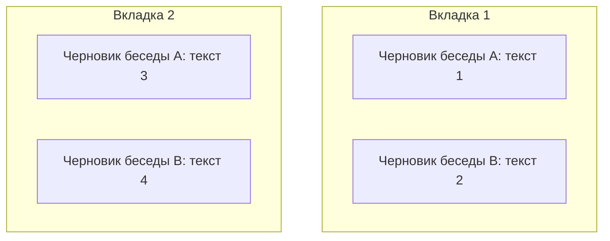
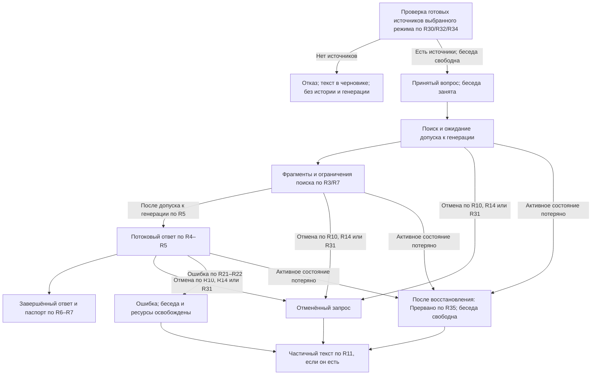
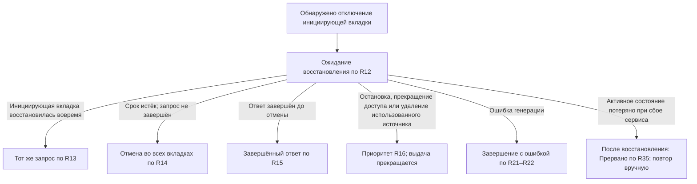
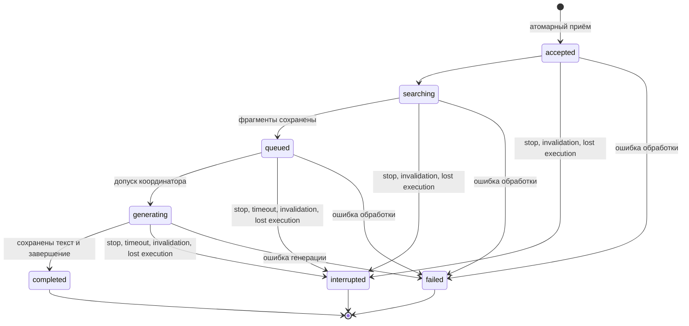
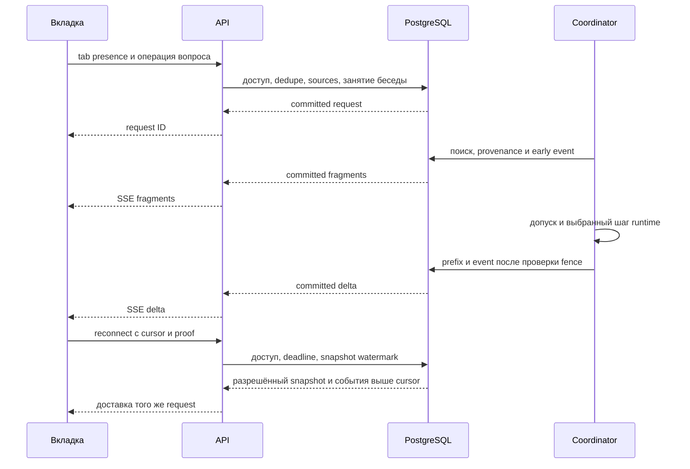
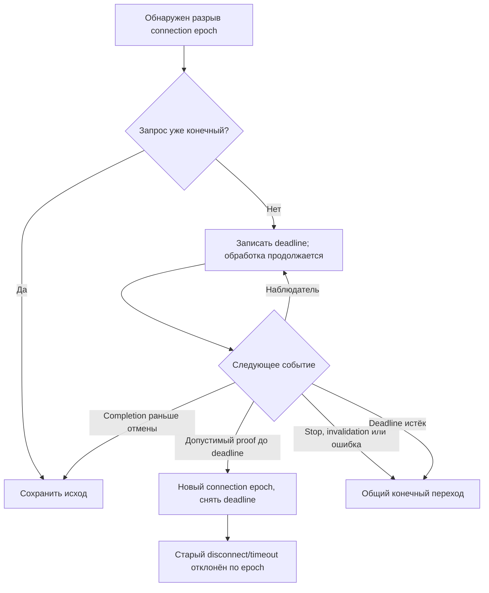
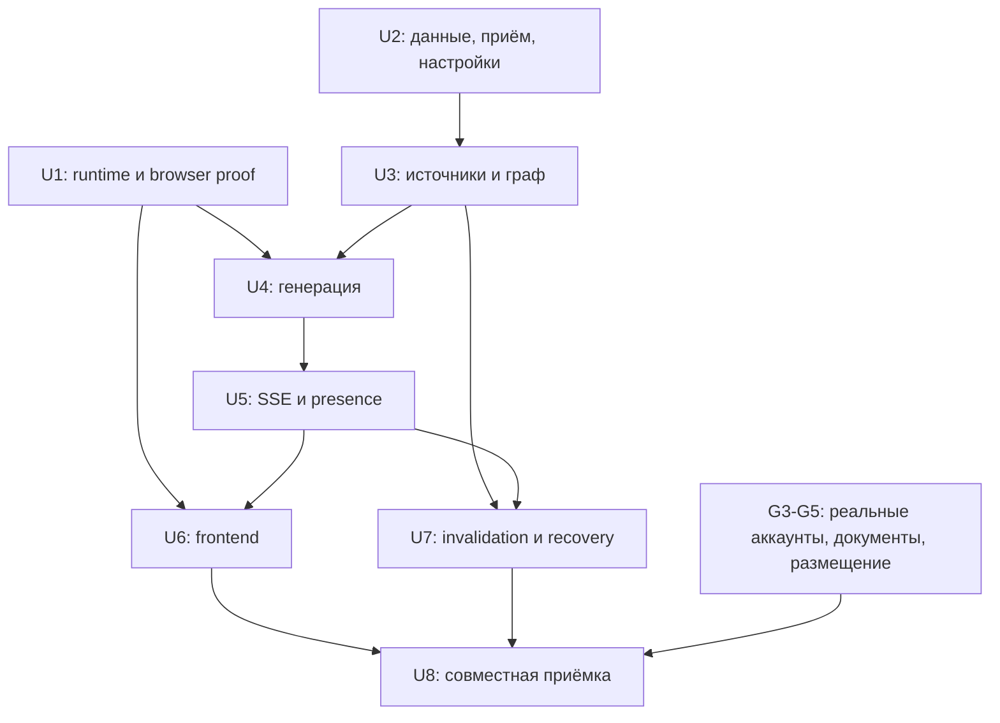

# RAG Answer Lifecycle - Plan

## Goal Capsule

- **Objective:** Владелец личной библиотеки получает полезные фрагменты до готовности ответа, видит его основания и сохраняет понятную историю при отмене или обрыве соединения.
- **Product authority:** Подтверждённое пользователем 2026-10-13 сводное описание текущего пути и действующий реестр `harness/project/decisions/2026-10-08-rag-architecture-decisions.md`, включая последнюю редакцию RAG-43 и последующие уточнения RAG-44–RAG-62.
- **Scope:** Путь одного вопроса от неотправленного черновика и приёма до ответа, ошибки или отмены, включая ранние фрагменты, ожидание, источники и навигацию между беседами и вкладками.
- **Means:** Общий серверный запрос, сохранённая выдача и независимые contexts выбранной локальной модели — KTD1–KTD4.
- **Execution boundary:** Реализация и её приёмка выполняются по U1–U8 отдельным поручением; отрицательные proof gates останавливают соответствующую зависимую работу.
- **Open blockers:** Вопросы Q01–Q13 из полной ревизии от 2026-10-13 согласованы в RAG-50–RAG-62; открытых продуктовых вопросов этого списка нет. Технические допущения и проверки перечислены ниже и в `harness/project/docs/ideation/2026-10-13-rag-brainstorm-question-audit.md`; условный внешний маршрут не активирован.

---

## Product Contract

### Summary

Один серверный жизненный цикл связывает вопрос, ранние фрагменты, очередь, потоковый ответ, его источники и обработку ошибки генерации.
Все вкладки беседы отображают общее состояние запроса, а его отмена и восстановление подчиняются R10–R16 и R20.

### Problem Frame

Ожидание генерации не должно скрывать уже найденные основания ответа.
Обрыв соединения, несколько вкладок и изменения источников могут оставить владельцу непонятную историю либо вернуть в следующий ответ сведения, которые больше нельзя использовать.
Текущий репозиторий хранит согласованные требования, но ещё не содержит реализации этого пути.

### Key Decisions

- **Серверная беседа — общая точка состояния вкладок.** Governs R2, R8, R9, R19; основание — RAG-25/RAG-42.
- **Сохранение прерванного текста.** Governs R11. 
- **Отмена по инициирующей вкладке с ожиданием восстановления.** Governs R12–R16, R20; действует последняя редакция RAG-43 вместо прежней отмены по последней вкладке.
- **Ошибка завершается без автоматического повтора.** Governs R11, R20–R22. 
- **Переключение беседы сохраняет выполняющийся запрос.** Governs R23, R24. 
- **Переключение сохраняет черновик исходной беседы.** Governs R25. 
- **Обновление страницы сохраняет черновики этой вкладки.** Governs R26. 
- **Закрытие вкладки удаляет её черновики.** Governs R27. 
- **Уменьшение лимита сохраняет уже активные запросы.** Governs R5, R28. 
- **Сохранённые настройки переживают перезапуск.** Governs R29. 
- **Без готовых источников вопрос сохраняется черновиком.** Governs R30. 
- **Удаление использованного источника останавливает текущий запрос.** Governs R11, R16, R18, R31. 
- **Документ доступен только как целиком готовый источник выбранного режима.** Governs R1, R30, R32, R34. 
- **OCR-правки сохраняют первоначальную историю.** Governs R18, R33. 
- **Пропуск рукописей требует явного выбора владельца.** Governs R6, R7, R32, R34. 
- **Потеря серверного состояния прерывает запрос без повтора.** Governs R8, R9, R11, R20, R35. 
- **Текущий план охватывает один путь пользователя.** Governs R1–R35; другие принятые идеи MVP остаются отдельными областями работы.

<!-- ce-section: work-relationships -->
### How This Work Fits Together

Этот документ охватывает жизненный цикл вопроса и соединяет идеи раннего результата и паспорта ответа.
Связи с остальным MVP отражают текущее понимание, а не фиксированный порядок реализации.

- **Depends on:** аккаунты, серверная история, личные готовые документы, поиск и управление генерацией по уже согласованным решениям RAG.
- **Shares:** правила доступа, удаления и сохранения контекста с обработкой документов и историей бесед.
- **Depends on:** фактическая поддержка выбранным runtime требований RAG-11; историческая проба одного слота её не доказывает.
- **Can proceed independently of:** проектирование сверки OCR, предпросмотра настроек и подбора допустимой пачки файлов, если соблюдаются их общие права доступа.
- **Still to decide:** технические интерфейсы этих областей; они не становятся дополнительными требованиями этого документа.

### Actors

- A1. Владелец аккаунта и личной беседы, допущенный к защищённым операциям.
- A2. Вкладки браузера A1: инициирующая вкладка отправила текущий вопрос, остальные наблюдают ту же беседу.
- A3. Сервис: хранит историю, проверяет доступ, принимает запрос и управляет его обработкой и выдачей.

### Requirements

**Search and answer**

- R1. Поиск использует выбранную личную область готовых доступных документов и не расширяет её автоматически при исключении или удалении источников.
- R2. История беседы хранится на сервере независимо от открытой вкладки по RAG-25.
- R3. Найденные доступные фрагменты показываются до первого токена ответа, включая ожидание в очереди, отдельно от текста модели по RAG-33.
- R4. Генерация после поиска продолжается автоматически до завершения, ошибки либо отмены запроса.
- R5. Генерация соблюдает действующий контракт RAG-11 с уточнением изменения лимита по R28: по умолчанию до 12 активных запросов с отдельными контекстами, до 3 продвигаемых запросов за шаг, справедливая выдача и общие для сервиса лимиты.
- R6. Ответ имеет компактный раскрываемый паспорт фактической области поиска, использованных источников и фрагментов с различением цитат и выводов по RAG-34.
- R7. Паспорт сообщает о неготовых или исключённых выбранных документах и недостатке найденных оснований, не выдавая отсутствие находки за отсутствие факта во всей библиотеке.

**Conversation and tabs**

- R8. С приёма вопроса до завершения, ошибки или отмены в беседе выполняется один запрос, включая ожидание в очереди; сервер атомарно отклоняет конкурирующий другой вопрос по RAG-42/RAG-44.
- R9. Все вкладки отображают общую беседу с состоянием отправки по RAG-42, сохраняя независимые черновики.

**Cancellation and reconnection**

- R10. Серверная остановка по кнопке проверяет владельца и отменяет запрос с освобождением места в очереди либо слота генерации.
- R11. Частичный текст ответа после отмены или ошибки сохраняется с отметкой «Прервано» и исключается из контекста последующих ответов, включая checkpoints и резюме, по RAG-41/RAG-44.
- R12. После обнаружения отключения инициирующей вкладки начинается ожидание восстановления 10 секунд независимо от других вкладок, при этом очередь и генерация продолжаются по последней редакции RAG-43.
- R13. Восстановление соединения инициирующей вкладки до истечения срока R12 сохраняет тот же незавершённый запрос и доставляет накопленный текст без повторного вопроса.
- R14. Без восстановления по R13 незавершённый запрос отменяется во всех вкладках по истечении срока R12, освобождая ресурсы и разблокируя отправку с сохранением черновиков открытых вкладок; для закрытых действует R27.
- R15. Ответ, завершившийся во время ожидания по R12, сохраняется обычным завершённым ответом.
- R16. Остановка кнопкой, прекращение доступа и удаление использованного источника по R31 не откладываются на срок R12.

**Access and consistency**

- R17. Защищённые операции соблюдают аутентификацию, подтверждение email, роль и владение ресурсом, а прекращение доступа прекращает дальнейшую выдачу по RAG-21/RAG-23/RAG-29.
- R18. Удалённые сведения исключаются из последующих поиска и контекста, включая checkpoints и резюме, при сохранении видимой старой истории с отметкой удалённого источника по RAG-16.
- R19. Повтор одной операции не дублирует пользовательский вопрос и запуск, как установлено в уточнениях выбранной архитектуры реестра RAG.
- R20. Отменённый или завершившийся ошибкой запрос не возобновляется при возвращении пользователя; повторный вопрос отправляется как новая операция.

**Generation failure**

- R21. Ошибка локальной генерации показывается пользователю без автоматической повторной попытки по RAG-44.
- R22. Ошибка завершает запрос, освобождая его ресурсы и разблокируя отправку во всех вкладках с сохранением черновиков открытых вкладок по R27; срок R12 не откладывает обработку ошибки.

**Conversation navigation**

- R23. Переключение из беседы A в B в той же открытой подключённой вкладке не отменяет запрос A и не запускает срок R12; ожидание или генерация A продолжается в фоне по RAG-45.
- R24. Результат фонового запроса сохраняется в исходной беседе A и отображается с её текущим состоянием при возвращении, не смешиваясь с ответом беседы B.
- R25. Каждая беседа в одной вкладке сохраняет отдельный неотправленный черновик при переключении и восстанавливает его в поле ввода при возвращении по RAG-46; восстановление не отправляет вопрос.
- R26. Обновление страницы в той же вкладке сохраняет её отдельные черновики бесед по RAG-47 и восстанавливает текст соответствующей беседы без отправки вопроса; независимость других вкладок по R9 сохраняется, а реальное отключение выполняющегося запроса обрабатывается по R12–R16.
- R27. Закрытие вкладки удаляет её неотправленные черновики всех бесед по RAG-48; при следующем открытии приложения эти тексты не восстанавливаются. Черновики остальных открытых вкладок и серверная история сохраняются; выполняющийся запрос следует R12–R16.

**Generation limit changes**

- R28. Уменьшение лимита активных запросов по RAG-49 не отменяет и не приостанавливает уже активные запросы; число ранее активных запросов может временно превышать новый лимит. Новые запросы ждут допуска, пока число активных не станет строго меньше нового лимита; завершение, ошибка и отмена продолжают действовать по R10–R22.
- R29. Изменения глобальных динамических настроек через админку сохраняются после перезапуска по RAG-50; сохранённые переопределения имеют приоритет, а файл задаёт дефолты для непереопределённых настроек. Права RAG-14 и ограничения изменения параметров RAG-30 сохраняются.

**Source readiness at admission**

- R30. Если в выбранной области нет готовых доступных источников, вопрос не принимается по RAG-56: причина показывается, текст остаётся черновиком своей беседы/вкладки без добавления в историю, очередь или запуска генерации. Отказ не занимает беседу; дальнейшая готовность источников не отправляет вопрос автоматически.

**Used source deletion**

- R31. Удаление использованного источника останавливает текущий незавершённый запрос по RAG-57: дальнейшая выдача прекращается, ресурсы и беседа освобождаются. Имеющийся частичный текст сохраняется как «Прервано» с отметкой удалённого источника и исключается из будущего контекста по R11/R18; автоматической повторной генерации нет.

**Whole document readiness**

- R32. Поиск и чтение готовых источников используют только целиком загруженный и успешно обработанный документ по RAG-59 в выбранном разрешённом режиме; сбой одной страницы исключает весь документ, частичные результаты с ошибками не используются в поиске или контексте. Режим с осознанным пропуском рукописей согласован отдельно в R34/RAG-61. Подробности ошибок передаются в отдельное окно отчёта RAG-58/RAG-59; успешные другие файлы пачки сохраняются.

**History after OCR correction**

- R33. После исправления OCR прежние ответы, использовавшие старый текст исправленного источника, и первоначальные цитаты сохраняются с отметкой по RAG-60. Затронутые ответы исключены из контекста следующих вопросов, включая checkpoints и сводки; история автоматически не переписывается и не перепроверяется. Оригинал документа сохраняется, а готовность исправленной ревизии для поиска подчиняется R32/RAG-35.

**Mixed PDF with skipped handwriting**

- R34. Для смешанного PDF, готового в явно выбранном владельцем режиме пропуска рукописей по RAG-61, поиск/RAG используют печатный текст, а ограничения источника видны в паспорте ответа R6/R7. Готовность определяется по R32; блоки пропусков не являются основанием для утверждений о рукописном содержании. Предупреждение, выбор режима и полный отчёт относятся к зависимой области обработки документов.

**Service recovery after lost active state**

- R35. После аварии/перезапуска с потерей активного состояния незавершённый запрос получает конечное состояние «Прервано» с причиной по RAG-62; ресурсы и беседа освобождаются, состояние видно во всех вкладках. Уже записанный частичный текст обрабатывается по R11, пустой ответ до первого токена не создаётся. Автоматического возобновления или повторной генерации нет; повторная отправка владельцем — новая операция. Завершённый и сохранённый до сбоя ответ остаётся завершённым.

### Key Flows

- F1. **Question to answer. Covers R1–R8, R17–R19, R28–R30, R32–R34.** Владелец отправляет вопрос; сервис проверяет доступ и целостную готовность выбранных источников по R30/R32. При отказе текст остаётся черновиком; при приёме в свободную беседу сервис выполняет поиск, показывает ранние фрагменты и выдаёт потоковый ответ с паспортом по R3–R7. Уменьшение лимита активных запросов меняет дальнейший допуск, сохраняя уже активные запросы по R28. После перезапуска настройки допуска определяются по R29. Если OCR источника исправлен, первоначальная история остаётся видимой с отметкой, но затронутые ответы не входят в новый контекст по R33. Для PDF в явно выбранном режиме пропуска рукописей поиск использует печатный текст; ограничения источника видны в паспорте по R34.
- F2. **Shared conversation. Covers R8, R9, R19, R22.** Вторая вкладка показывает текущую серверную беседу; конфликтующий вопрос остаётся её черновиком, а после завершения, ошибки или отмены отправка снова доступна по R9/R14/R22.
- F3. **Connection recovery. Covers R11–R16, R20.** При отключении инициирующей вкладки действует R12; восстановление обслуживается по R13, отсутствие восстановления — по R14, завершение ответа в этот период — по R15.
- F4. **Stop, access loss or source deletion. Covers R10, R11, R16–R18, R31.** Остановка отменяет текущий запрос; прекращение доступа прекращает защищённые операции и дальнейшую выдачу без ожидания R12. Удаление использованного источника завершает текущий запрос по R31, сохраняя частичный текст с обеими отметками и исключая его из будущего контекста.
- F5. **Generation failure and service recovery. Covers R8, R9, R11, R20–R22, R35.** Ошибка локальной генерации завершает запрос по R21/R22; потеря активного состояния при аварии/перезапуске следует R35. После восстановления владелец видит конечное состояние и сохранённую историю; частичный текст обрабатывается по R11, новый вопрос — по R20.
- F6. **Navigate to another conversation. Covers R2, R5, R12–R16, R23, R24.** Владелец переключается из A в B; запрос A продолжает свой путь по R23, а при возвращении его результат доступен по R24; последующее отключение соединения обрабатывается по R12–R16.
- F7. **Restore an unsent draft. Covers R9, R25–R27.** Владелец набирает вопрос в A, переходит в B и возвращается; поле ввода A восстанавливается по R25, сохраняя отдельный черновик B и независимость других вкладок по R9. После обновления страницы в той же вкладке отдельные черновики также восстанавливаются по R26, без отправки вопроса. Закрытие вкладки удаляет её черновики по R27.

Схема показывает границу независимости черновиков по R9/R25.



Ниже схема F1; поиск и показ фрагментов могут выполняться во время ожидания генерации по R3.



Ожидание восстановления в F3 относится к соединению, а не заменяет состояние запроса: обработка по R12 продолжается.
Схема ниже показывает правила R12–R16, а не способ обнаружения отключения.



### Acceptance Examples

| Example | Covers | Scenario and expected result |
| --- | --- | --- |
| AE1. Early result | R1, R3–R5 | Генерация ожидает допуска; найденные разрешённые фрагменты уже доступны владельцу, и запрос продолжает путь F1 без дополнительного подтверждения. |
| AE2. Two different questions | R8, R9 | Две вкладки одновременно отправляют разные вопросы; сервер принимает один, второй не добавляется в историю или очередь и остаётся черновиком с отказом «В беседе уже выполняется запрос». |
| AE3. Waiting request stopped | R8–R10 | Владелец отменяет ожидающий запрос; он покидает очередь, не начинает генерацию, беседа освобождается и вкладки могут отправить следующий вопрос. |
| AE4. Partial output stopped | R9–R11, R16 | Владелец останавливает начатый ответ; выданный текст сохраняется как прерванный и не попадает в контекст следующего ответа. |
| AE5. Initiating tab recovers | R12, R13, R19 | Соединение инициирующей вкладки восстановлено через 5 секунд после обнаружения обрыва; она получает накопленный текст того же запроса, без второго вопроса или запуска. |
| AE6. Another tab stays connected | R9, R11, R12, R14 | Инициирующая вкладка не вернулась за 10 секунд, но другая вкладка подключена; незавершённый запрос отменяется для всех вкладок, черновики сохраняются и отправка разблокируется. |
| AE7. Answer completes during recovery wait | R12, R15 | Ответ завершился через 6 секунд ожидания восстановления; он остаётся завершённым и не меняется на «Прервано» по истечении таймера. |
| AE8. Stop during recovery wait | R10–R12, R16 | При действующем ожидании восстановления поступает допустимая остановка; отмена не ждёт остаток таймера. |
| AE9. Access revoked | R16, R17 | Во время ожидания или выдачи аккаунт административно блокируется; новые защищённые операции и дальнейшая выдача прекращаются без ожидания таймера R12. |
| AE10. Isolation and service limits | R1, R5, R17 | При дефолтах R5 тринадцатый запрос ждёт допуска, активные контексты разных пользователей не смешиваются, а за шаг продвигается не более трёх запросов справедливым образом. |
| AE11. Incomplete selected library | R1, R6, R7 | Часть выбранных документов не готова; паспорт сообщает ограничение фактического поиска, а поиск не расширяется на остальные документы пользователя. |
| AE12. Removed source and next question | R11, R18 | Источник старого ответа удалён и ранее отменённый ответ сохранён; следующий вопрос не получает удалённые сведения или прерванный текст через историю контекста, checkpoints или резюме. |
| AE13. Repeated operation | R8, R19 | Повтор отправки той же операции не создаёт второе сообщение или второй запуск; намеренно новый вопрос после завершения или отмены является новой операцией. |
| AE14. Return after cancellation | R11, R14, R20 | Владелец возвращается после отмены; история сохраняет прерванный текст, но генерация не возобновляется до явной отправки нового вопроса. |
| AE15. Foreign conversation | R1, R10, R17 | Другой обычный пользователь обращается напрямую к чужой беседе или её остановке; сервер отказывает, не раскрывая вопрос, фрагменты или ответ владельца. |
| AE16. Failure after partial output | R8, R9, R11, R20–R22 | Модель выдала часть текста и завершилась с ошибкой; ошибка видна, ресурсы освобождены, вкладки могут отправить новый вопрос, частичный текст исключён из последующего контекста, повторного запуска нет. |
| AE17. Failure before first token | R8, R9, R21, R22 | Локальная генерация завершается ошибкой до первого токена; частичный ответ не создаётся, ошибка видна и беседа освобождается без повторной попытки. |
| AE18. Failure during recovery wait | R11, R12, R20–R22 | Во время ожидания восстановления инициирующей вкладки генерация завершается ошибкой; завершение не ждёт таймера, а восстановление вкладки не запускает запрос заново. |
| AE19. Navigate while answer runs | R2, R5, R23, R24 | Запрос A ожидает или генерируется, владелец смотрит B в той же подключённой вкладке; запрос A продолжает работу без таймера отмены, его текст не появляется как ответ B, при возвращении виден текущий результат A. |
| AE20. Disconnect after navigation | R12–R14, R23, R24 | После перехода из A в B соединение инициирующей вкладки реально прерывается; для незавершённого запроса A действует ожидание восстановления по R12 и последующая отмена по R14. |
| AE21. Separate conversation drafts | R25 | В A набран один неотправленный вопрос, затем в B другой; переключение между A и B восстанавливает соответствующий текст, без его подмены или автоматической отправки. |
| AE22. Independent tab drafts | R9, R25 | Две вкладки имеют разные черновики одной беседы; переключение бесед в первой восстанавливает её собственный текст и не меняет черновик второй вкладки. |
| AE23. Refresh restores drafts | R25, R26 | В A и B набраны разные неотправленные вопросы; после обновления страницы в той же вкладке открытие каждой беседы восстанавливает её текст, без добавления вопроса в историю или очередь. |
| AE24. Refresh preserves tab independence | R9, R26 | Две вкладки имеют разные черновики одной беседы; обновление первой восстанавливает её собственный текст и не меняет текст второй. |
| AE25. Closing removes drafts | R25–R27 | В A и B набраны разные неотправленные вопросы; после закрытия вкладки и следующего открытия приложения оба черновика не восстанавливаются. |
| AE26. Closing preserves other tab and history | R2, R9, R12–R16, R27 | Две вкладки имеют разные черновики одной беседы; закрытие первой удаляет только её черновики, сохраняя текст второй и серверную историю. Незавершённый запрос закрытой инициирующей вкладки обрабатывается по R12–R16. |
| AE27. Lower limit preserves active requests | R5, R28 | При 10 активных запросах супер-администратор уменьшает лимит до 6; все 10 продолжают свой жизненный цикл, без отмены или приостановки из-за изменения лимита, а новые ждут допуска. |
| AE28. Admission at the new limit | R5, R28 | После уменьшения лимита до 6 при 6 активных ожидающий запрос ещё не допускается; когда остаётся 5 активных, допускается один, соблюдая новый предел 6. |
| AE29. Saved override after restart | R5, R29 | В файле лимит активных запросов 12, super_admin сохраняет 6; после перезапуска действует 6, без сброса к файловому значению. |
| AE30. File default without override | R29 | Для настройки нет сохранённого переопределения; при запуске применяется её значение из конфигурационного файла. |
| AE31. No ready available sources | R1, R8, R25, R30 | Все выбранные документы ещё обрабатываются или исключены; отправка показывает причину и сохраняет текст черновиком, без нового сообщения, очереди, генерации или занятия беседы. Поиск не расширяется. |
| AE32. Sources become ready later | R25, R30 | После отказа по R30 документ становится готовым; вопрос сам не отправляется. Владелец явно отправляет сохранённый черновик, и при выполнении условий приёма запрос следует F1. |
| AE33. Used source deleted during output | R11, R16, R18, R20, R31 | Во время ответа удалён использованный источник; поток прекращается без ожидания R12, ресурсы и беседа освобождаются. Уже выданный текст сохраняется как «Прервано» с отметкой удалённого источника, исключается из будущего контекста, автоматического повторного запуска нет. |
| AE34. Used source deleted before first token | R8, R18, R31 | Использованный источник удалён после приёма, но до первого токена; незавершённый запрос останавливается без выдачи ответа на его основе, частичный ответ не создаётся и ресурсы освобождаются. |
| AE35. One page fails the document | R1, R30, R32 | Из 20 страниц извлечены 15, на пяти сбой; весь документ недоступен для поиска/чтения готового источника, его 15 страниц не попадают в ответ. Ошибки файла и страниц видны в отдельном отчёте; успешные другие файлы пачки доступны. Если готовых источников больше нет, вопрос отклоняется по R30. |
| AE36. Incomplete file is not a source | R1, R32 | Передача файла прервалась; неполный файл не публикуется как готовый документ и не выдаётся для чтения, поиска или контекста. Причина показана в отчёте; полностью загруженный и успешно обработанный документ публикуется целиком. |
| AE37. OCR correction preserves history and excludes context | R18, R33 | Старый ответ процитировал OCR-число «100», затем владелец исправил его на «10»; старый ответ и цитата «100» сохраняются с отметкой об исправлении. При следующем вопросе этот ответ не передаётся напрямую и не возвращается через checkpoints/сводки; оригинал неизменен, автоматической перепроверки или переписывания истории нет. |
| AE38. Cancelled mixed PDF is not a source | R1, R30, R34 | Владелец ранее отменил смешанный PDF после предупреждения RAG-61; файл не опубликован. При отправке вопроса он не используется как источник; если других готовых источников нет, действует R30. |
| AE39. Ready mixed PDF with explicit skips | R1, R6, R7, R32, R34 | Смешанный PDF полностью готов в выбранном владельцем режиме печатного текста с блоками пропусков по RAG-61. При вопросе печатный текст смешанной страницы доступен поиску/RAG, ограничения видны в паспорте; ответ не приписывает содержание пропущенным рукописям. |
| AE40. Failed skip-mode document is not a source | R1, R30, R32, R34 | При обработке PDF в режиме пропуска рукописей произошёл технический сбой одной страницы, весь документ не опубликован по RAG-59/RAG-61. При вопросе удачные страницы не используются поиском/RAG; при отсутствии других готовых источников действует R30. |
| AE41. Crash after saved partial output | R8, R9, R11, R20, R35 | До аварии записана часть ответа, активное состояние потеряно. После восстановления во всех вкладках запрос отмечен как прерванный с причиной, записанный текст остаётся в истории вне контекста/checkpoints/сводок; беседа и ресурсы освобождены. Автоматического запуска нет, владелец явно отправляет вопрос как новую операцию. |
| AE42. Crash before first token | R8, R9, R20, R35 | Принятый запрос потерял активное состояние до первого токена, включая ожидание. После восстановления вопрос отмечен как прерванный, пустой частичный ответ не создан, беседа освобождена и запрос не запускается автоматически. |
| AE43. Completed answer survives restart | R2, R35 | Ответ завершён и сохранён до перезапуска; после восстановления он остаётся завершённым в общей серверной истории. Запрос не становится прерванным и повторная генерация не запускается. |

### Scope Boundaries

- Активная область — Requirements и Key Flows этого документа; проектирование аккаунтов, загрузки документов и общей админки относится к зависимостям, а не к дополнительным возможностям этого пути.
- Сверка и исправление OCR, предпросмотр настроек, помощь с пачкой файлов и поиск опровержений остаются принятыми частями MVP, но не проектируются здесь.
- Условный внешний fallback не включается этим документом; RAG-31/RAG-39 сохраняют отдельные условия его разрешения.
- Восстановление черновиков закрытой вкладки не входит в MVP по R27. Подробная компоновка интерфейса и ограничения очереди сверх уже согласованного RAG-11 этим документом не утверждаются.
- Биллинг, общие библиотеки, автономные действия и автоматическая перепроверка старых ответов не добавляются.

### Dependencies / Assumptions

- Действующая архитектура и границы MVP остаются в реестре RAG; этот документ уточняет один пользовательский путь.
- Общие критерии приёмки MVP задаёт RAG-27; текущие Acceptance Examples проверяют только этот путь.
- Фактическая поддержка R5 выбранным runtime и работа при совместной нагрузке с OCR/API/worker/PostgreSQL ещё не проверены; исторические результаты одного слота не подтверждают эти требования.
- Готовность документов, статус аккаунта, владение беседой и удаление источников должны быть доступны текущему пути как серверные факты.
- Начальные персональные разрешения PDF, DOCX, TXT, Markdown и OCR рукописей включены по RAG-51; персональные разрешения меняют admin и super_admin по RAG-52. Это правила зависимой области обработки документов; общие условия доступа, квоты и запрет admin на чтение чужого содержимого сохраняются.
- При изменении общих дефолтов документных лимитов super_admin выбирает существующих пользователей в окне сравнения по RAG-53; лимиты невыбранных сохраняются. Это правило зависимой области документов и настроек, не изменение лимита генерации R28.
- Уже допущенные загрузки/обработка сохраняют прежние персональные лимиты при уменьшении квоты по RAG-54; новые операции проверяются по новым значениям. Отзыв разрешения формата/OCR запрещает новые требующие его операции и останавливает затронутую работу на безопасной границе по RAG-55; общие условия доступа сохраняются.
- Успешно обработанные файлы пачки доступны для поиска независимо от ошибок остальных по RAG-58. Отдельное окно и экспорт отчёта .xlsx/.docx/.txt/.md с неудачными файлами сверху и удачными снизу относятся к области обработки документов и не проектируются в этом пути.
- Таймер R12 отсчитывается после обнаружения отключения; мгновенное обнаружение физического обрыва не обещается.

- Предупреждение и явный выбор отмены либо печатного текста смешанного PDF относятся к обработке документов по RAG-61. Оригинал неизменен, разрешение OCR не обходится; пропуски обозначаются блоками в документе и в отдельном отчёте RAG-58, включая экспорт .xlsx/.docx/.txt/.md. Поздняя выдача разрешения сама не запускает обработку. Путь ответа использует готовый результат по R34; обнаружение рукописных участков ещё не проверено.

### Outstanding Questions

**Resolve Before Planning:**

- Нет незакрытых вопросов согласованного списка Q01–Q13. Все ответы записаны в
  RAG-50–RAG-62 и в `harness/project/docs/ideation/2026-10-13-rag-brainstorm-question-audit.md`.
- Q01/Q07/Q08/Q10–Q13 отражены в R29–R35, Q02–Q06/Q09 — в Dependencies / Assumptions.
  Этот контракт охватывает один путь ответа; аудит учитывает весь принятый MVP.
- Условные C01/C02 относятся к внешнему маршруту, не включённому в текущий MVP.
  T01/T02 остаются техническими допущениями; если проектирование обнаружит новую
  продуктовую развилку, её нужно явно согласовать, сохранив уже принятые решения.

**Deferred to Planning:**

Технические ответы приведены в Planning Contract; соответствие исходных вопросов решениям и проверкам — в Technical Question Disposition.
Проверки, зависящие от выполнения кода, остаются задачами реализации, а не результатами этого документа.

- Связь прежнего ответа и исходных цитат с ревизией OCR, отметка исправления и исключение затронутого ответа из прямого/производного контекста для R33; публикация исправленного индекса согласованной целой ревизией.

- Способ обнаружения отключения и безопасного подтверждения, что вернулась именно инициирующая вкладка, для R12/R13.
- Доставка и восстановление пропущенных фрагментов, текста и состояния без повторной операции по R3/R9/R13/R19.
- Атомарный порядок приёма, завершения, отмены и истечения таймера для R8/R10/R14/R15.
- Проверка готовых доступных источников до приёма и согласование с конкурентным изменением доступа/готовности для R30.
- Атомарная публикация целого документа выбранного режима, отсутствие частичных результатов с ошибками в чтении/поиске/контексте и доставка подробностей ошибок в отчёт для R32.
- Интерфейс готового источника и передачи ограничений выбранного режима из зависимой области документов в паспорт по R34; обнаружение рукописных участков и подготовка блоков относятся к обработке документов, их точность требует проверки.
- Доставка состояния ошибки и безопасное освобождение ресурсов при сбое генерации для R21/R22.
- Обнаружение потерянного активного состояния, восстановление конечного состояния/истории и освобождение занятости для R35; согласование сохранения частичного текста с выдачей. Нельзя обещать восстановление ещё не записанных перед аварией фрагментов.
- Сохранение связи инициирующей вкладки с фоновым запросом и доставка его состояния при переключении бесед для R23/R24.
- Способ хранения независимых черновиков бесед и вкладок для R9/R25–R27: сохранение при навигации и обновлении страницы, удаление при закрытии вкладки и различение этих событий.
- Представление паспорта и связывание утверждений с доступными источниками по R6/R7.
- Исключение прерванного и удалённого материала из контекста по R11/R18 при сохранении видимой истории.
- Порядок удаления использованного источника, завершения и публикации ответа, прекращение выдачи и освобождение ресурсов для R31.
- Атомарное применение нового лимита при допуске по R28 и техническая граница применения отдельного лимита продвижения за шаг по R5/RAG-11.
- Место и механизм хранения глобальных динамических переопределений, проверка значений и восстановление настроек по R29.
- Фактическая поддержка планирования генерации по R5/R28, совместная нагрузка и условия технической приёмки интеграции.

### Sources / Research

- `harness/project/docs/ideation/2026-10-13-rag-brainstorm-question-audit.md`: полный список вопросов Q01–Q13, условных пунктов и технических допущений; запрет преждевременного перехода к планированию.

- `harness/project/decisions/2026-10-08-rag-architecture-decisions.md`: RAG-11/RAG-15/RAG-16/RAG-21/RAG-23/RAG-25/RAG-26/RAG-27/RAG-29/RAG-33/RAG-34/RAG-40–RAG-62 и уточнения выбранной архитектуры.
- `harness/project/handoffs/2026-10-08-rag-project-continuation.md`: текущая редакция правил отмены, контекст продолжения и границы непроверенных возможностей.
- `harness/project/docs/ideation/2026-10-09-personal-rag-ideation.html`: происхождение идей раннего результата и паспорта ответа; последующие согласования определяются реестром RAG.
- `harness/project/testing/evidence/2026-10-08-rag-decision-import/_docs/idea-review.md`: исторический источник уточнений; прежнее поведение при обрыве не является текущим правилом отмены.

---

## Planning Contract

**Product Contract preservation:** Product Contract unchanged in meaning; R1–R35, A1–A3, F1–F7, AE1–AE43 и основания продуктовых решений сохранены.
Добавлены Problem Frame и указатель на технические ответы, без изменения продуктового scope.

### Current Baseline and Execution Boundary

`main.py` содержит только перевод строки; `backend/` и `frontend/` отсутствуют.
Прикладного манифеста, схемы БД, миграций, API, UI и тестов приложения пока нет.
Корневой `pytest.ini` выбирает только `harness/common/testing/tests`; его успешный запуск не доказывает поведение RAG.
Все прикладные пути ниже — предлагаемые новые файлы, а не найденная реализация.

Этот план реализует один путь ответа и его серверные границы.
Регистрация, подтверждение email, обработка файлов, OCR-редактор и общий административный интерфейс остаются зависимыми областями Product Contract.
Их подмены позволяют проверять локальные механизмы, но не заменяют интеграционную приёмку с реальными аккаунтами и документами.

### Key Technical Decisions

- KTD1. **PostgreSQL определяет приём и конечное состояние запроса.** Governs R2, R8, R10, R17, R19, R30, R35. Общий серверный запрос хранит владельца, беседу, ключ операции, fingerprint входа, этап, причину завершения и версию исполнения. Транзакция под блокировкой беседы повторно проверяет доступ и готовые источники, затем вместе сохраняет вопрос и занимает беседу. Уникальность операции и одного незавершённого запроса обеспечивается также ограничениями БД. Повтор с прежним ключом разрешается после проверки текущего доступа и до проверки занятости; другой payload с тем же ключом отклоняется. Отказ до приёма не создаёт историю или очередь. Основание механизма — [PostgreSQL locking](https://www.postgresql.org/docs/current/explicit-locking.html).

- KTD2. **История и выдача используют сохранённый журнал событий.** Governs R2, R3, R9, R11, R13, R19, R24, R35. В одной транзакции фиксируются очередной текстовый фрагмент, его последовательный номер и изменение запроса; SSE читает только committed события. Snapshot возвращает согласованные состояние, текст и watermark; доставка продолжается после него, без разрыва между replay и live. Идентификаторы беседы и запроса в событии предотвращают смешивание результатов навигации. Формат следует [WHATWG SSE](https://html.spec.whatwg.org/multipage/server-sent-events.html); курсор доставки не предоставляет доступ и не запускает граф. В MVP журнал не обрезается во время выполнения; устаревший или недопустимый курсор возвращает разрешённый snapshot либо отказ.

- KTD3. **Один координатор владеет генерацией для всего сервиса.** Governs R4, R5, R28, R35. Координатор — отдельный процесс внутри backend, общий для API-процессов; очередь находится в PostgreSQL. Выделенное соединение держит service-wide advisory lock, а каждая команда и запись результата несут epoch исполнения. Один deployment supervisor владеет coordinator/native process и прекращает его при потере владения. Замена допускается к загрузке модели только после подтверждённого terminate/reap предшественника; без этого подтверждения replacement заблокирован. Epoch запрещает старые команды, а завершение процесса отдельно доказывает освобождение памяти и reservations. Автоматический failover на другой host этим механизмом не вводится. Новый coordinator прерывает потерянные исполнения после fencing/reap, включая принятые, но ещё не переданные ему вопросы; здоровый API-restart сам их не прерывает. При недоступности coordinator новые вопросы получают объяснимый отказ до приёма. Redis, Celery и дополнительный брокер для этого пути не нужны.

- KTD4. **Шагами llama.cpp управляет координатор через low-level API.** Governs R5, R28. Предпочтительный механизм — существующие [низкоуровневые Python bindings](https://llama-cpp-python.readthedocs.io/en/latest/api-reference/) с одной загруженной моделью и отдельным native context/sampler для каждого активного запроса. Это позволяет выбирать следующую группу runnable запросов и вычислять по одному следующему токену каждому, сохраняя round-robin порядок. Обработка prompt делится на ограниченные порции между такими группами. Размер шага не подменяется размером native batch или числом HTTP completion; speculative decoding отключён. Возможность подтверждается в U1 на выбранной модели и зафиксированной сборке; интерфейс [llama.cpp](https://raw.githubusercontent.com/ggml-org/llama.cpp/master/include/llama.h) сам по себе не доказывает память и скорость. Изменение активного лимита не уничтожает имеющиеся contexts; расширение требует реальной доступной ёмкости. Если поддержка немедленного изменения не доказана, зависимая реализация останавливается, без скрытого clamp, перезапуска или замены R5.

- KTD5. **Переопределения настроек сохраняются в PostgreSQL.** Governs R5, R28, R29. Предлагаемый `backend/config/runtime.toml` задаёт стартовые дефолты; валидированные сохранённые значения и revision имеют приоритет. Координатор читает новую committed revision перед следующим допуском и шагом. Ответ административной операции сообщает сохранённую revision и подтверждение её применения, не выдавая запись в БД за уже применённый лимит. Глобальные записи допускаются только super_admin и аудируются. Параметры, требующие перезапуска, доступны для просмотра и отклоняются при прямой записи API. Диапазоны изменяемых параметров определяются U1, без новых произвольных численных ограничений. Это способ реализовать согласованное сохранение настроек, а не уже установленный конфигурационный файл.

- KTD6. **Поиск и паспорт опираются на целиком опубликованные ревизии.** Governs R1, R3, R6, R7, R18, R30–R34. Граница документов предоставляет owner, document/revision ID, текущую published revision, статус удаления, chunks, координаты и ограничения выбранного режима. Приём фиксирует выбранную область; поиск повторно проверяет её доступность, не расширяя набор. До передачи текста в модель или ранней выдачи сохраняются зависимости запроса от реально используемых ревизий. Паспорт различает выбранные, доступные, найденные и переданные модели источники. Цитаты сверяются с сохранёнными разрешёнными spans; выводы модели отображаются отдельно. При готовых источниках без совпадений вопрос следует R4/R7; отказ R30 применяется только к отсутствию готовых доступных источников.

- KTD7. **Контекст нового вопроса строится заново из допустимой истории.** Governs R11, R17, R18, R20, R33, R35. `AsyncPostgresSaver` сохраняет состояние графа, но не является историей UI или авторитетом доступа. Серверная связь graph `thread_id` с владельцем, беседой, request и context epoch проверяется до каждого обращения к saver. Каждый новый request получает отдельную persistence identity, однозначно связанную с беседой по RAG-29; прежний checkpoint не загружается как input нового вопроса. Backend собирает graph input из разрешённых завершённых сообщений и текущих ревизий. Provenance переданного исторического контекста входит в зависимости нового ответа транзитивно. Общая saver boundary сериализует checkpoint reads/writes и pending writes с проверкой execution/context epochs; invalidation закрывает запись старого исполнения. Его state не используется в новом запросе, а старые ответы и первоначальные цитаты сохраняются независимо. Запуск терминального или потерянного исполнения через resume запрещён. Это ограничение интеграции поверх [LangGraph persistence](https://docs.langchain.com/oss/python/langgraph/persistence), а не обещание автоматической очистки библиотекой.

- KTD8. **Все причины остановки проходят общий переход и барьер выдачи.** Governs R10, R11, R15–R18, R21, R22, R31, R33, R35. Finish, stop, ошибка, timeout, изменение доступа и удаление источника сериализуются с публикацией результата. Условный переход из незавершённого состояния фиксирует один исход; поздний callback с прежним epoch не меняет историю. Занятость беседы снимается логически, а physical reservation coordinator освобождается только после подтверждённого удаления native context. Необратимая граница выдачи — авторизованный handoff байтов ASGI/transport. Проверка owner/source/request fences и этот handoff участвуют в одном межпроцессном барьере invalidation; ранее прочитанное событие само не разрешает поздний send. Mutation сначала закрывает новые выдачи, затем подтверждается после завершения предшествующих handoffs. Ожидание backpressure не держит DB-lock: неподанные события отменяемы, после ожидания проверка повторяется. Уже handed-off байты отозвать невозможно. Реальная поддержка такого порядка транспортом доказывается в U7/U8, включая replay; один вызов стандартного ASGI send её не подтверждает. OCR-исправление само не добавляет отмену текущего запроса: provenance отмечает также позднее завершившийся ответ старой ревизии и исключает его из будущего контекста по R33.

- KTD9. **Соединение принадлежит вкладке, независимо от открытой беседы.** Governs R9, R12–R16, R19, R20, R23, R24. Сервер связывает запрос с аутентифицированной вкладкой и выдаёт ей proof восстановления; tab ID не заменяет auth. Один tab-level SSE и подтверждения heartbeat обслуживают также фоновые беседы. Разрыв обнаруживается по закрытию соединения либо потере подтверждений, после чего фиксируются deadline и connection epoch. Reconnect и timeout проверяют deadline под одной блокировкой; устаревшее событие прежнего соединения не отменяет восстановившуюся вкладку. Наблюдатель не обновляет presence инициатора. При запоздавшем reconnect сервер сначала завершает просроченное незавершённое исполнение; отложенный запуск timer callback не продлевает R12. Навигация, скрытие вкладки и смена наблюдаемой беседы сами не считаются разрывом.

- KTD10. **Для этого пути достаточно браузерных ES modules.** Governs R3, R6, R7, R9, R23–R27. Предлагаемый frontend использует HTML/CSS и native JS без нового production framework и сборщика. Общий state reducer принимает только авторитетные версии запросов; event handler проверяет принадлежность результата беседе. Черновики хранятся отдельно по владельцу и беседе в tab-local `sessionStorage`, а подтверждение отправки удаляет только отправленную revision черновика. Новая или дублированная вкладка получает самостоятельную identity и proof. [Session storage](https://developer.mozilla.org/en-US/docs/Web/API/Window/sessionStorage) переживает reload и может переживать restore; [pagehide](https://developer.mozilla.org/en-US/docs/Web/API/Window/pagehide_event) не является надёжным сигналом закрытия. Поэтому механизм хранения становится окончательным только после U1: R26/R27 нельзя объявлять выполненными по названию storage. Отрицательный результат требует решения о доказанном конфликте платформы, без ослабления R27. Logout/смена владельца очищают локальные credentials и черновики прежнего владельца.

### Prerequisites and Proof Gates

| Gate | Что должно быть доказано | Где снимается | Что блокирует |
| --- | --- | --- | --- |
| G1. Native runtime | Выбранная сборка, Qwen3.5-2B Q4_K_M, отдельные contexts, управление шагами, отмена и изменение лимитов при базовых параметрах RAG-30 | U1, реальные runtime-тесты | U4 и объявление R5/R28 выполненными |
| G2. Browser lifetime | Refresh сохраняет свои черновики; закрытая вкладка не восстанавливает их; новая вкладка не выдаёт себя за прежнего инициатора | U1, реальные браузеры и сценарии restore/duplicate | U6 и объявление R26/R27 выполненными |
| G3. Real access | Проверяемый principal, email, роли, владение, актуальное прекращение доступа и общий порядок invalidation | Зависимая область аккаунтов + U2/U7/U8 | Интеграционная приёмка R17; тестовый пользователь не снимает gate |
| G4. Real documents | Опубликованные целые ревизии, pgvector-поиск, provenance, удаление/исправление с барьером, ограничения выбранного режима | Зависимая область документов + U3/U7/U8 | Интеграционная приёмка R1/R18/R30–R34 |
| G5. Real deployment | PostgreSQL, выбранные модели и E5 ONNX, отдельный coordinator, разрешённый транспорт auth между самостоятельно размещаемыми backend/frontend | U8 совместно с зависимыми областями | Приёмка независимого размещения и реального потока |

Начать U1 можно без незакрытого продуктового вопроса.
G3–G5 пока не реализованы; их результаты нельзя выводить из fixtures.
При провале G1/G2 исполнитель сохраняет измерения и прекращает соответствующую зависимую работу до решения по конфликту, не подменяя контракт.
Поддерживаемые браузеры фиксируются для проверки, но этим документом не вводится исключение для остальных случаев R26/R27.

### Technical Question Disposition

| Исходный технический вопрос | Решение | Проверка при реализации |
| --- | --- | --- |
| Подтверждение инициатора и обнаружение обрыва | KTD9 | U5: epochs, heartbeat, наблюдатель, deadline race |
| Replay фрагментов, текста и состояния | KTD2 | U5: snapshot barrier и committed replay |
| Атомарность приёма и конечных переходов | KTD1/KTD8 | U2/U7: реальные конкурентные транзакции |
| Готовность до приёма и конкурентные изменения | KTD1/KTD6 | U2/U3/U7: отказ без записи и source fence |
| Целая публикация документа и ограничения режима | KTD6, G4 | U3/U8: boundary fixtures и реальный publisher |
| Ошибка генерации и освобождение ресурсов | KTD8 | U4/U7: physical cancellation ACK, поздний callback |
| Потеря активного состояния | KTD3/KTD8 | U7: epoch recovery без повторного запуска |
| Фоновая беседа и независимые черновики | KTD9/KTD10, G2 | U5/U6: навигация, refresh, close/restore |
| Паспорт и связь утверждений с источниками | KTD6 | U3/U6: фактические spans и ограничения |
| Прерванный/удалённый/исправленный контекст | KTD7/KTD8 | U3/U7: checkpoints, сводки, транзитивные зависимости |
| Удаление использованного источника и completion | KTD6/KTD8 | U7: provenance зарегистрирована до выдачи |
| Активный лимит, шаги и сохранённые настройки | KTD4/KTD5, G1 | U1/U4: реальные contexts и hot update |

### High-Level Technical Design

Общий порядок блокировок: service settings/execution epoch → владелец → выбранные документы по стабильному ID → беседа → запрос.
Операция, которой не нужны некоторые уровни, пропускает их, но не меняет порядок.
Блокировки не держатся во время вычисления модели или ожидания сети; подготовленный результат проверяется заново на границе публикации по KTD8.
Барьер KTD8 включает handoff, а не заканчивается после предварительного чтения БД; его транспортная реализация проверяется под backpressure до приёмки выдачи.

**Компоненты и данные:**

```mermaid
flowchart TB
    tabs["Вкладки: черновики и UI"] --> api["FastAPI: auth, приём, stop, SSE"]
    api --> db["PostgreSQL: запросы, история, события, настройки"]
    docs["Зависимая область: целые ревизии документов"] --> db
    auth["Зависимая область: доступ аккаунта"] --> api
    auth --> db
    db --> coordinator["Единственный coordinator с execution epoch"]
    coordinator --> graph["LangGraph: допустимый поиск и контекст"]
    graph --> db
    coordinator --> runtime["llama.cpp: модель и отдельные contexts"]
    runtime --> coordinator
    coordinator --> db
    db --> api
    api --> tabs
```

**Состояния запроса:**



Ожидание восстановления соединения — отдельный deadline, а не новое состояние запроса.
Поиск и early fragments завершаются до первого модельного токена; ожидание этого этапа не отменяет R8.

**Приём, выдача и повторная доставка:**



**Решения при восстановлении инициатора:**



**Путь допустимого контекста:**

```mermaid
flowchart TB
    visible["Полная видимая история"] --> eligible["Допустимость сообщений и source revisions"]
    current["Целые текущие ready revisions"] --> retrieval["Поиск только в выбранной области"]
    retrieval --> provenance["Сохранение fragment/revision dependencies"]
    eligible --> context["Ограниченный context нового запроса"]
    provenance --> context
    context --> graph["Новый запуск графа с context epoch"]
    graph --> checkpoints["AsyncPostgresSaver"]
    mutation["Deletion, OCR correction, interruption"] --> invalidate["Изменить eligibility/epoch зависимых материалов"]
    invalidate --> eligible
    invalidate --> checkpoints
```

**Режимы лимитов:**

| Состояние | Допуск нового context | Выбор следующей группы | Уже активные contexts |
| --- | --- | --- | --- |
| Активных меньше действующего лимита | Разрешён по KTD4 | По round-robin и текущей ширине шага | Продолжаются |
| Активных ровно лимит | Очередь | Тот же механизм | Продолжаются |
| Лимит уменьшен ниже текущего числа | Очередь до выполнения условия R28 | Тот же механизм | Не удаляются и не приостанавливаются |
| Изменена ширина шага | Активный лимит не меняется | Новая revision на следующей границе | Сохраняют порядок обслуживания |
| Context отменён, native ACK ещё нет | Его reservation ещё учитывается | Отменённый context не выбирается | Остальные продолжаются |

### Output Structure

Предлагаемая структура новых прикладных компонентов:

```text
backend/
  pyproject.toml
  uv.lock
  config/runtime.toml
  migrations/001_answer_lifecycle.sql
  app/
    __init__.py
    main.py
    db.py
    answers.py
    sources.py
    rag.py
    generation.py
    llama_runtime.py
    settings.py
    events.py
    api/
      answers.py
      tabs.py
      settings.py
  tests/
    conftest.py
    test_admission.py
    test_settings.py
    test_source_contract.py
    test_rag_context.py
    test_scheduler.py
    test_stream_recovery.py
    test_invalidation.py
    test_service_recovery.py
    runtime/test_generation_contract.py
    browser/test_draft_lifecycle.py
    browser/test_answer_lifecycle.py
    integration/test_answer_lifecycle.py
    integration/test_multi_process.py
    fixtures/answer_lifecycle/
frontend/
  index.html
  src/
    app.js
    api.js
    conversations.js
    drafts.js
    styles.css
```

Browser checks предлагаются на Python Playwright в backend test environment, чтобы не добавлять Node toolchain только ради проверки native frontend.
Это предложение зависимости, не установленный пакет или уже доступные браузеры.

### Sequencing and Integration Risks

U1 снимает G1/G2 прежде зависимой реализации.
U2 создаёт прикладной фундамент, U3 — источники/контекст, U4 — общий исполнитель, U5 — доставку и presence.
U6 и U7 могут опираться на этот фундамент независимо; U8 проверяет их вместе с реальными зависимостями.



Отдельные native contexts выбраны ради ясной изоляции и возможности менять число активных запросов без фиксированного числа sequences в одном context.
Multi-sequence batching может уменьшить overhead, но пока не имеет локального доказательства для выбранной модели; это не основание строить второй runtime или fork server.
Обычный llama-server completion не выбран: его [описание batching](https://github.com/ggml-org/llama.cpp/blob/master/tools/server/README-dev.md) не устанавливает независимый динамический предел продвижения R5.
Сравнение не требует конкурирующих реализаций на этапе планирования; при провале выбранного механизма U1 фиксирует конкретную причину для дальнейшего технического решения.

### Deferred Implementation Details

- Точные версии Python/FastAPI/LangGraph/checkpointer/native bindings, llama.cpp build ID и SHA256 модели фиксируются в U1/U2, до зависимой интеграции; версии в репозитории пока не установлены.
- Размер prompt-порции, heartbeat detection interval и интервал чтения committed events определяются измерениями, сохраняя KTD4/KTD9. Численного SLA задержки Product Contract не задаёт.
- Контекст 4096 учитывается в реальной токенизации вместе с ответом; допустимая история и retrieval помещаются в него без передачи исключённых сведений. Детали распределения token budget проверяются в U3/U4.
- Transport credentials/CORS/CSRF согласуются с фактической реализацией аккаунтов по G3/G5. Secret proof не хранится в URL, журнале или идентификаторе SSE-события; временный test auth не попадает в production.
- Native память и скорость при совместной работе с OCR/API/PostgreSQL ещё не измерены. План не заменяет выбранную модель, не включает внешний fallback и не создаёт новый порог качества.

---

## Implementation Units

### U1. Prove Native Scheduling and Browser Lifetime

**Goal:** Получить воспроизводимые доказательства G1/G2 до зависимой реализации.

**Requirements:** R5, R9, R12, R13, R26–R29; A1/A2, F1/F3/F7.

**Dependencies:** Нет прикладных зависимостей; фактический доступ к модели, native сборке и браузерам нужен для выполнения proof.

**Files:** Создать `backend/pyproject.toml`, `backend/uv.lock`, `backend/tests/runtime/test_generation_contract.py`, `backend/tests/browser/test_draft_lifecycle.py`; минимальный browser fixture разместить в `backend/tests/fixtures/answer_lifecycle/`.

**Approach:**

1. Зафиксировать доступные версии и проверить low-level механизм KTD4 на выбранной модели; использовать один общий экземпляр весов.
2. Записать trace вычисленных token/sequence/step IDs, native reservations, settings revision, память и время выдачи.
3. Проверить KTD10 на реальных браузерах, включая копирование вкладки и восстановление закрытой сессии; идентичность инициатора проверять отдельно от текста черновика.
4. Сохранить фактические результаты G1/G2. При провале не продолжать соответствующий зависимый участок.

**Execution note:** Начать с проверок, способных опровергнуть выбранный механизм; имитация scheduler и тест storage API не заменяют этот proof.

**Patterns to follow:** Базовые параметры и выбранные модели из RAG-30; границы непроверенной поддержки из исходного контракта.

**Test scenarios:**

1. Covers AE10. При дефолтах R5 создать двенадцать независимых contexts и ожидающий тринадцатый; trace показывает продвижение допустимой группы и отсутствие смешивания текста/самплеров.
2. На постоянно runnable группе каждый context обслуживается за полный round-robin круг; новый prefill, EOS и остановка одного не оставляют остальные без продвижения.
3. Covers AE27, AE28. Уменьшить лимит при десяти активных до шести; trace подтверждает исход R28, включая допуск ровно после уменьшения числа до пяти.
4. Изменить ширину шага во время генерации и затем увеличить активный лимит; действующее исполнение не перезапускается, фактическая ёмкость и новая revision проверены.
5. Covers AE23, AE24. Refresh двух вкладок с разными черновиками A/B сохраняет свой текст и независимость.
6. Covers AE25, AE26. Close→новое открытие и browser restore закрытой вкладки не возвращают её черновики; другая вкладка сохраняет свой текст.
7. Duplicate/opener создают самостоятельную вкладку и не восстанавливают presence старого инициатора; недоступность storage не принимается за доказательство соблюдения R26.

**Verification:** G1/G2 подтверждены реальными trace и браузерными результатами, либо явно заблокированы с воспроизводимым противоречием. Непроверенный результат не разрешает объявить зависимые требования выполненными.

### U2. Persist Admission, History and Settings

**Goal:** Создать общий транзакционный фундамент запросов и настроек.

**Requirements:** R2, R8, R10, R17, R19, R29, R30; A1–A3, F1/F2.

**Dependencies:** Прикладное окружение U1; contract fixtures доступа и готовых документов. Реальная security-приёмка требует G3/G4.

**Files:** Создать `backend/app/main.py`, `backend/app/db.py`, `backend/app/answers.py`, `backend/app/settings.py`, `backend/app/api/answers.py`, `backend/app/api/settings.py`, `backend/config/runtime.toml`, `backend/migrations/001_answer_lifecycle.sql`, `backend/tests/conftest.py`, `backend/tests/test_admission.py`, `backend/tests/test_settings.py`; дополнить прикладной manifest U1.

**Approach:**

1. Описать request/message/event/provenance/settings persistence и применить KTD1/KTD2. Миграции выполняются отдельной контролируемой операцией, а не при каждом API-start.
2. Создать общие операции принятия, чтения и остановки с owner/access boundary; API вызывает их, не повторяя транзакционную логику.
3. Подключить сохранение настроек по KTD5 и подготовить versioned данные для coordinator.
4. Lifespan владеет async DB pool и graph resources; модель не загружается на каждый API worker. Следовать [FastAPI lifespan](https://fastapi.tiangolo.com/advanced/events/).
5. Прикладной manifest устанавливает пакет `app` и entrypoints запуска API, supervisor генерации и миграций. Миграционный entrypoint применяет прикладную схему и контролируемое setup checkpointer; integration fixtures используют тот же путь.

**Execution note:** Сначала проверить конкурентный приём в настоящем PostgreSQL; mock repository не доказывает R8/R19.

**Patterns to follow:** RAG-03/RAG-06/RAG-19/RAG-20; приложению нужен собственный test root вместо изменения harness pytest.

**Test scenarios:**

1. Covers AE2. Два соединения БД одновременно принимают разные вопросы одной беседы; только один создаёт историю и занимает беседу.
2. Covers AE13. Повтор после потерянного ACK возвращает тот же request; одинаковый текст с новым ключом после завершения создаёт новую операцию.
3. Другой payload с прежним ключом получает отказ; повтор не обходит актуальную блокировку владельца.
4. Covers AE31, AE32. Нет готовых источников — ни истории, ни занятости; поздняя готовность сама не создаёт запрос.
5. Covers AE15. Чужое чтение/stop, включая обычного admin без права чтения, не раскрывает содержимое.
6. Covers AE29, AE30. Перезапуск с override сохраняет его приоритет; без override применяется файл.
7. Запись глобального значения обычным admin/user и restart-only параметра super_admin отклоняется прямым API; невалидная запись не меняет revision.
8. Сбой транзакции перед commit не оставляет часть вопроса, события или occupancy; завершённая история доступна после закрытия браузера.
9. Anonymous, неподтверждённый email, inactive и disabled principals получают отказ на admit/read/stop/SSE/reconnect и checkpoint access. `paid=False` сам по себе не запрещает MVP-доступ. Реальная матрица повторяется с G3, не только test principals.

**Verification:** Ограничения БД и атомарность подтверждены независимыми соединениями; маршруты соблюдают общий контракт без fixture-auth в production.

### U3. Build Permitted Retrieval, Context and Passport

**Goal:** Связать поиск, provenance и граф с допустимыми ревизиями источников.

**Requirements:** R1, R3, R6, R7, R11, R17, R18, R30, R32–R34; A1/A3, F1/F4.

**Dependencies:** U2; boundary G4 для ready revisions, chunks и их изменений.

**Files:** Создать `backend/app/sources.py`, `backend/app/rag.py`, `backend/tests/test_source_contract.py`, `backend/tests/test_rag_context.py`; дополнить persistence U2 и `backend/tests/fixtures/answer_lifecycle/`.

**Approach:**

1. Реализовать KTD6: owner/scope/readiness filtering выполняется в серверном поиске, не поручается модели.
2. Сохранить ранние фрагменты и provenance до model handoff; построить фактический passport.
3. Асинхронный graph использует разрешённый retrieval и KTD7; модельные callbacks подключаются к общему исполнению U4.
4. Разделить UI-history и допустимый model context, включая производные сообщения; перед graph/checkpoint read проверить owner и epoch.
5. Persistence identity и guarded saver operations реализовать по KTD7, не полагаясь на replacement input в прежнем graph thread.

**Patterns to follow:** RAG-15/RAG-16/RAG-22/RAG-28/RAG-29; staging и опубликованная ревизия — разные факты.

**Test scenarios:**

1. Covers AE1. Ранние фрагменты committed раньше первого токена, в том числе при ожидании допуска.
2. Covers AE11. Неготовые выбранные документы и недостаток совпадений видны в паспорте, поиск не выходит за выбранный набор.
3. Covers AE35. Ошибка страницы целого документа исключает его успешные страницы; успешный соседний файл остаётся доступен.
4. Covers AE36. Неполный upload не создаёт ready revision или читаемый источник.
5. Covers AE38. Отменённый mixed PDF не используется; при нуле оставшихся ready sources действует R30.
6. Covers AE39. Готовый skip-mode PDF даёт только допустимый печатный текст и явные ограничения паспорта.
7. Covers AE40. Ошибка страницы skip-mode документа исключает всю ревизию.
8. Covers AE12, AE37. Следующий реальный graph input, checkpoint state и summary не содержат прерванных, удалённых или исправленных оснований, сохраняя исходный UI-текст.
9. Документ с инструкцией обратиться к чужому источнику не меняет owner/scope; citation ID, которого нет среди разрешённых spans, не становится доказательством.
10. Готовые источники с нулём релевантных совпадений дают сообщение о недостатке оснований по R7, а не расширенный поиск или ложный отказ R30.
11. Старый checkpoint и задержанный pending write после invalidation не попадают в новую persistence identity или фактический model input.
12. Реальная токенизация перегруженных system/history/retrieval inputs соблюдает согласованный контекст 4096 вместе с ответом; passport различает найденное и фактически переданное модели, исключённые сведения не возвращаются при сокращении контекста.

**Verification:** Наблюдаемые retrieval/model inputs и passport совпадают с разрешённой source projection; fixtures не выдаются за проверку реального OCR/publisher.

### U4. Run Shared Fair Generation

**Goal:** Соединить проверенный native механизм с общими допуском, отменой и настройками.

**Requirements:** R4, R5, R10, R21, R22, R28, R29; A3, F1/F4/F5.

**Dependencies:** U1/G1, U2, U3.

**Files:** Создать `backend/app/generation.py`, `backend/app/llama_runtime.py`, `backend/tests/test_scheduler.py`; расширить `backend/tests/runtime/test_generation_contract.py` и настройки U2.

**Approach:**

1. Coordinator забирает принятые запросы по KTD3 и выполняет graph/search без блокирования API event loop.
2. Подключить context/sampler lifetime и round-robin KTD4, проверяя permissions/provenance перед model handoff и output commit.
3. Применять committed settings revision по KTD5; admission и physical reservation учитывать отдельно от логической занятости беседы.
4. Подключить общий terminal transition KTD8; ошибка освобождает ресурсы без повторного запуска.
5. Supervisor и coordinator запускаются через общий entrypoint KTD3; replacement не создаёт contexts до подтверждённого reap.

**Patterns to follow:** Runtime trace U1 — доказательство механизма; LangGraph super-step не считается native token-step.

**Test scenarios:**

1. Covers AE10. Два API-процесса не умножают число contexts, fairness или ширину шага.
2. Covers AE3. Отмена queued request исключает его из допуска, даже при одновременно пришедшем dequeue.
3. Covers AE4. После stop последний committed prefix сохраняется; поздний native token не публикуется.
4. Covers AE16. Ошибка после текста оставляет прерванный prefix и разрешает новую явную операцию, без auto retry.
5. Covers AE17. Ошибка до первого токена не создаёт пустое assistant message.
6. Covers AE27, AE28. Логический terminal до native ACK не позволяет превысить physical active reservation при новом допуске.
7. EOS, prefill и settings update не теряют runnable запросы; повтор cancellation ACK не освобождает дважды или чужой context.
8. После потери coordinator ownership запись/выдача с прежним epoch запрещена; независимый API restart не останавливает живой coordinator.
9. Потеря DB-соединения при живом native decode не создаёт overlap старой и новой incarnation; физическое освобождение подтверждается supervisor, а не изменением DB-счётчика.
10. Реальный tokenizer и output accounting подтверждают контекст 4096 для перегруженного prompt, не подменяя предел delivery truncation.

**Verification:** Mock-token tests проверяют порядок, а реальный runtime trace отдельно доказывает R5; оба обязательны для завершения U4.

### U5. Deliver Shared State and Recover the Originating Tab

**Goal:** Доставлять committed состояние всем вкладкам с корректным восстановлением инициатора.

**Requirements:** R3, R9, R12–R16, R19, R20, R23, R24; A1–A3, F2/F3/F6.

**Dependencies:** U2, U4; действующая auth граница G3.

**Files:** Создать `backend/app/events.py`, `backend/app/api/tabs.py`, `backend/tests/test_stream_recovery.py`; дополнить `backend/app/api/answers.py` и persistence U2.

**Approach:**

1. Создать tab presence/recovery по KTD9; принятие вопроса связывается с уже подтверждённым соединением вкладки.
2. Подключить snapshot/replay/live delivery по KTD2 и контроль барьера KTD8 на каждом replay/output.
3. Серверный deadline обслуживает все принятые незавершённые запросы инициатора, включая accepted/searching, независимо от наблюдаемой беседы.

**Execution note:** Для deadline races использовать контролируемое время; отдельно проверить heartbeat реального браузера/proxy в U8.

**Patterns to follow:** SSE по RAG-26; общий запрос U2, без duplicate graph invocation в HTTP stream handler.

**Test scenarios:**

1. Covers AE5. Возврат через пять секунд получает накопленный текст того же request, без второго model start.
2. Covers AE6. Другая подключённая вкладка не предотвращает отмену по deadline инициатора.
3. Covers AE7. Commit completion через шесть секунд сохраняет completed после позднего timeout.
4. Covers AE8. Stop во время grace не ждёт его окончания.
5. Covers AE18. Ошибка во время grace немедленно завершает запрос; reconnect не вызывает retry.
6. Covers AE14. Возврат после terminal показывает историю без resume; reconnect после deadline не спасает запрос из-за задержанного timer callback.
7. Covers AE19, AE20. Навигация сохраняет presence фонового A; последующий реальный обрыв активирует grace также для A.
8. Snapshot watermark одновременно с новым delta не теряет и не удваивает текст; повтор event ID не добавляет prefix второй раз.
9. Старый disconnect/timeout после нового connection epoch не отменяет восстановившийся request; proof чужой вкладки/владельца не работает.
10. Потеря ACK принятия разрешается read/dedupe, а не новой отправкой; heartbeat скрытой вкладки не подменяется фактом её видимости.
11. Covers AE5, AE6. Обрыв при accepted или задержанном searching действует по тому же deadline; возврат в срок сохраняет операцию, а просроченный search callback не выдаёт fragments и не запускает модель.

**Verification:** Тесты доказывают отсутствие второго запуска, согласованные snapshots и строгую принадлежность deadline инициатору.

### U6. Present Answers and Independent Drafts

**Goal:** Дать владельцу общий путь ответа с независимыми черновиками и паспортом.

**Requirements:** R3, R6, R7, R9, R10, R23–R27, R30, R34; A1/A2, F1/F2/F6/F7.

**Dependencies:** U1/G2, U3, U5; реальный auth transport G3/G5 нужен для приёмки.

**Files:** Создать `frontend/index.html`, `frontend/src/app.js`, `frontend/src/api.js`, `frontend/src/conversations.js`, `frontend/src/drafts.js`, `frontend/src/styles.css`, `backend/tests/browser/test_answer_lifecycle.py`; дополнить browser proof U1.

**Approach:**

1. Применить state reducer и tab/draft lifetime KTD10; не создавать соединение заново при переключении беседы.
2. Показывать early fragments отдельно от ответа, состояние ожидания/ошибки/прерывания и доступную кнопку stop.
3. Компактный раскрываемый passport строить из KTD6; original citations не переписывать при обновлении отметок источников.
4. Подтверждённый acceptance очищает только отправленную draft revision; отказ и потеря ACK сохраняют редактирование.
5. Использовать семантические элементы, keyboard navigation и сдержанное live-announcement изменений, без озвучивания каждого токена.
6. Публичный API origin задаётся в bootstrap `frontend/index.html`; статические файлы запускаются отдельно от backend, а credentials/CORS проверяются с G3/G5.

**Patterns to follow:** Native controls и общие server operations; browser proof G2, а не предположение об unload.

**Test scenarios:**

1. Covers AE21, AE22. Тексты A/B восстанавливаются только в своей вкладке, без submit или изменения соседней вкладки.
2. Covers AE23, AE24. Refresh восстанавливает черновики и не вызывает новую операцию.
3. Covers AE25, AE26. Закрытая вкладка не восстанавливает черновики; другая вкладка и серверная история сохраняются.
4. Covers AE2, AE31. Отказ busy/no-source оставляет текст и объясняет причину; готовность источника сама не отправляет вопрос.
5. Covers AE19. Background A не отображается как ответ B; возвращение показывает актуальное состояние A.
6. Covers AE1, AE11, AE39. Fragments видны до ответа, паспорт сообщает фактический scope и skip limitations, вывод не отображается как исходная цитата.
7. Пока acceptance ACK задержан, владелец набирает новую revision текста; ACK прежнего вопроса её не стирает.
8. Keyboard/focus доступны для отправки, stop и раскрытия паспорта; документ/модельный HTML не исполняется в UI.
9. Logout/смена аккаунта не оставляет прежние черновики или recovery credentials доступными новому владельцу.

**Verification:** Реальные browser checks подтверждают G2 и поведение UI на серверном API; отсутствие production framework не отменяет accessibility/безопасный rendering.

### U7. Invalidate Sources and Reconcile Lost Execution

**Goal:** Закрыть общий путь остановки, исключения контекста и восстановления сервиса.

**Requirements:** R10, R11, R16–R18, R20–R22, R31, R33, R35; A1–A3, F4/F5.

**Dependencies:** U2–U5; реальные mutation boundaries G3/G4 обязательны для завершения интеграционной части.

**Files:** Создать `backend/tests/test_invalidation.py`, `backend/tests/test_service_recovery.py`; дополнить `backend/app/answers.py`, `backend/app/sources.py`, `backend/app/rag.py`, `backend/app/generation.py`, `backend/app/events.py`, `backend/app/main.py` и migration U2.

**Approach:**

1. Подключить реальные операции revoke/delete/correction к порядку блокировок и epoch/version barriers KTD6–KTD8.
2. Общая финализация отменяет runtime и сохраняет итоговые отметки; повторная команда stop адресует конкретный request.
3. Протянуть eligibility к сообщениям, derived context и checkpoint writes; первоначальные UI-history/citations хранить отдельно.
4. Recovery нового coordinator по KTD3 сначала fences потерянное исполнение, затем освобождает occupancy и reconciles native reservations.

**Patterns to follow:** Общий terminal transition U2/U4, provenance U3 и connection epoch U5; отдельный callback не становится вторым авторитетом состояния.

**Test scenarios:**

1. Covers AE9. Block/soft delete во время очереди или выдачи запрещает дальнейшую выдачу, включая replay; документы и история не удаляются.
2. Covers AE33. Used source delete после текста прекращает выдачу и сохраняет обе отметки с исключением prefix из последующего контекста.
3. Covers AE34. Used source delete до первого токена не создаёт пустой ответ или поздний запуск.
4. Covers AE12. Удалённая зависимость не возвращается через завершённый следующий ответ, checkpoint, summary или native cache reuse.
5. Covers AE37. Исправление OCR сохраняет старую цитату, меняет отметку и исключает затронутый контекст; поздний complete старой revision получает ту же eligibility, без новой политики отмены.
6. Covers AE41. Crash после committed prefix прерывает lost request во всех вкладках и не выполняет resume/retry.
7. Covers AE42. Crash до первого токена, включая accepted/searching/queued, освобождает беседу без пустого assistant message.
8. Covers AE43. Completed commit до crash остаётся completed; повтор API-start не меняет живое исполнение.
9. Complete×timeout, complete×delete, output×revoke и checkpoint-write×correction дают один сериализованный исход и ни одной новой публикации после fence.
10. Stop старого request одновременно с новым submit не отменяет новый вопрос; native ACK учитывается один раз.
11. Suspend между access check и ASGI handoff, затем revoke/delete: два API-процесса не передают неподанные события после барьера, включая replay и backpressure.
12. При native process, пережившем потерю advisory connection, successor не загружает модель до terminate/reap; неподтверждённое завершение оставляет replacement заблокированным.
13. Late checkpoint/pending write старого context epoch не изменяет состояние нового request; отключение/мягкое удаление аккаунта сохраняет историю и checkpoints, запрещая их дальнейшее использование по доступу.

**Verification:** Real-DB races и перезапуск coordinator подтверждают единый исход, физическое освобождение ресурсов и отсутствие загрязнённого следующего model input.

### U8. Verify the Integrated User Path

**Goal:** Доказать Product Contract на совместной работе компонентов и реальных зависимостей.

**Requirements:** R1–R35, A1–A3, F1–F7, AE1–AE43.

**Dependencies:** U1–U7 и G3–G5. До появления реальных зависимостей contract fixtures дают только частичное доказательство.

**Files:** Создать `backend/tests/integration/test_answer_lifecycle.py`, `backend/tests/integration/test_multi_process.py`; дополнить runtime/browser tests и `backend/tests/fixtures/answer_lifecycle/`.

**Approach:**

1. Привязать каждый Acceptance Example к исполняемому сценарию таблицы Verification Contract.
2. Проверить два API-процесса, один coordinator, настоящий PostgreSQL и browser, затем выбранную модель и реальные аккаунты/документы.
3. Записать фактические результаты, версию runtime/model/browser и исходные входы; не повышать fixtures или историческую пробу одного слота до MVP-приёмки.
4. Integration fixture запускает два реальных API-процесса, один generation supervisor/coordinator и отдельно обслуживаемый frontend после применения production migrations; проверка не использует in-process HTTP client вместо всех процессов.

**Patterns to follow:** Versioned fixtures, реальные concurrent DB sessions, контролируемые время/токены для races, runtime trace отдельно от browser-observed text.

**Test scenarios:**

1. F1/F2: два владельца и две вкладки, разные операции и потеря ACK; реальный admitted request даёт ранние фрагменты и корректный passport без утечки.
2. F3/F6: реальный разрыв через proxy, reconnect и background navigation; состояние и prefix восстанавливаются без второго model start.
3. F4/F5: stop, source delete, revoke и crash между commit/emit; следующий prompt не содержит исключённых оснований.
4. F7: реальные refresh/close/duplicate/restore с отдельными текстами и tab proofs, включая выбранную browser matrix G2.
5. Одновременно два API-процесса и настройки super_admin: trace подтверждает общие R5/R28/R29, а не ограничения каждого процесса.
6. Все AE1–AE43 из таблицы ниже проходят с требуемым типом доказательства; skipped/fixture-only scenario оставляет соответствующий gate неснятым.
7. R17 matrix проверяется с реальными anonymous/unverified/inactive/disabled principals и допустимым владельцем с paid=False; отказ не раскрывает историю, sources или checkpoint state.

**Verification:** Все lifecycle examples и security/race gates подтверждены; реальные зависимости и runtime проверены. Это доказательство одного пути, не автоматическая приёмка всего MVP.

---

## Verification Contract

Команды ниже — будущие команды создаваемого окружения, они ещё не запускались.
Прикладные тесты вызываются явно; корневой harness pytest не является их заменой.

Запуск прикладных компонентов становится частью G5. Предлагаемые entrypoints реализуются в `backend/app/main.py`, `backend/app/generation.py`, `backend/app/db.py` и объявляются в прикладном manifest; сейчас их ещё нет.

| Операция | Предлагаемая команда | Проверяемый результат |
| --- | --- | --- |
| Контролируемая миграция | `uv run --project backend rag-migrate` | Прикладная схема и checkpointer setup применены до admission |
| Первый API-процесс | `uv run --project backend rag-api --port 8000` | Общие серверные операции, без загрузки native модели |
| Второй API-процесс | `uv run --project backend rag-api --port 8002` | Та же DB authority; лимиты не умножены |
| Общая генерация | `uv run --project backend rag-generation` | Один supervisor и coordinator с физически исключённым predecessor |
| Независимый frontend | `python3 -m http.server 8081 --directory frontend` | Статический frontend обращается к заданному API origin |

Это интерфейсы запуска для будущей реализации, а не уже работающие команды или production deployment recipe.
Integration fixture задаёт временные подключения/порты и завершает все запущенные процессы; teardown не оставляет native модель живой.

| Проверка | Предлагаемая команда после создания окружения | Доказательство |
| --- | --- | --- |
| Прикладные unit/DB tests | `uv run --project backend pytest backend/tests --ignore=backend/tests/runtime --ignore=backend/tests/browser --ignore=backend/tests/integration` | Транзакции, states, context/provenance и deterministic races |
| Реальный runtime | `uv run --project backend pytest backend/tests/runtime` | G1, native 12/3 trace, отмена и hot updates |
| Реальные браузеры | `uv run --project backend pytest backend/tests/browser` | G2, UI, presence, draft lifecycle и accessibility |
| Совместная интеграция | `uv run --project backend pytest backend/tests/integration` | G3–G5, два API-процесса, настоящий DB/model и совместные события |
| Проверка документации | Сопоставление R/F/AE с units и текущими sources | Product Contract не ослаблен; новые пути помечены предложенными |

Python-зависимости устанавливаются через uv в отдельном прикладном окружении.
Если требуются отсутствующие system toolchain или browser binaries, их установка согласуется по ограничениям проекта; этот план не утверждает их наличие.
При недоступности реального runtime/DB/browser соответствующая проверка остаётся непроверенной, а не считается пройденной по mock.

### Acceptance Coverage

| Примеры | Unit | Авторитетное доказательство |
| --- | --- | --- |
| AE1, AE11 | U3/U6/U8 | Committed fragments до первого токена, паспорт против фактического поиска |
| AE2, AE13, AE15 | U2/U8 | Реальный concurrent admission, idempotency и auth boundary |
| AE3, AE4 | U4/U7/U8 | Queue/native cancellation и сохранённый допустимый prefix |
| AE5, AE6, AE7, AE8 | U5/U8 | Presence/deadline/terminal ordering и отсутствие повторного запуска |
| AE9 | U7/U8 | Реальный отзыв доступа и барьер дальнейшей выдачи/replay |
| AE10, AE27, AE28 | U1/U4/U8 | Native trace и общие лимиты нескольких API-процессов |
| AE12 | U3/U7/U8 | Реальные inputs модели, checkpoints и производный контекст |
| AE14 | U5/U7/U8 | Read-only возврат после terminal, без resume |
| AE16, AE17 | U4/U7/U8 | Ошибки до/после текста, occupancy и physical reservations |
| AE18 | U5/U7/U8 | Ошибка во время grace без retry |
| AE19, AE20 | U5/U6/U8 | Фоновая беседа и реальный tab disconnect |
| AE21, AE22 | U6/U8 | Отдельные черновики бесед и вкладок |
| AE23, AE24, AE25, AE26 | U1/U6/U8 | Browser refresh/close/restore и независимость соседней вкладки |
| AE29, AE30 | U2/U4/U8 | Сохранённые overrides и файловые дефолты после restart |
| AE31, AE32 | U2/U3/U6/U8 | Отказ без history/occupancy и отсутствие auto submit |
| AE33, AE34 | U7/U8 | Source deletion до/после первого токена с реальным publisher |
| AE35, AE36, AE38, AE39, AE40 | U3/U8 | Whole-revision publication/skip contract с реальной областью документов |
| AE37 | U3/U7/U8 | Исходные цитаты, revision labels и исключённый следующий контекст |
| AE41, AE42, AE43 | U7/U8 | Fenced lost execution и различение partial/empty/completed при crash |

R1–R35 покрыты Requirements units; F1–F7 проходят совместные сценарии U8, A1/A2/A3 участвуют в access, browser и server assertions.
Таблица связывает исходные примеры с проверками, не является их результатом.

### Wider MVP Acceptance Boundary

RAG-27 требует 30/30 заранее подготовленных контрольных вопросов по реальным документам и успешных проверок прав, удаления и очереди.
Также сохраняется совместная нагрузка RAG-10: 30 аккаунтов и до 10 одновременных пользователей с OCR/API/worker/PostgreSQL.
Эти gates проверяются при готовности соответствующих областей MVP; lifecycle AE и scheduler mocks их не заменяют.
Численного latency SLA и подтверждённой ёмкости железа пока нет.
Внешний fallback/GLM этим планом не активируется.

---

## Definition of Done

- Каждый U-ID завершён по своему Verification, с конкретными прикладными test paths и актуальными результатами.
- G1–G5 сняты для принятия всего lifecycle; зависимые области реально интегрированы, а не подменены fixtures.
- Все AE1–AE43 проходят, включая concurrency/fault cases и настоящие runtime/browser proofs.
- Product Contract соблюдён без тихой подмены R5, R26/R27, provenance, права доступа или поведения после crash.
- Видимая история и исходные цитаты сохраняются; исключённые сведения не попадают в следующий model input, checkpoints, сводки или повторно используемый native context.
- Прикладные backend/frontend самостоятельно запускаются через HTTP API; число API-процессов не умножает генерационные лимиты.
- Экспериментальный код неудавшихся вариантов и test-only обходы доступа удалены из production diff; fixtures остаются только в тестах.
- Результаты этого пути отделены от приёмки всего MVP, исторических измерений и непроверенных зависимостей.
